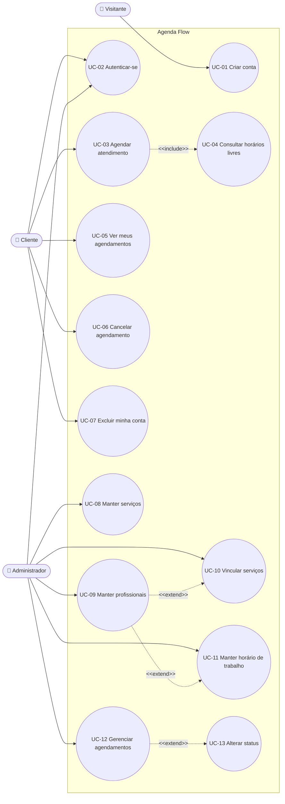
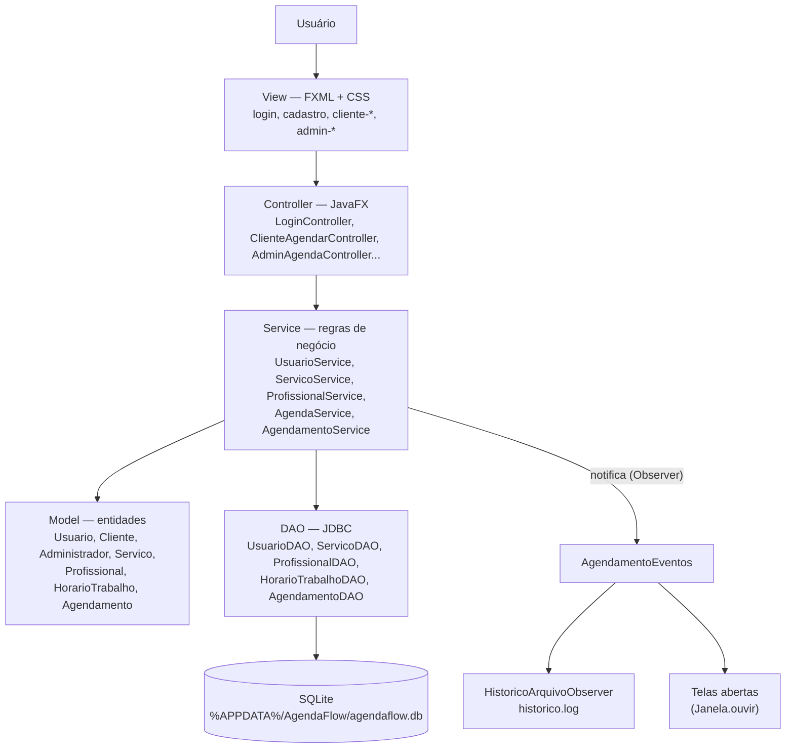
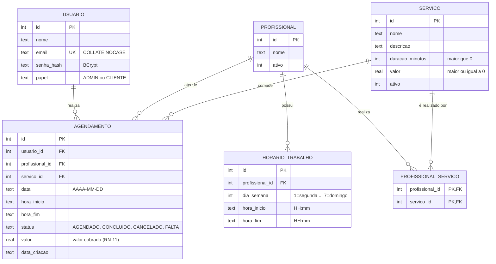
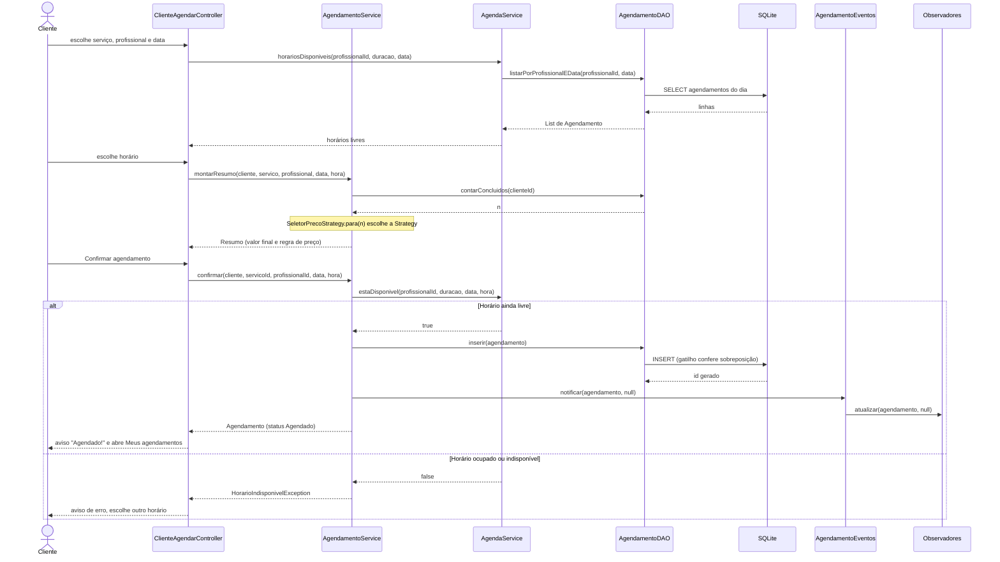
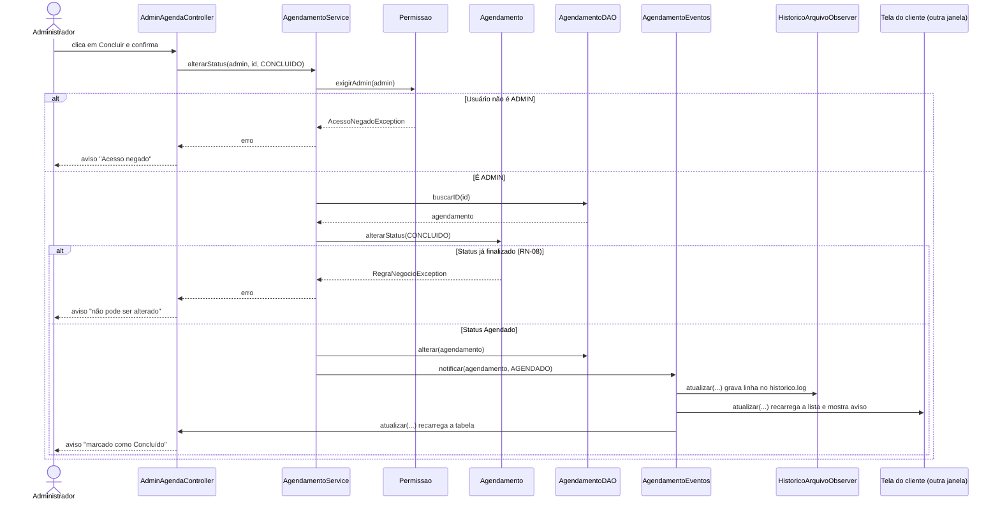
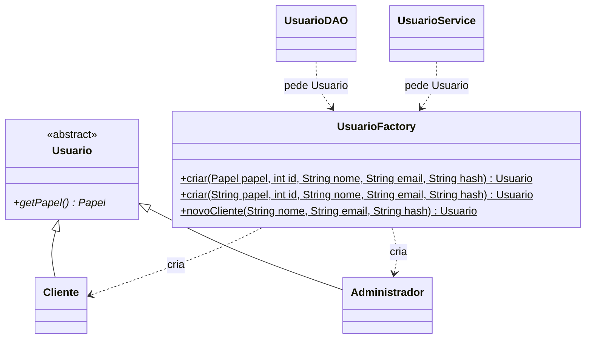
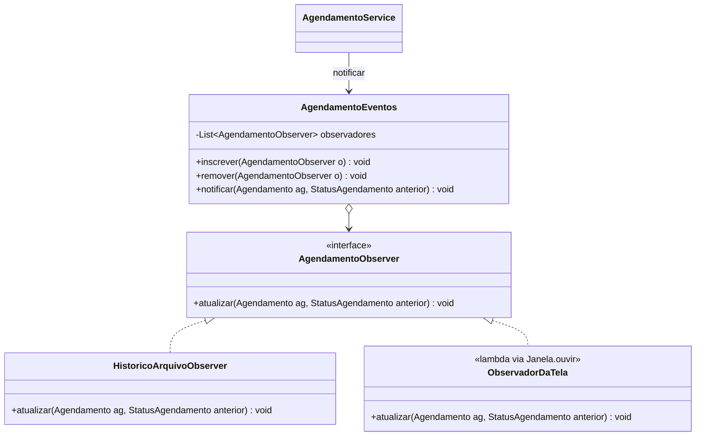
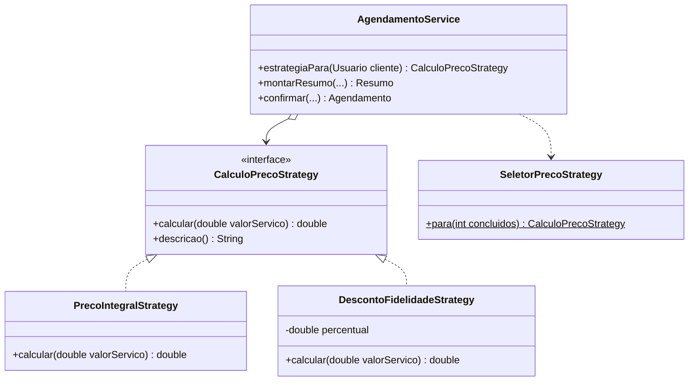

# Documentação do Software — Agenda Flow: Sistema de Agendamento para Salões de Beleza

| Campo | Valor |
|---|---|
| **Versão do documento** | 2.0 |
| **Data** | 27/11/2026 |
| **Autor(es)** | Daniel Gomes |
| **Status** | Concluído |
| **Aprovado por** | Daniel Gomes (autor do projeto) |

## Histórico de Revisões

| Versão | Data | Autor | Descrição da alteração |
|---|---|---|---|
| 1.0 | 28/08/2026 | Daniel Gomes | Criação do documento com o escopo fechado do MVP (requisitos, regras e casos de teste). |
| 2.0 | 27/11/2026 | Daniel Gomes | Implementação completa como aplicação desktop JavaFX + SQLite, aplicação dos padrões GoF Factory, Observer e Strategy, inclusão da RN-11, testes JUnit (66 testes aprovados) e executável Windows. Documento reorganizado no modelo "Versão 2 Final". |

---

## Sumário

1. [Visão Geral](#1-visão-geral)
2. [Escopo do Projeto](#2-escopo-do-projeto)
3. [Requisitos Funcionais](#3-requisitos-funcionais)
4. [Requisitos Não Funcionais](#4-requisitos-não-funcionais)
5. [Regras de Negócio](#5-regras-de-negócio)
6. [Projeto e Arquitetura do Software](#6-projeto-e-arquitetura-do-software)
7. [Plano e Casos de Teste](#7-plano-e-casos-de-teste)
8. [Matriz de Rastreabilidade](#8-matriz-de-rastreabilidade-requisitos-x-testes-x-código-fonte)
9. [Glossário](#9-glossário)
10. [Anexos e Referências](#10-anexos-e-referências)

---

## 1. Visão Geral

### 1.1 Propósito do documento

Este documento define, de forma única, fechada e completa, o escopo da primeira versão (MVP) do **Agenda Flow — Sistema de Agendamento para Salões de Beleza**, e registra como ele foi construído. Ele serve ao mesmo tempo como especificação funcional, especificação técnica, plano de testes e matriz de rastreabilidade, sendo a única fonte de verdade do projeto. Destina-se ao desenvolvedor (autor e responsável pela implementação) e a quem for avaliar o projeto (professora/banca).

Tudo o que está listado neste documento é necessário e suficiente para considerar o projeto 100% concluído. Nada aqui foi adiado, e nada além disto foi implementado nesta versão.

### 1.2 Descrição resumida do sistema

O Agenda Flow é uma **aplicação desktop** (Windows) para agendamento de atendimentos em um **único estabelecimento** de beleza (salão, barbearia, estúdio de estética etc.). O administrador cadastra os serviços oferecidos, os profissionais que os realizam e o horário de trabalho semanal de cada profissional. Com essas informações, o sistema calcula sozinho os horários disponíveis e permite que clientes se cadastrem, escolham um serviço, um profissional e um horário livre e confirmem o agendamento. O administrador acompanha todos os agendamentos e pode marcá-los como concluídos, cancelá-los ou registrar a falta do cliente. Clientes fiéis (3 ou mais atendimentos concluídos) ganham desconto automático.

O problema resolvido é o controle centralizado da agenda de um estabelecimento que atende com hora marcada: o sistema evita conflitos de horário e substitui controles manuais (papel, planilha, WhatsApp) por um fluxo automatizado e consistente.

### 1.3 Stakeholders

| Nome / Papel | Responsabilidade | Contato |
|---|---|---|
| Product Owner | Definição de escopo e prioridades | Daniel Gomes |
| Arquiteto de Software | Definição da arquitetura em camadas e dos padrões GoF | Daniel Gomes |
| Time de Desenvolvimento | Implementação do sistema (Java/JavaFX) | Daniel Gomes |
| Time de QA | Execução dos casos de teste da Seção 7 (JUnit + roteiro manual) | Daniel Gomes |
| Cliente / Patrocinador | Avaliação da entrega conforme os critérios da disciplina | Professora de Engenharia de Software III (Fatec) |

---

## 2. Escopo do Projeto

### 2.1 Objetivos do projeto

- Disponibilizar um fluxo completo e funcional de agendamento de serviços para um único estabelecimento.
- Garantir que nenhum agendamento seja criado em conflito com outro (mesmo profissional, mesmo horário).
- Permitir que o administrador controle serviços, profissionais e agendamentos sem nenhuma etapa manual fora do sistema.
- Entregar uma aplicação Java **100% funcional de ponta a ponta**, em um executável que roda em qualquer computador Windows sem instalar Java nem banco de dados.
- Aplicar na prática três padrões de projeto GoF (Factory, Observer e Strategy) e testes unitários com JUnit.

### 2.2 Dentro do escopo (In Scope)

- Cadastro e autenticação de usuários com dois papéis: **ADMIN** e **CLIENTE**.
- Cadastro de **serviços** (nome, descrição, duração em minutos, valor, status ativo/inativo) pelo ADMIN.
- Cadastro de **profissionais** (nome, status ativo/inativo) pelo ADMIN.
- Vínculo entre profissionais e serviços (quais serviços cada profissional realiza).
- Cadastro do **horário de trabalho semanal fixo** de cada profissional (dia da semana, hora de início, hora de término), permitindo mais de um intervalo no mesmo dia desde que não se sobreponham.
- Cálculo automático de horários disponíveis, considerando o horário de trabalho do profissional no dia da semana, a duração do serviço escolhido e os agendamentos já existentes daquele profissional.
- Fluxo de agendamento pelo cliente: escolher serviço → escolher profissional habilitado → escolher data/horário disponível → confirmar resumo.
- Confirmação automática do agendamento (sem etapa de aprovação manual pelo administrador).
- Listagem dos agendamentos do próprio cliente, com status.
- Cancelamento do próprio agendamento pelo cliente, enquanto o status for "Agendado".
- Painel do administrador para listar todos os agendamentos do sistema, com filtro por data.
- Ações do administrador sobre um agendamento: **cancelar**, **marcar como concluído**, **marcar falta do cliente**.
- Regra de não sobreposição de horários (nenhum profissional pode ter dois agendamentos que se sobreponham), garantida na regra de negócio e também por gatilho no banco.
- **Desconto fidelidade** (RN-11): cliente com 3 ou mais atendimentos concluídos paga 10% a menos.
- **Exclusão da própria conta** pelo cliente (LGPD, RNF-L04).
- Testes automatizados cobrindo o fluxo principal (cadastro, disponibilidade, criação, cancelamento e mudança de status de agendamento) e os padrões GoF.
- Executável Windows com Java embutido.

### 2.3 Fora do escopo (Out of Scope)

Os itens abaixo **não fazem parte desta versão**:

- Múltiplos estabelecimentos / múltiplas unidades (multi-tenant).
- Confirmação manual de agendamento pelo administrador (fila de "aguardando confirmação").
- Reagendamento de um atendimento existente (alterar data/hora/profissional de um agendamento já criado). Cancelar e criar um novo agendamento cobre essa necessidade.
- Configuração de feriados, férias, folgas avulsas, bloqueios manuais de horário e intervalos configuráveis.
- Upload/gestão de imagens de serviços ou de profissionais.
- Notificações por e-mail, SMS ou push.
- Pagamentos, cobrança ou integração financeira.
- Avaliações/comentários de clientes.
- Relatórios gerenciais, dashboards e exportações.
- Recuperação de senha por e-mail ("esqueci minha senha").
- Versão web ou aplicativo mobile nativo.
- Uso em rede (vários computadores compartilhando o mesmo banco).

### 2.4 Premissas

- O sistema atende a um único estabelecimento, funcionando nos dias em que houver profissional com horário de trabalho cadastrado.
- O sistema roda localmente em um computador Windows; o banco de dados é um arquivo SQLite criado automaticamente na primeira execução, em `%APPDATA%\AgendaFlow\agendaflow.db`.
- Na primeira execução o banco já recebe dados de demonstração (1 administrador, 2 clientes, 6 serviços, 3 profissionais com horários e alguns agendamentos), para que o sistema possa ser avaliado na hora:
  - Administrador: `admin@agendaflow.com` / `admin123`
  - Cliente: `cliente@agendaflow.com` / `cliente123` (já tem 3 atendimentos concluídos, portanto tem desconto fidelidade)
  - Cliente: `marina@agendaflow.com` / `marina123`
- O desenvolvedor tem conhecimento de Java, JavaFX, FXML e acesso a banco com JDBC/DAO (conteúdo das aulas).

### 2.5 Restrições

- Linguagem obrigatória: **Java**.
- Interface no padrão visto em aula: **JavaFX + FXML**, com organização MVC (model / view / controller) e acesso a dados por **DAO + JDBC**.
- Padrões GoF obrigatórios escolhidos: **Factory**, **Observer** e **Strategy**; testes com **JUnit** em no mínimo 3 classes.
- Desenvolvimento por uma única pessoa, com prazo da disciplina.
- O executável deve funcionar sem instalação de servidor de banco de dados.

### 2.6 Riscos identificados

| ID | Risco | Probabilidade | Impacto | Mitigação |
|---|---|---|---|---|
| R-01 | Escopo crescer durante o desenvolvimento ("scope creep") | Média | Alto | Documento tratado como fechado; ideias novas ficam para versão futura |
| R-02 | Cálculo de disponibilidade com falhas de lógica (conflitos não detectados) | Média | Alto | Regra pura testada com JUnit (AgendaServiceTest) e gatilho no banco que barra sobreposição (RNF-03) |
| R-03 | Tempo insuficiente por ser um único desenvolvedor | Média | Médio | Escopo reduzido ao fluxo essencial; dados de demonstração automáticos |
| R-04 | Datas e horas mal tratadas | Baixa | Médio | Uso de `LocalDate`, `LocalTime` e `LocalDateTime` (`java.time`) em todo o sistema; gravação em texto ISO no banco |
| R-05 | Computador da avaliação sem Java ou sem banco instalado | Alta | Alto | SQLite embutido (arquivo) e executável gerado com `jpackage`, que leva o Java junto |

### 2.7 Entregáveis

- Código-fonte completo da aplicação (repositório GitHub), organizado conforme a Seção 6.11.
- Instalador Windows (`AgendaFlow-1.0.0.exe`, com Java embutido, publicado no Release) e o `agenda-flow.jar` (jar único).
- Script do banco (`db/agendaflow.sql`); o mesmo esquema é criado automaticamente pela aplicação.
- Suíte de testes automatizados JUnit 5 (66 testes, todos aprovados).
- `README.md` (apresentação, prints e como executar) e este documento (`DOCUMENTACAO.md`).

---

## 3. Requisitos Funcionais

> Requisitos funcionais descrevem **o que** o sistema deve fazer.

### Convenção de ID
`RF-XX` (Requisito Funcional número XX)

### 3.1 Lista de Requisitos Funcionais

| ID | Descrição | Prioridade | Origem / Solicitante | Status |
|---|---|---|---|---|
| RF-01 | O sistema deve permitir o cadastro de um novo usuário (cliente), informando nome, e-mail e senha. | Alta | Autor do projeto | Implementado |
| RF-02 | O sistema deve permitir que um usuário (cliente ou admin) se autentique com e-mail e senha. | Alta | Autor do projeto | Implementado |
| RF-03 | O sistema deve permitir que o ADMIN cadastre, edite e ative/inative um serviço (nome, descrição, duração em minutos, valor). | Alta | Autor do projeto | Implementado |
| RF-04 | O sistema deve permitir que o ADMIN cadastre, edite e ative/inative um profissional (nome). | Alta | Autor do projeto | Implementado |
| RF-05 | O sistema deve permitir que o ADMIN vincule e desvincule serviços a um profissional. | Alta | Autor do projeto | Implementado |
| RF-06 | O sistema deve permitir que o ADMIN cadastre o horário de trabalho semanal de um profissional (dia da semana, hora início, hora fim). | Alta | Autor do projeto | Implementado |
| RF-07 | O sistema deve listar, para o cliente, apenas os serviços com status ativo. | Alta | Autor do projeto | Implementado |
| RF-08 | O sistema deve listar, para um serviço escolhido, apenas os profissionais ativos vinculados a ele. | Alta | Autor do projeto | Implementado |
| RF-09 | O sistema deve calcular e exibir, para um profissional, serviço e data escolhidos, apenas os horários de início realmente disponíveis. | Alta | Autor do projeto | Implementado |
| RF-10 | O sistema deve permitir que o cliente crie um agendamento somente após confirmar um resumo com serviço, profissional, data, horário e valor. | Alta | Autor do projeto | Implementado |
| RF-11 | O sistema deve impedir a criação de um agendamento em um horário que já esteja ocupado, indisponível ou insuficiente para a duração do serviço. | Alta | Autor do projeto | Implementado |
| RF-12 | O sistema deve listar os agendamentos do cliente autenticado, com seus respectivos status, em lista ou em calendário mensal. | Alta | Autor do projeto | Implementado |
| RF-13 | O sistema deve permitir que o cliente cancele um agendamento próprio enquanto o status for "Agendado". | Alta | Autor do projeto | Implementado |
| RF-14 | O sistema deve permitir que o ADMIN liste todos os agendamentos do sistema, com filtro por data, em lista ou em calendário mensal. | Alta | Autor do projeto | Implementado |
| RF-15 | O sistema deve permitir que o ADMIN altere o status de um agendamento para "Concluído", "Cancelado" ou "Falta do cliente". | Alta | Autor do projeto | Implementado |

### 3.2 Detalhamento dos Requisitos Funcionais

#### RF-01 — Cadastro de cliente
- **Descrição:** O sistema deve permitir que um visitante crie uma conta informando nome, e-mail e senha.
- **Ator(es):** Visitante (futuro cliente)
- **Pré-condições:** E-mail ainda não cadastrado no sistema.
- **Fluxo principal:**
  1. Visitante clica em "Criar conta" na tela de login.
  2. Visitante informa nome, e-mail, senha e a confirmação da senha.
  3. Sistema valida os dados (RN-01, RN-02) e cria o usuário com papel CLIENTE (via `UsuarioFactory`).
  4. Sistema já entra na área do cliente.
- **Fluxos alternativos / exceções:**
  - E-mail já cadastrado → sistema exibe mensagem de erro e não cria o usuário.
  - Senha fora do padrão mínimo ou senhas diferentes → sistema exibe mensagem de erro.
- **Pós-condições:** Usuário criado com papel CLIENTE e senha armazenada com hash BCrypt.
- **Critérios de aceite:**
  - [x] Cadastro com dados válidos é concluído com sucesso.
  - [x] Cadastro com e-mail duplicado é rejeitado.
  - [x] Senha nunca é armazenada em texto puro.
- **Requisitos relacionados:** RNF-02, RNF-L01, RNF-L02, RN-01, RN-02

#### RF-02 — Autenticação
- **Descrição:** O sistema deve permitir login de CLIENTE e ADMIN com e-mail e senha, direcionando cada papel à sua respectiva área.
- **Ator(es):** Cliente, Admin
- **Pré-condições:** Usuário previamente cadastrado.
- **Fluxo principal:**
  1. Usuário abre o aplicativo (tela de login).
  2. Usuário informa e-mail e senha.
  3. Sistema valida as credenciais e o papel do usuário.
  4. Sistema abre a área do cliente ou a área do administrador, conforme o papel.
- **Fluxos alternativos / exceções:**
  - Credenciais inválidas → sistema exibe "E-mail ou senha inválidos." e não autentica.
- **Pós-condições:** Sessão autenticada na janela (cada janela guarda o seu usuário).
- **Critérios de aceite:**
  - [x] Login válido autentica e direciona corretamente por papel.
  - [x] Login inválido é rejeitado com mensagem clara.
- **Requisitos relacionados:** RNF-02, RN-03

#### RF-03 — Cadastro de serviço
- **Descrição:** ADMIN cadastra, edita e ativa/inativa serviços oferecidos pelo estabelecimento.
- **Ator(es):** Admin
- **Pré-condições:** Usuário autenticado com papel ADMIN.
- **Fluxo principal:**
  1. Admin acessa "Serviços".
  2. Admin informa nome, descrição, duração (minutos) e valor.
  3. Sistema valida (RN-04) e salva o serviço como ativo por padrão.
- **Fluxos alternativos / exceções:**
  - Duração ≤ 0 ou valor negativo → sistema rejeita o cadastro.
- **Pós-condições:** Serviço disponível para vínculo com profissionais.
- **Critérios de aceite:**
  - [x] Serviço criado aparece na listagem administrativa.
  - [x] Serviço inativo não aparece para o cliente (RF-07).
- **Requisitos relacionados:** RN-04, RN-09, RF-07

#### RF-04 — Cadastro de profissional
- **Descrição:** ADMIN cadastra, edita e ativa/inativa profissionais do estabelecimento.
- **Ator(es):** Admin
- **Pré-condições:** Usuário autenticado com papel ADMIN.
- **Fluxo principal:**
  1. Admin acessa "Profissionais" e clica em "Novo profissional".
  2. Admin informa o nome do profissional.
  3. Sistema salva o profissional como ativo por padrão.
- **Pós-condições:** Profissional disponível para vínculo com serviços e cadastro de horário de trabalho.
- **Critérios de aceite:**
  - [x] Profissional criado aparece na listagem administrativa.
  - [x] Profissional inativo não aparece como opção para o cliente (RF-08).
- **Requisitos relacionados:** RF-05, RF-06, RF-08, RN-09

#### RF-05 — Vínculo profissional × serviço
- **Descrição:** ADMIN define quais serviços um profissional pode realizar.
- **Ator(es):** Admin
- **Pré-condições:** Serviço e profissional já cadastrados.
- **Fluxo principal:**
  1. Admin seleciona um profissional.
  2. Admin marca/desmarca os serviços que esse profissional realiza.
  3. Sistema salva o vínculo na hora.
- **Pós-condições:** O profissional passa a ser (ou deixa de ser) uma opção válida para o serviço.
- **Critérios de aceite:**
  - [x] Vincular um serviço faz o profissional aparecer na etapa de escolha de profissional (RF-08).
  - [x] Desvincular remove o profissional dessa listagem para o serviço.
- **Requisitos relacionados:** RF-03, RF-04, RF-08

#### RF-06 — Horário de trabalho do profissional
- **Descrição:** ADMIN cadastra os dias da semana e o intervalo (hora início/fim) em que cada profissional trabalha.
- **Ator(es):** Admin
- **Pré-condições:** Profissional já cadastrado.
- **Fluxo principal:**
  1. Admin seleciona um profissional.
  2. Admin escolhe o dia da semana, a hora de início e a hora de término e clica em "Adicionar".
  3. Sistema salva o horário de trabalho (RN-05).
- **Fluxos alternativos / exceções:**
  - Hora de início maior ou igual à hora de término → sistema rejeita.
  - Intervalo que se sobrepõe a outro do mesmo dia → sistema rejeita.
- **Pós-condições:** O dia/horário passa a ser considerado no cálculo de disponibilidade (RF-09).
- **Critérios de aceite:**
  - [x] Um profissional sem horário cadastrado para um dia não possui horários disponíveis nesse dia.
  - [x] Horário sobreposto para o mesmo profissional/dia é rejeitado.
- **Requisitos relacionados:** RN-05, RF-09

#### RF-07 — Listagem de serviços ativos
- **Descrição:** Cliente visualiza somente os serviços com status ativo.
- **Ator(es):** Cliente
- **Fluxo principal:**
  1. Cliente acessa "Agendar" (passo 1 — Serviço).
  2. Sistema mostra um cartão para cada serviço ativo, com duração e valor.
- **Critérios de aceite:**
  - [x] Serviços inativos nunca aparecem nesta lista.
- **Requisitos relacionados:** RF-03, RN-10

#### RF-08 — Listagem de profissionais por serviço
- **Descrição:** Ao escolher um serviço, o cliente vê apenas os profissionais ativos vinculados a ele.
- **Ator(es):** Cliente
- **Fluxo principal:**
  1. Cliente escolhe um serviço.
  2. Sistema lista os profissionais ativos vinculados a esse serviço (passo 2 — Profissional).
  3. Se houver apenas um profissional vinculado, o sistema o seleciona automaticamente e avança para a escolha de data/horário.
- **Critérios de aceite:**
  - [x] Profissionais inativos ou não vinculados ao serviço nunca aparecem.
  - [x] Com um único profissional vinculado, a seleção manual é dispensada.
- **Requisitos relacionados:** RF-05, RF-04, RN-10

#### RF-09 — Cálculo de horários disponíveis
- **Descrição:** O sistema calcula os horários de início disponíveis para um profissional, serviço e data, considerando expediente e agendamentos existentes.
- **Ator(es):** Cliente (consumidor da informação); Sistema (processamento)
- **Pré-condições:** Serviço, profissional e data selecionados.
- **Fluxo principal:**
  1. Sistema obtém o horário de trabalho do profissional para o dia da semana da data escolhida.
  2. Sistema obtém a duração do serviço escolhido.
  3. Sistema obtém os agendamentos já existentes do profissional naquela data.
  4. Sistema gera os horários de início (de 30 em 30 minutos) dentro do expediente, garantindo que o intervalo completo (início + duração) não se sobreponha a nenhum agendamento ativo e não ultrapasse o fim do expediente (RN-06, RN-07). Datas passadas e horários que já passaram no dia de hoje não são oferecidos.
  5. Sistema exibe os horários disponíveis como botões.
- **Fluxos alternativos / exceções:**
  - Profissional sem expediente na data → lista vazia, com mensagem explicando.
  - Nenhum horário livre suficiente para a duração do serviço → lista vazia, com mensagem explicando.
- **Pós-condições:** Nenhuma (consulta, não altera dados).
- **Critérios de aceite:**
  - [x] Horários que se sobrepõem a um agendamento existente nunca são retornados.
  - [x] Horários sem tempo suficiente para a duração completa do serviço nunca são retornados.
- **Requisitos relacionados:** RF-06, RN-06, RN-07, RNF-01

#### RF-10 — Confirmação e criação do agendamento
- **Descrição:** O cliente revisa um resumo do agendamento antes de confirmá-lo; o agendamento só é criado após confirmação explícita.
- **Ator(es):** Cliente
- **Pré-condições:** Serviço, profissional, data e horário selecionados dentre os horários disponíveis (RF-09).
- **Fluxo principal:**
  1. Sistema exibe o resumo: serviço, profissional, data, horário de início e fim, duração e valor (com o desconto fidelidade, quando houver — RN-11).
  2. Cliente clica em "Confirmar agendamento".
  3. Sistema revalida serviço, profissional e disponibilidade do horário (RN-06, RN-10) e cria o agendamento com status "Agendado".
- **Fluxos alternativos / exceções:**
  - Horário deixou de estar disponível entre a consulta e a confirmação → sistema rejeita a criação e informa o cliente.
- **Pós-condições:** Agendamento criado; o horário passa a ocupar a agenda do profissional; observadores são notificados (Observer).
- **Critérios de aceite:**
  - [x] Nenhum agendamento é criado sem confirmação explícita do resumo.
  - [x] Um horário confirmado por dois clientes ao mesmo tempo resulta em apenas um agendamento criado.
- **Requisitos relacionados:** RF-09, RF-11, RN-06, RN-07, RN-11

#### RF-11 — Prevenção de conflito de horário
- **Descrição:** O sistema nunca permite dois agendamentos do mesmo profissional com sobreposição de horário.
- **Ator(es):** Sistema
- **Fluxo principal:** Validação executada dentro de RF-10, no momento da criação do agendamento (regra no `AgendamentoService` + gatilho `trg_agendamento_sem_conflito` no banco).
- **Critérios de aceite:**
  - [x] Tentativa de criar agendamento sobreposto a outro existente é sempre rejeitada.
- **Requisitos relacionados:** RF-09, RF-10, RN-06, RNF-03

#### RF-12 — Listagem de agendamentos do cliente
- **Descrição:** Cliente visualiza seus próprios agendamentos com status atual.
- **Ator(es):** Cliente
- **Fluxo principal:**
  1. Cliente acessa "Meus agendamentos".
  2. Sistema lista os agendamentos do cliente autenticado, separados em "Próximos" e "Histórico", ordenados por data, com status (Agendado, Concluído, Cancelado, Falta do cliente).
- **Critérios de aceite:**
  - [x] Cliente nunca visualiza agendamentos de outro cliente.
- **Requisitos relacionados:** RN-03

#### RF-13 — Cancelamento pelo cliente
- **Descrição:** Cliente cancela um agendamento próprio, desde que ainda esteja com status "Agendado".
- **Ator(es):** Cliente
- **Pré-condições:** Agendamento pertence ao cliente autenticado e possui status "Agendado".
- **Fluxo principal:**
  1. Cliente clica em "Cancelar" num agendamento próprio com status "Agendado".
  2. Cliente confirma o cancelamento no diálogo.
  3. Sistema altera o status para "Cancelado" e libera o horário.
- **Fluxos alternativos / exceções:**
  - Agendamento já concluído, cancelado ou com falta registrada → ação não é permitida (o botão nem aparece, e o service rejeita).
- **Pós-condições:** Horário liberado no cálculo de disponibilidade (RF-09).
- **Critérios de aceite:**
  - [x] Agendamento cancelado libera o horário para novos clientes.
  - [x] Cliente não consegue cancelar agendamento de outro cliente.
- **Requisitos relacionados:** RF-09, RF-12, RN-03, RN-07, RN-08

#### RF-14 — Listagem administrativa de agendamentos
- **Descrição:** ADMIN visualiza todos os agendamentos do sistema, podendo filtrar por data.
- **Ator(es):** Admin
- **Fluxo principal:**
  1. Admin acessa "Agendamentos".
  2. Sistema lista todos os agendamentos em uma tabela, com filtro opcional por data (botões "Hoje" e "Todos" e seletor de data).
- **Critérios de aceite:**
  - [x] Todos os agendamentos do sistema aparecem para o admin, independentemente do cliente.
- **Requisitos relacionados:** RF-15, RN-03

#### RF-15 — Alteração de status pelo admin
- **Descrição:** ADMIN altera o status de um agendamento para "Concluído", "Cancelado" ou "Falta do cliente".
- **Ator(es):** Admin
- **Pré-condições:** Agendamento com status "Agendado".
- **Fluxo principal:**
  1. Admin clica numa das ações da linha (concluir, falta ou cancelar).
  2. Admin confirma no diálogo.
  3. Sistema atualiza o status e notifica os observadores.
- **Fluxos alternativos / exceções:**
  - Agendamento já finalizado → não pode ser alterado novamente (as ações somem e o service rejeita).
- **Pós-condições:** Status refletido para o cliente (RF-12); horário liberado quando cancelado.
- **Critérios de aceite:**
  - [x] Alteração de status feita pelo admin aparece imediatamente para o cliente (inclusive numa segunda janela aberta, via Observer).
- **Requisitos relacionados:** RF-12, RF-14, RN-08, RN-09

---

## 4. Requisitos Não Funcionais

> Requisitos não funcionais descrevem **como** o sistema deve se comportar. As categorias seguem o modelo de qualidade da **ISO/IEC 25010**, complementado por requisitos de **conformidade legal (LGPD)**, reduzidos ao necessário para um MVP de uso acadêmico.

### Convenção de ID
`RNF-XX` (Requisito Não Funcional número XX)

### 4.1 Categorias segundo ISO/IEC 25010

| Característica ISO 25010 | Subcaracterísticas | Descrição no projeto |
|---|---|---|
| **Adequação Funcional** | Completude, Corretude | O sistema implementa exatamente os RFs da Seção 3, sem lacunas. |
| **Eficiência de Desempenho** | Comportamento temporal | Tempo de resposta adequado para uso local. |
| **Compatibilidade** | N/A nesta versão | Não há integração com sistemas externos (fora de escopo). |
| **Usabilidade** | Operabilidade, Proteção contra erros, Estética | Fluxo de agendamento simples, mensagens claras e confirmação antes de ações irreversíveis. |
| **Confiabilidade** | Maturidade | O sistema não permite estados inconsistentes (ex.: agendamentos conflitantes). |
| **Segurança** | Confidencialidade, Autenticidade | Senhas protegidas; ações restritas por papel (ADMIN/CLIENTE). |
| **Manutenibilidade** | Modularidade, Testabilidade | Código em camadas, padrões GoF e testes automatizados. |
| **Portabilidade** | Instalabilidade | Executável que abre com dois cliques, sem instalar Java nem banco. |

### 4.2 Lista de Requisitos Não Funcionais

| ID | Característica ISO 25010 | Subcaracterística | Descrição | Critério de aceite / Métrica | Prioridade |
|---|---|---|---|---|---|
| RNF-01 | Eficiência de Desempenho | Comportamento temporal | O cálculo de horários disponíveis deve responder em até 1 segundo para um dia com até 50 agendamentos existentes. | Tempo de resposta ≤ 1 s em ambiente local (consulta indexada por profissional e data) | Média |
| RNF-02 | Segurança | Confidencialidade | Senhas devem ser armazenadas com hash (BCrypt). | Nenhuma senha em texto puro no banco (jBCrypt, custo 10) | Alta |
| RNF-03 | Confiabilidade | Maturidade | O sistema nunca deve persistir dois agendamentos sobrepostos para o mesmo profissional. | 0 conflitos: regra no service (`synchronized`) + gatilho `trg_agendamento_sem_conflito` no banco, testados | Alta |
| RNF-04 | Usabilidade | Operabilidade | O fluxo completo de agendamento (serviço → profissional → data/horário → confirmação) deve ser realizável em no máximo 5 telas/passos. | Fluxo implementado em 4 passos com indicador de etapas | Média |
| RNF-05 | Segurança | Autenticidade | Áreas e ações administrativas só podem ser acessadas por usuários com papel ADMIN. | Tentativa por CLIENTE é bloqueada com `AcessoNegadoException` (equivalente ao HTTP 403) e a tela de administração não abre | Alta |
| RNF-06 | Manutenibilidade | Testabilidade | As regras de disponibilidade e de conflito de horário devem possuir testes unitários dedicados. | `AgendaServiceTest` e `AgendamentoServiceTest` aprovados | Alta |
| RNF-07 | Manutenibilidade | Modularidade | O código deve ser organizado em camadas (apresentação, controle, serviço, domínio, persistência), conforme a Seção 6. | Estrutura de pastas conforme a Seção 6.11 | Alta |
| RNF-08 | Portabilidade | Instalabilidade | O sistema deve rodar sem infraestrutura externa obrigatória. | O executável abre com dois cliques; para desenvolvimento, `mvn javafx:run`; banco SQLite criado sozinho | Média |

### 4.3 Conformidade com a LGPD (Lei nº 13.709/2018)

> O sistema trata dados pessoais básicos de cadastro (nome, e-mail e senha). Os requisitos abaixo foram reduzidos ao necessário para essa coleta mínima. Os demais mecanismos previstos na lei (portabilidade, DPO, notificação formal de incidentes, transferência internacional etc.) ficam **fora do escopo** desta versão, por não serem essenciais ao MVP local.

| ID | Princípio / Exigência LGPD | Descrição | Critério de aceite | Prioridade |
|---|---|---|---|---|
| RNF-L01 | Finalidade | O formulário de cadastro deve informar que os dados são usados apenas para autenticação e identificação nos agendamentos. | Texto de finalidade visível na tela de cadastro | Alta |
| RNF-L02 | Minimização de dados | O sistema deve coletar somente nome, e-mail e senha do cliente — nenhum outro dado pessoal. | Formulário de cadastro com apenas esses campos (RF-01) | Alta |
| RNF-L03 | Segurança e sigilo (Art. 46) | Senha armazenada com hash; acesso a dados de outro usuário é bloqueado. | Ver RNF-02, RNF-05 e RN-03 | Alta |
| RNF-L04 | Direitos do titular (Art. 18) — exclusão | O cliente deve conseguir excluir a própria conta, o que remove seus dados de identificação. | "Excluir minha conta" em Minha conta: pede a senha, cancela os agendamentos em aberto e apaga nome, e-mail e senha (o histórico fica anônimo) | Média |

**Papéis relevantes (LGPD):**

| Papel | Responsabilidade |
|---|---|
| Controlador | O estabelecimento que usa o sistema: define a finalidade (agendar atendimentos). |
| Operador | Não há operador externo: os dados ficam só no computador do estabelecimento. |
| Encarregado (DPO) | Fora do escopo nesta versão. |

### 4.4 Mapeamento RNF × ISO 25010 × LGPD

| ID | Categoria | Referência normativa | Requisito(s) funcional(is) relacionado(s) |
|---|---|---|---|
| RNF-02 | Segurança (ISO 25010) | LGPD Art. 46 | RF-01, RF-02 |
| RNF-05 | Segurança (ISO 25010) | — | RF-03, RF-04, RF-05, RF-06, RF-14, RF-15 |
| RNF-L01 | Adequação Funcional | LGPD Art. 6º, I (finalidade) | RF-01 |
| RNF-L02 | Adequação Funcional | LGPD Art. 6º, III (necessidade) | RF-01 |
| RNF-L03 | Segurança | LGPD Art. 46 | RF-01, RF-02, RF-12 |
| RNF-L04 | Adequação Funcional | LGPD Art. 18 | RF-01 (conta do cliente) |

---

## 5. Regras de Negócio

> Regras de negócio são políticas independentes de uma tela específica e valem em todo o sistema.

### Convenção de ID
`RN-XX` (Regra de Negócio número XX)

### 5.1 Lista de Regras de Negócio

| ID | Descrição | Origem | Requisitos relacionados |
|---|---|---|---|
| RN-01 | A senha do usuário deve ter no mínimo 8 caracteres, contendo letras e números. | Autor do projeto | RF-01 |
| RN-02 | Não pode existir mais de um usuário com o mesmo e-mail (sem diferenciar maiúsculas e minúsculas). | Autor do projeto | RF-01 |
| RN-03 | Um usuário só pode visualizar e alterar os próprios dados e os próprios agendamentos, salvo o ADMIN, que visualiza todos os agendamentos. | Autor do projeto | RF-02, RF-12, RF-13, RF-14 |
| RN-04 | A duração de um serviço deve ser maior que 0 minutos e o valor deve ser maior ou igual a 0. | Autor do projeto | RF-03 |
| RN-05 | Para um mesmo profissional e dia da semana, os intervalos de horário de trabalho cadastrados não podem se sobrepor. | Autor do projeto | RF-06 |
| RN-06 | Um agendamento só pode ser criado se o intervalo completo (horário de início + duração do serviço) estiver contido no horário de trabalho do profissional e não se sobrepuser a nenhum outro agendamento ativo (status "Agendado" ou "Concluído") do mesmo profissional. | Autor do projeto | RF-09, RF-10, RF-11 |
| RN-07 | Agendamentos com status "Cancelado" não bloqueiam horários — o horário correspondente volta a ficar disponível. | Autor do projeto | RF-09, RF-13 |
| RN-08 | Um agendamento só pode ter seu status alterado (concluído, cancelado, falta) enquanto estiver no status "Agendado". Uma vez finalizado, o status não pode ser alterado novamente. | Autor do projeto | RF-13, RF-15 |
| RN-09 | Apenas usuários com papel ADMIN podem cadastrar/editar serviços, profissionais, vínculos e horários de trabalho, e podem alterar o status de qualquer agendamento. | Autor do projeto | RF-03, RF-04, RF-05, RF-06, RF-15 |
| RN-10 | Um serviço só pode ser selecionado pelo cliente para agendamento se estiver com status ativo. Um profissional só pode ser selecionado se estiver ativo e vinculado ao serviço escolhido. | Autor do projeto | RF-07, RF-08, RF-10 |
| RN-11 | **Desconto fidelidade:** o cliente com 3 ou mais atendimentos concluídos ganha 10% de desconto no valor do serviço. O valor é mostrado no resumo (RF-10) e gravado no agendamento. Implementada com o padrão Strategy (Seção 6.9). | Autor do projeto (versão 2.0) | RF-10 |

---

## 6. Projeto e Arquitetura do Software

### 6.1 Diagrama de casos de uso



**Descrição dos atores**

| Ator | Descrição | Casos de uso associados |
|---|---|---|
| Visitante | Pessoa que ainda não tem conta. | UC-01 |
| Cliente | Usuário com papel CLIENTE, que agenda atendimentos. | UC-02, UC-03, UC-04, UC-05, UC-06, UC-07 |
| Administrador | Usuário com papel ADMIN, que configura o salão e gerencia a agenda. | UC-02, UC-08 a UC-13 |

**Lista de casos de uso**

| ID | Caso de uso | Ator(es) | Requisito(s) funcional(is) relacionado(s) |
|---|---|---|---|
| UC-01 | Criar conta | Visitante | RF-01 |
| UC-02 | Autenticar-se | Cliente, Administrador | RF-02 |
| UC-03 | Agendar atendimento (inclui UC-04) | Cliente | RF-07, RF-08, RF-10, RF-11 |
| UC-04 | Consultar horários livres | Cliente | RF-09 |
| UC-05 | Ver meus agendamentos | Cliente | RF-12 |
| UC-06 | Cancelar agendamento | Cliente | RF-13 |
| UC-07 | Excluir minha conta | Cliente | RNF-L04 |
| UC-08 | Manter serviços | Administrador | RF-03 |
| UC-09 | Manter profissionais | Administrador | RF-04 |
| UC-10 | Vincular serviços ao profissional | Administrador | RF-05 |
| UC-11 | Manter horário de trabalho | Administrador | RF-06 |
| UC-12 | Gerenciar agendamentos (listar e filtrar) | Administrador | RF-14 |
| UC-13 | Alterar status do agendamento | Administrador | RF-15 |

---

### 6.2 Visão arquitetural

Aplicação **desktop monolítica em camadas**, empacotada como um único executável. As camadas seguem uma regra de dependência de cima para baixo: cada uma só conhece a imediatamente abaixo.

1. **Apresentação (View):** arquivos FXML + CSS (`resources/.../view` e `styles/app.css`). Tema dark em grafite e azul com painéis translúcidos (fundo #0A0C10, superfícies #151A21/#1B222B, destaque azul #3B82F6 e ciano #00C2FF). Agendamentos podem ser vistos em lista ou em calendário mensal (`util/CalendarioMes`).
2. **Controle (Controller):** controllers JavaFX (`controller/`) — recebem os eventos da tela, chamam os services e mostram o resultado. Não têm regra de negócio.
3. **Serviço (Service):** regras de negócio (`service/`), permissões (RN-09), contexto do Strategy e disparo do Observer.
4. **Domínio (Model):** entidades e regras próprias de cada objeto (`model/`), como `Agendamento.conflitaCom` e `Agendamento.alterarStatus` (RN-08).
5. **Persistência (DAO):** interface `DAO<MODEL>` e um DAO por tabela com JDBC puro (`dao/`), a classe `Banco` e o esquema (`persistencia/`).
6. **Banco de dados:** SQLite em arquivo único.

Não há servidor, rede nem múltiplos serviços implantáveis — decisão deliberada para o sistema rodar em qualquer computador (ADR-01, ADR-02).

### 6.3 Diagrama de arquitetura (visão geral)



### 6.4 Componentes / Módulos

| Componente | Responsabilidade | Tecnologia |
|---|---|---|
| Apresentação | Telas de login, cadastro, área do cliente (agendar, meus agendamentos, minha conta) e área do admin (agendamentos, serviços, profissionais) | JavaFX 23 + FXML + CSS |
| Moldura da janela (`util/Janela`) | Barra de título própria, painéis translúcidos, navegação entre telas, avisos, diálogos, sessão da janela e inscrição de observadores | JavaFX |
| Calendário do mês (`util/CalendarioMes`) | Grade mensal com os agendamentos de cada dia (cor por status) e seleção do dia; usado na área do cliente e do admin (RF-12, RF-14) | JavaFX |
| Serviço de Usuário | Cadastro, autenticação e exclusão de conta | Java + jBCrypt |
| Serviço de Catálogo | Serviços, profissionais e vínculos | Java |
| Serviço de Agenda | Horário de trabalho e cálculo de disponibilidade | Java (`java.time`) |
| Serviço de Agendamento | Criação, cancelamento e mudança de status; preço (Strategy); eventos (Observer) | Java |
| Persistência | Acesso e mapeamento dos dados (um DAO por tabela) | JDBC + interface `DAO<MODEL>` |
| Banco de Dados | Armazenamento em arquivo, criado na primeira execução com dados de demonstração | SQLite (sqlite-jdbc) |
| Composição (`Sistema`) | Monta DAOs e services uma vez e entrega às telas; publicador de eventos único para todas as janelas | Java |

### 6.5 Stack tecnológica

| Camada | Tecnologia / Ferramenta | Versão |
|---|---|---|
| Linguagem | Java | 21 (LTS) |
| Interface (front-end desktop) | JavaFX (controls + fxml), FXML, CSS do JavaFX | 23.0.2 |
| Back-end / regras | Java puro, organizado em camadas | — |
| Persistência | JDBC + padrão DAO | — |
| Banco de Dados | SQLite embutido (`org.xerial:sqlite-jdbc`) | 3.46.1.3 |
| Segurança | jBCrypt (`org.mindrot:jbcrypt`) | 0.4 |
| Build | Maven (+ `javafx-maven-plugin`, `maven-shade-plugin`) | 3.9+ |
| Empacotamento | `jpackage` do JDK (executável `.exe` com Java embutido) | JDK 21 |
| Testes | JUnit 5 (Jupiter, com `junit-jupiter-params`) | 5.10.2 |
| Imagens | Logo e ícones vetoriais próprios (sem imagens de terceiros) | — |

### 6.6 Modelo de dados



Restrições importantes no banco (`persistencia/Esquema.java` e `db/agendaflow.sql`):

- `usuario.email` é único sem diferenciar maiúsculas (RN-02).
- `CHECK` em `duracao_minutos > 0`, `valor >= 0` (RN-04), `hora_inicio < hora_fim` e nos valores de `papel` e `status`.
- Gatilho `trg_agendamento_sem_conflito`: antes de inserir um agendamento ativo, aborta se já existir outro ativo do mesmo profissional, na mesma data, com intervalo sobreposto (RNF-03).
- Índices em `agendamento (profissional_id, data)` e `agendamento (usuario_id)` (RNF-01).

### 6.7 Diagrama de classes

```mermaid
classDiagram
    direction TB

    class Usuario {
        <<abstract>>
        #int id
        #String nome
        #String email
        #String senhaHash
        +getPapel()* Papel
        +isAdmin() boolean
    }
    class Cliente {
        +getPapel() Papel
    }
    class Administrador {
        +getPapel() Papel
    }
    class Papel {
        <<enumeration>>
        ADMIN
        CLIENTE
    }
    class Servico {
        -int id
        -String nome
        -String descricao
        -int duracaoMinutos
        -double valor
        -boolean ativo
    }
    class Profissional {
        -int id
        -String nome
        -boolean ativo
        -Set~Integer~ servicoIds
        +atendeServico(int servicoId) boolean
        +adicionarServico(int servicoId) void
        +removerServico(int servicoId) void
    }
    class HorarioTrabalho {
        -int id
        -int profissionalId
        -DayOfWeek diaSemana
        -LocalTime horaInicio
        -LocalTime horaFim
        +isIntervaloValido() boolean
        +sobrepoe(HorarioTrabalho outro) boolean
        +comporta(LocalTime inicio, LocalTime fim) boolean
    }
    class Agendamento {
        -int id
        -LocalDate data
        -LocalTime horaInicio
        -LocalTime horaFim
        -StatusAgendamento status
        -double valor
        +conflitaCom(LocalTime inicio, LocalTime fim) boolean
        +alterarStatus(StatusAgendamento novo) void
        +cancelar() void
        +concluir() void
        +registrarFalta() void
    }
    class StatusAgendamento {
        <<enumeration>>
        AGENDADO
        CONCLUIDO
        CANCELADO
        FALTA
        +isFinalizado() boolean
        +ocupaHorario() boolean
    }

    class UsuarioFactory {
        <<Factory>>
        +criar(Papel papel, int id, String nome, String email, String senhaHash)$ Usuario
        +criar(String papel, int id, String nome, String email, String senhaHash)$ Usuario
        +novoCliente(String nome, String email, String senhaHash)$ Usuario
    }

    class CalculoPrecoStrategy {
        <<interface>>
        +calcular(double valorServico) double
        +descricao() String
    }
    class PrecoIntegralStrategy
    class DescontoFidelidadeStrategy {
        -double percentual
    }
    class SeletorPrecoStrategy {
        +para(int atendimentosConcluidos)$ CalculoPrecoStrategy
    }

    class AgendamentoObserver {
        <<interface>>
        +atualizar(Agendamento ag, StatusAgendamento anterior) void
    }
    class AgendamentoEventos {
        -List~AgendamentoObserver~ observadores
        +inscrever(AgendamentoObserver o) void
        +remover(AgendamentoObserver o) void
        +notificar(Agendamento ag, StatusAgendamento anterior) void
    }
    class HistoricoArquivoObserver {
        -Path arquivo
        +atualizar(Agendamento ag, StatusAgendamento anterior) void
    }

    class DAO~MODEL~ {
        <<interface>>
        +inserir(MODEL dado) boolean
        +alterar(MODEL dado) boolean
        +remover(MODEL dado) boolean
        +buscarID(int id) MODEL
        +listar() List
    }
    class UsuarioDAO {
        +buscarPorEmail(String email) Usuario
        +existeEmail(String email) boolean
    }
    class ServicoDAO {
        +listarAtivos() List
    }
    class ProfissionalDAO {
        +listarAtivosPorServico(int servicoId) List
        +vincularServico(int p, int s) void
        +desvincularServico(int p, int s) void
    }
    class HorarioTrabalhoDAO {
        +listarPorProfissional(int id) List
        +listarPorProfissionalEDia(int id, DayOfWeek dia) List
    }
    class AgendamentoDAO {
        +listarPorData(LocalDate data) List
        +listarPorCliente(int clienteId) List
        +listarPorProfissionalEData(int id, LocalDate data) List
        +contarConcluidos(int clienteId) int
        +cancelarAbertosDoCliente(int clienteId) int
    }
    class Banco {
        +conectar()$ Connection
        +inicializar()$ void
        +criarEstrutura()$ void
    }

    class UsuarioService {
        +cadastrarCliente(String nome, String email, String senha) Usuario
        +autenticar(String email, String senha) Usuario
        +excluirConta(Usuario cliente, String senha) void
    }
    class ServicoService {
        +salvar(Usuario solicitante, Servico s) Servico
        +alterarAtivo(Usuario solicitante, Servico s, boolean ativo) void
        +listarAtivos() List
    }
    class ProfissionalService {
        +salvar(Usuario solicitante, Profissional p) Profissional
        +definirVinculo(Usuario solicitante, Profissional p, int servicoId, boolean vinculado) void
        +adicionarHorario(Usuario solicitante, HorarioTrabalho h) HorarioTrabalho
        +listarParaServico(int servicoId) List
    }
    class AgendaService {
        +horariosDisponiveis(int profissionalId, int duracao, LocalDate data) List
        +calcularHorariosLivres(List exp, int duracao, List ags, int intervalo)$ List
    }
    class AgendamentoService {
        +estrategiaPara(Usuario cliente) CalculoPrecoStrategy
        +montarResumo(...) Resumo
        +confirmar(Usuario cliente, int servicoId, int profissionalId, LocalDate data, LocalTime inicio) Agendamento
        +cancelarPeloCliente(Usuario cliente, int id) Agendamento
        +alterarStatus(Usuario admin, int id, StatusAgendamento novo) Agendamento
        +listarDoCliente(Usuario cliente) List
        +listarTodos(Usuario admin, LocalDate filtro) List
    }
    class Permissao {
        +exigirAdmin(Usuario u)$ void
        +exigirCliente(Usuario u)$ void
    }

    Usuario <|-- Cliente
    Usuario <|-- Administrador
    Usuario --> Papel
    Agendamento --> StatusAgendamento : possui
    Cliente "1" --> "0..*" Agendamento : solicita
    Profissional "1" --> "0..*" Agendamento : realiza
    Servico "1" <-- "0..*" Agendamento : composto por
    Profissional "0..*" o-- "1..*" Servico : habilitado em
    Profissional "1" *-- "0..*" HorarioTrabalho : cumpre

    UsuarioFactory ..> Cliente : cria
    UsuarioFactory ..> Administrador : cria
    UsuarioDAO ..> UsuarioFactory : usa
    UsuarioService ..> UsuarioFactory : usa

    CalculoPrecoStrategy <|.. PrecoIntegralStrategy
    CalculoPrecoStrategy <|.. DescontoFidelidadeStrategy
    SeletorPrecoStrategy ..> CalculoPrecoStrategy : escolhe
    AgendamentoService ..> CalculoPrecoStrategy : contexto

    AgendamentoObserver <|.. HistoricoArquivoObserver
    AgendamentoEventos o--> AgendamentoObserver : avisa
    AgendamentoService --> AgendamentoEventos : notifica

    DAO <|.. UsuarioDAO
    DAO <|.. ServicoDAO
    DAO <|.. ProfissionalDAO
    DAO <|.. HorarioTrabalhoDAO
    DAO <|.. AgendamentoDAO
    UsuarioDAO ..> Banco
    AgendamentoDAO ..> Banco

    UsuarioService --> UsuarioDAO
    ServicoService --> ServicoDAO
    ProfissionalService --> ProfissionalDAO
    ProfissionalService --> HorarioTrabalhoDAO
    AgendaService --> HorarioTrabalhoDAO
    AgendaService --> AgendamentoDAO
    AgendamentoService --> AgendamentoDAO
    AgendamentoService --> AgendaService
    AgendamentoService ..> Permissao
```



**Descrição das principais classes**

| Classe | Responsabilidade | Requisito(s) relacionado(s) |
|---|---|---|
| `Usuario` / `Cliente` / `Administrador` | Usuário abstrato e seus dois papéis concretos | RF-01, RF-02, RN-09 |
| `Servico` | Procedimento oferecido (duração, valor, ativo) | RF-03, RF-07, RN-04 |
| `Profissional` | Quem atende; conhece os serviços que faz | RF-04, RF-05, RF-08 |
| `HorarioTrabalho` | Expediente semanal; sabe se sobrepõe outro e se comporta um atendimento | RF-06, RN-05, RN-06 |
| `Agendamento` | Liga cliente, profissional e serviço; detecta conflito e controla a mudança de status | RF-10, RF-11, RN-06, RN-07, RN-08 |
| `StatusAgendamento` | Ciclo de vida do agendamento; diz o que ocupa horário e o que é final | RN-06, RN-07, RN-08 |
| `UsuarioFactory` | **Factory**: decide qual classe de usuário instanciar | RF-01, RF-02 |
| `CalculoPrecoStrategy` e implementações | **Strategy**: formas de calcular o preço | RN-11 |
| `AgendamentoObserver`, `AgendamentoEventos`, `HistoricoArquivoObserver` | **Observer**: avisar telas e histórico sobre criação e mudança de agendamentos | RF-12, RF-15 |
| `DAO<MODEL>` e DAOs | Acesso ao banco por tabela (JDBC) | RNF-07 |
| `Banco`, `Esquema`, `DadosIniciais` | Conexão SQLite, criação das tabelas/gatilho e dados de demonstração | RNF-03, RNF-08 |
| `UsuarioService` | Cadastro, login e exclusão de conta | RF-01, RF-02, RN-01, RN-02, RNF-L04 |
| `ServicoService` / `ProfissionalService` | Cadastros do admin | RF-03 a RF-08, RN-04, RN-05, RN-09, RN-10 |
| `AgendaService` | Cálculo de horários livres | RF-09, RN-06, RN-07 |
| `AgendamentoService` | Confirmar, cancelar, alterar status, listar; contexto do Strategy e sujeito do Observer | RF-10 a RF-15, RN-03, RN-08, RN-11 |
| `Permissao` | Barra ações sem o papel certo (`AcessoNegadoException`) | RN-09, RNF-05 |
| `Janela` | Moldura de cada janela: navegação, vidro, avisos, sessão e observadores da tela | RNF-04, RNF-05 |

---

### 6.8 Diagrama de sequência

**Diagrama de sequência — UC-03: Agendar atendimento (RF-09, RF-10, RF-11, RN-11)**



**Diagrama de sequência — UC-13: Admin altera status (RF-15, RN-08, Observer)**



---

### 6.9 Padrões de projeto (GoF) utilizados

| Padrão GoF | Categoria | Problema que resolve no projeto | Classes / arquivos envolvidos |
|---|---|---|---|
| Factory (método fábrica estático) | Criacional | Decidir em um só lugar qual classe concreta de usuário (`Cliente` ou `Administrador`) criar, a partir do papel | `factory/UsuarioFactory.java`, `dao/UsuarioDAO.java`, `service/UsuarioService.java` |
| Observer | Comportamental | Avisar histórico e telas abertas quando um agendamento é criado ou muda de status, sem o service conhecer quem ouve | `observer/AgendamentoObserver.java`, `observer/AgendamentoEventos.java`, `observer/HistoricoArquivoObserver.java`, `service/AgendamentoService.java`, `util/Janela.java` |
| Strategy | Comportamental | Trocar a forma de calcular o preço (integral ou com desconto fidelidade) sem `if` espalhado | `strategy/CalculoPrecoStrategy.java`, `PrecoIntegralStrategy.java`, `DescontoFidelidadeStrategy.java`, `SeletorPrecoStrategy.java`, `service/AgendamentoService.java` |

#### Padrão 1 — Factory

- **Categoria:** Criacional
- **Intenção do padrão:** encapsular a criação de objetos, para que quem precisa de um objeto peça à fábrica sem saber qual classe concreta será instanciada.
- **Motivação / contexto no projeto:** `Usuario` é abstrata e tem duas subclasses. O papel vem de dois lugares: do banco (texto `ADMIN`/`CLIENTE` lido pelo `UsuarioDAO`) e do cadastro (sempre CLIENTE). Sem a fábrica, o `switch` sobre o papel ficaria repetido no DAO, no cadastro e nos dados de demonstração.
- **Alternativas consideradas:** `new Cliente(...)`/`new Administrador(...)` espalhados com `if` (duplicação, fácil esquecer um papel novo); Abstract Factory (exagero: só existe uma família de produtos).
- **Participantes (mapeamento para o projeto):**

  | Papel no padrão | Classe no projeto |
  |---|---|
  | Creator (fábrica) | `UsuarioFactory` |
  | Product (produto abstrato) | `Usuario` |
  | ConcreteProduct | `Cliente`, `Administrador` |
  | Client (quem pede) | `UsuarioDAO.montar`, `UsuarioService.cadastrarCliente`, `DadosIniciais` |

- **Diagrama de classes do padrão:**



- **Trecho de código ilustrativo** (`factory/UsuarioFactory.java` e `dao/UsuarioDAO.java`):

```java
public static Usuario criar(Papel papel, int id, String nome, String email, String senhaHash) {
    if (papel == null) {
        throw new IllegalArgumentException("O papel do usuário é obrigatório.");
    }
    return switch (papel) {
        case ADMIN -> new Administrador(id, nome, email, senhaHash);
        case CLIENTE -> new Cliente(id, nome, email, senhaHash);
    };
}

// UsuarioDAO: o papel gravado no banco decide a classe concreta — quem decide é a Factory
private Usuario montar(ResultSet rs) throws SQLException {
    return UsuarioFactory.criar(rs.getString("papel"), rs.getInt("id"), rs.getString("nome"),
            rs.getString("email"), rs.getString("senha_hash"));
}
```

- **Benefícios obtidos e consequências (trade-offs):** criação centralizada e testada (`UsuarioFactoryTest`); um papel novo muda só a fábrica; o login devolve o objeto certo e a tela decide a área com `isAdmin()`. Trade-off: é um método fábrica estático (simple factory), mais simples que o Factory Method clássico com subclasses criadoras — suficiente para dois produtos.

#### Padrão 2 — Observer

- **Categoria:** Comportamental
- **Intenção do padrão:** definir uma dependência um-para-muitos: quando o sujeito muda, todos os observadores inscritos são avisados automaticamente.
- **Motivação / contexto no projeto:** o critério do RF-15 diz que a alteração feita pelo admin deve aparecer imediatamente para o cliente. Além disso, cada criação/mudança deve ir para um histórico em arquivo, e a tabela do admin deve se atualizar quando um cliente agenda. O `AgendamentoService` não deve conhecer telas nem arquivos.
- **Alternativas consideradas:** o service chamar diretamente as telas (acoplamento da regra com a interface); a tela consultar o banco de tempos em tempos (polling: atraso e consultas à toa).
- **Participantes (mapeamento para o projeto):**

  | Papel no padrão | Classe no projeto |
  |---|---|
  | Subject (sujeito) | `AgendamentoEventos` (instância única em `Sistema.EVENTOS`, compartilhada por todas as janelas) |
  | Observer (interface) | `AgendamentoObserver` |
  | ConcreteObserver | `HistoricoArquivoObserver` (grava `historico.log`); observadores das telas inscritos por `Janela.ouvir` em `ClienteController` e `AdminAgendaController` |
  | Quem dispara | `AgendamentoService.confirmar` e `AgendamentoService.mudarStatus` |

- **Diagrama de classes do padrão:**



- **Trecho de código ilustrativo** (`observer/AgendamentoEventos.java`, `service/AgendamentoService.java` e `controller/AdminAgendaController.java`):

```java
// Sujeito
public void notificar(Agendamento agendamento, StatusAgendamento statusAnterior) {
    for (AgendamentoObserver o : observadores) {
        try {
            o.atualizar(agendamento, statusAnterior);
        } catch (RuntimeException e) {
            // um observador com problema não pode derrubar a operação nem os outros
            System.err.println("Observador falhou: " + e.getMessage());
        }
    }
}

// Service dispara depois de gravar
private Agendamento mudarStatus(Agendamento ag, StatusAgendamento novo) throws SQLException {
    StatusAgendamento anterior = ag.getStatus();
    ag.alterarStatus(novo);                                                    // RN-08
    agendamentoDAO.alterar(ag);
    eventos.notificar(ag, anterior);
    return ag;
}

// Tela do admin se inscreve (desfeito ao trocar de tela ou fechar a janela)
janela.ouvir((ag, anterior) -> {
    recarregar();
    if (anterior == null) {
        janela.aviso("Novo agendamento: " + ag.getClienteNome() + " · " + ag.getServicoNome() + " em "
                + Formatos.data(ag.getData()) + " às " + ag.getHoraInicio() + ".", Janela.TipoAviso.INFO);
    }
});
```

- **Benefícios obtidos e consequências (trade-offs):** o service fica independente da interface; novas reações (ex.: notificação por e-mail no futuro) entram como um novo observador sem mexer no service. Na prática: com o botão "abrir outra janela" da barra de título, o admin numa janela e o cliente na outra, a mudança aparece na hora na janela do cliente. Um observador com erro não derruba os outros. Trade-off: a ordem de aviso segue a ordem de inscrição, e observadores das telas precisam ser removidos ao sair da tela (feito por `Janela`) para não vazar memória.

#### Padrão 3 — Strategy

- **Categoria:** Comportamental
- **Intenção do padrão:** definir uma família de algoritmos, encapsular cada um e torná-los intercambiáveis; o contexto usa a estratégia sem saber qual é.
- **Motivação / contexto no projeto:** a RN-11 dá 10% de desconto ao cliente fiel. O preço é usado no resumo (RF-10), na gravação do agendamento e na tela "Minha conta". Sem o padrão, o mesmo `if (concluidos >= 3)` com a conta do desconto ficaria repetido, e uma nova promoção exigiria mexer em todos esses pontos.
- **Alternativas consideradas:** `if/else` no service (cresce a cada promoção e mistura regra de preço com regra de agenda); guardar o percentual no cliente (não explica a regra e exige atualizar o cadastro).
- **Participantes (mapeamento para o projeto):**

  | Papel no padrão | Classe no projeto |
  |---|---|
  | Context | `AgendamentoService` (`montarResumo`, `confirmar`, `estrategiaPara`) |
  | Strategy | `CalculoPrecoStrategy` |
  | ConcreteStrategy | `PrecoIntegralStrategy`, `DescontoFidelidadeStrategy` |
  | Seleção da estratégia | `SeletorPrecoStrategy.para(atendimentosConcluidos)` |

- **Diagrama de classes do padrão:**



- **Trecho de código ilustrativo** (`strategy/SeletorPrecoStrategy.java`, `strategy/DescontoFidelidadeStrategy.java` e `service/AgendamentoService.java`):

```java
public static CalculoPrecoStrategy para(int atendimentosConcluidos) {
    if (atendimentosConcluidos >= ATENDIMENTOS_PARA_FIDELIDADE) {
        return new DescontoFidelidadeStrategy(PERCENTUAL_FIDELIDADE);
    }
    return new PrecoIntegralStrategy();
}

@Override
public double calcular(double valorServico) {
    double comDesconto = valorServico * (1 - percentual / 100.0);
    return Math.round(comDesconto * 100.0) / 100.0; // arredonda em centavos
}

// Contexto: só chama calcular(), sem saber qual estratégia é
double valor = estrategiaPara(cliente).calcular(servico.getValor());
```

- **Benefícios obtidos e consequências (trade-offs):** regra de preço isolada e testada (`CalculoPrecoStrategyTest`); o resumo mostra o valor riscado e o selo "Desconto fidelidade 10%" usando `descricao()`; uma promoção nova é uma classe nova. Trade-off: mais classes pequenas para um cálculo simples; a escolha da estratégia ainda tem um `if` (concentrado em um só lugar, no seletor).

---

### 6.10 Decisões de arquitetura (ADR resumido)

| ID | Decisão | Contexto | Alternativas consideradas | Justificativa |
|---|---|---|---|---|
| ADR-01 | Monolito em camadas, sem microsserviços | Projeto de uma pessoa, escopo fechado | Microsserviços, hexagonal completa | Menos infraestrutura e conclusão total do MVP |
| ADR-02 | Aplicação desktop JavaFX + FXML (em vez de web Spring + Thymeleaf da versão 1.0) | A disciplina usa JavaFX/FXML e pede um executável funcionando | Spring Boot web, Swing | Mesma base das aulas, MVC com FXML, CSS para o visual e entrega como executável |
| ADR-03 | SQLite embutido em arquivo (em vez de MariaDB/XAMPP ou H2) | O avaliador precisa abrir o sistema sem instalar nada | MariaDB (aulas), H2 | O banco nasce sozinho em `%APPDATA%\AgendaFlow`; o padrão DAO/JDBC das aulas continua igual, só muda a URL de conexão |
| ADR-04 | DAO + JDBC puro (sem JPA/Hibernate) | Conteúdo das aulas | Spring Data JPA | Código explícito e didático; uma classe DAO por tabela implementando `DAO<MODEL>` |
| ADR-05 | Gatilho no banco contra sobreposição + método `synchronized` | RNF-03 exige zero conflitos mesmo com duas janelas confirmando ao mesmo tempo | Só validação em Java | Defesa em duas camadas: a regra explica o erro ao usuário e o banco garante a integridade |
| ADR-06 | Confirmação automática do agendamento | Simplificar o ciclo de status | Status "Aguardando confirmação" | Remove uma tela e uma decisão administrativa extra |
| ADR-07 | Horário de trabalho semanal fixo | Reduzir regras de disponibilidade | Calendário com feriados/férias | Cálculo simples, puro e testável |
| ADR-08 | Observer com publicador único (`Sistema.EVENTOS`) compartilhado por todas as janelas | Mudanças do admin devem aparecer na hora para o cliente (RF-15) | Polling do banco, chamada direta às telas | Telas e histórico reagem sem acoplar o service à interface |
| ADR-09 | Strategy para o preço (RN-11) | Desconto fidelidade usado no resumo, na gravação e na conta | `if` no service | Regra isolada, testável e extensível |
| ADR-10 | Empacotamento com maven-shade (jar único) + jpackage (executável com Java embutido) | Rodar em qualquer Windows | Exigir Java instalado | Abre com dois cliques |

### 6.11 Estrutura de pastas do projeto

```
Java-Agenda-Flow/
├── README.md                     apresentação, prints e como executar
├── DOCUMENTACAO.md               este documento
├── pom.xml                       dependências e build (Maven)
├── assets/                       logo.svg e banner.svg (README)
├── packaging/                    ícone do executável (icone.ico / icone.png)
├── db/
│   └── agendaflow.sql            script do banco (o app cria o mesmo esquema sozinho)
└── src/
    ├── main/
    │   ├── java/br/com/fatec/agendaflow/
    │   │   ├── App.java                  aplicação JavaFX (abre o banco e a primeira janela)
    │   │   ├── Launcher.java             main do jar/executável
    │   │   ├── Sistema.java              monta DAOs → services; publicador de eventos
    │   │   ├── Demonstracao.java         passeio automático para gerar os prints do README
    │   │   ├── model/                    Usuario, Cliente, Administrador, Papel, Servico,
    │   │   │                             Profissional, HorarioTrabalho, Agendamento, StatusAgendamento
    │   │   ├── dao/                      DAO (interface), UsuarioDAO, ServicoDAO, ProfissionalDAO,
    │   │   │                             HorarioTrabalhoDAO, AgendamentoDAO
    │   │   ├── persistencia/             Banco, Esquema, DadosIniciais
    │   │   ├── service/                  UsuarioService, ServicoService, ProfissionalService,
    │   │   │                             AgendaService, AgendamentoService, Permissao
    │   │   ├── factory/                  UsuarioFactory                      (GoF Factory)
    │   │   ├── observer/                 AgendamentoObserver, AgendamentoEventos,
    │   │   │                             HistoricoArquivoObserver            (GoF Observer)
    │   │   ├── strategy/                 CalculoPrecoStrategy, PrecoIntegralStrategy,
    │   │   │                             DescontoFidelidadeStrategy, SeletorPrecoStrategy (GoF Strategy)
    │   │   ├── exception/                RegraNegocioException, AcessoNegadoException,
    │   │   │                             HorarioIndisponivelException
    │   │   ├── controller/               LoginController, CadastroController, ClienteController,
    │   │   │                             ClienteAgendarController, ClienteAgendamentosController,
    │   │   │                             ClienteContaController, AdminController, AdminAgendaController,
    │   │   │                             AdminServicosController, AdminProfissionaisController
    │   │   └── util/                     Janela, Tela, CalendarioMes, Icones, Logo, Formatos, Senha
    │   └── resources/br/com/fatec/agendaflow/
    │       ├── view/                     login, cadastro, cliente, cliente-agendar, cliente-agendamentos,
    │       │                             cliente-conta, admin, admin-agenda, admin-servicos,
    │       │                             admin-profissionais (.fxml)
    │       ├── styles/app.css            tema dark
    │       └── img/                      icone.png
    └── test/java/br/com/fatec/agendaflow/
        ├── service/                      AgendaServiceTest, AgendamentoServiceTest, UsuarioServiceTest,
        │                                 CadastrosAdminTest, BancoDeTeste (base com @TempDir)
        ├── factory/UsuarioFactoryTest
        ├── strategy/CalculoPrecoStrategyTest
        ├── observer/AgendamentoEventosTest
        └── model/AgendamentoTest
```

### 6.12 Integrações externas

| Sistema externo | Finalidade | Protocolo | Observações |
|---|---|---|---|
| — | Nenhuma integração externa em tempo de execução | — | Fora de escopo (Seção 2.3). |

---

## 7. Plano e Casos de Teste

### 7.1 Estratégia de testes

- **Testes unitários** (sem banco) das regras críticas: cálculo de disponibilidade (`AgendaService.calcularHorariosLivres` — RN-06, RN-07), regras da entidade `Agendamento` (conflito e RN-08) e os três padrões GoF (Factory, Strategy e Observer).
- **Testes de integração** (service + DAO + SQLite real): cada teste recebe um banco novo e vazio em uma pasta temporária (`@TempDir`), criado pela classe base `BancoDeTeste`. Cobrem cadastro/login, cadastros do admin, criação, conflito, cancelamento e mudança de status de agendamento, permissões e o desconto fidelidade. O "agora" do `AgendaService` é fixado por um relógio injetado (domingo, 06/01/2030 12:00), para os testes não dependerem da data em que rodam.
- **Testes manuais de sistema/aceitação:** roteiro dos casos da Seção 7.3 executado no aplicativo, com prints gerados automaticamente pela classe `Demonstracao` (usados no README).
- Ferramentas: **JUnit 5** (Jupiter + Params), executado pelo Maven (`mvn test`) ou pela IDE. Não foi usado Mockito: os testes de integração usam o banco real temporário, o que testa também o SQL e o gatilho.
- Fora de escopo: testes de carga, segurança ofensiva e automação de cliques na interface.

**Testes unitários com JUnit — classes testadas**

| Classe testada | Classe de teste (JUnit) | Cenários cobertos | Requisito(s) / Regra(s) relacionado(s) | Resultado |
|---|---|---|---|---|
| `AgendaService` | `service/AgendaServiceTest` (11 testes) | Dia sem expediente → vazio; agendamento 09:00–10:00 tira 08:30, 09:00 e 09:30; serviço precisa caber até o fim do expediente; cancelado libera; concluído ocupa; dois expedientes no mesmo dia; `@ParameterizedTest` com 5 durações (30, 60, 120, 240, 241 min) | RF-09, RN-06, RN-07, RNF-06 (CT-07, CT-08) | 11/11 aprovados |
| `AgendamentoService` | `service/AgendamentoServiceTest` (13 testes, banco temporário) | Consulta no banco; criação em horário livre; rejeição de horário ocupado; gatilho do banco barra sobreposição; cancelamento libera horário; não cancela concluído; não cancela de outro cliente; admin conclui e o Observer avisa; status finalizado não muda; admin lista todos / cliente só os seus; cliente barrado em ações de admin; profissional inativo; desconto fidelidade após 3 concluídos | RF-09 a RF-15, RN-03, RN-06, RN-08, RN-10, RN-11, RNF-03, RNF-05 (CT-08 a CT-17) | 13/13 aprovados |
| `UsuarioService` | `service/UsuarioServiceTest` (10 testes) | Cadastro válido cria `Cliente` com hash BCrypt; e-mail duplicado (mesmo com maiúsculas); `@ParameterizedTest` com 5 senhas inválidas; login válido por papel; login inválido; exclusão de conta | RF-01, RF-02, RN-01, RN-02, RNF-02, RNF-L04 (CT-01 a CT-04, CT-19) | 10/10 aprovados |
| `ServicoService` / `ProfissionalService` | `service/CadastrosAdminTest` (5 testes) | Duração 0 e valor negativo rejeitados; serviço inativo some do cliente; horário sobreposto rejeitado (e outro dia/encostado aceito); início depois do fim; vincular/desvincular | RF-03 a RF-08, RN-04, RN-05 (CT-05, CT-06) | 5/5 aprovados |
| `UsuarioFactory` | `factory/UsuarioFactoryTest` (7 testes) | ADMIN → `Administrador`; CLIENTE → `Cliente`; texto do banco sem diferenciar maiúsculas (`@ValueSource`); cadastro sempre CLIENTE; papel inválido lança exceção | Padrão Factory, RF-01, RF-02 | 7/7 aprovados |
| `CalculoPrecoStrategy` e implementações | `strategy/CalculoPrecoStrategyTest` (12 testes) | Preço integral; desconto com 6 combinações (`@CsvSource`) e arredondamento; percentual inválido; seletor troca de estratégia no 3º concluído | Padrão Strategy, RN-11 (CT-16) | 12/12 aprovados |
| `AgendamentoEventos` / `HistoricoArquivoObserver` | `observer/AgendamentoEventosTest` (4 testes) | Todos os inscritos são avisados; removido não recebe; erro num observador não impede os outros; histórico grava uma linha por evento (`@TempDir`) | Padrão Observer, RF-15 | 4/4 aprovados |
| `Agendamento` | `model/AgendamentoTest` (4 testes) | Estado inicial e hora de fim; intervalos que se encostam não conflitam; cancelado não conflita; finalizado não muda | RN-06, RN-07, RN-08 | 4/4 aprovados |

**Recursos do JUnit utilizados:** `@Test`, `@BeforeEach` (prepara o cenário; na base `BancoDeTeste` cria o banco vazio), `@DisplayName` (nomes legíveis com o ID do caso de teste), `@ParameterizedTest` com `@CsvSource` e `@ValueSource`, `@TempDir` (pasta temporária para o banco SQLite e para o `historico.log`), e as asserções `assertEquals`, `assertTrue`, `assertFalse`, `assertThrows`, `assertInstanceOf`, `assertNotEquals` e `assertDoesNotThrow`. Herança de classe de teste (`BancoDeTeste`) para reaproveitar o cenário de integração.

**Execução e resultado:** `mvn test` na raiz do projeto (ou "Test" na IDE). Resultado em 27/11/2026: **66 testes executados, 0 falhas, 0 erros, 0 ignorados** (relatórios em `target/surefire-reports`).

### 7.2 Ambientes de teste

| Ambiente | Finalidade | URL / Acesso |
|---|---|---|
| Desenvolvimento | Codificação e execução pela IDE (NetBeans ou VS Code) | `mvn javafx:run`; banco em `%APPDATA%\AgendaFlow\agendaflow.db` |
| Testes (QA) | Testes automatizados JUnit | `mvn test`; cada teste usa um SQLite temporário (`@TempDir`) |
| Produção / entrega | Uso e avaliação no Windows | Instalador `AgendaFlow-1.0.0.exe` no Release (Java embutido) ou `java -jar agenda-flow.jar`; logins de demonstração na Seção 2.4 |

### Convenção de ID
`CT-XX` (Caso de Teste número XX)

### 7.3 Casos de Teste

| ID | Requisito relacionado | Descrição / Cenário | Pré-condições | Passos | Resultado esperado | Teste automatizado | Status |
|---|---|---|---|---|---|---|---|
| CT-01 | RF-01 | Cadastro de cliente com dados válidos | Nenhuma | 1. Preencher nome, e-mail e senha válidos 2. Criar conta | Usuário criado com papel CLIENTE e senha em hash | `UsuarioServiceTest.cadastroValido` | Aprovado |
| CT-02 | RF-01, RN-02 | Cadastro com e-mail já existente | Usuário com o e-mail X | 1. Cadastrar com e-mail X (mesmo com maiúsculas) | Rejeitado com mensagem de e-mail duplicado | `UsuarioServiceTest.emailDuplicado` | Aprovado |
| CT-03 | RF-02 | Login com credenciais válidas | Usuário cadastrado | 1. Informar e-mail/senha corretos 2. Entrar | Autenticado e direcionado pela área do papel | `UsuarioServiceTest.loginValido` | Aprovado |
| CT-04 | RF-02 | Login com senha inválida | Usuário cadastrado | 1. Informar senha incorreta 2. Entrar | Mensagem de erro, sem autenticação | `UsuarioServiceTest.loginInvalido` | Aprovado |
| CT-05 | RF-03, RN-04 | Serviço com duração inválida (0 minutos) | Admin autenticado | 1. Cadastrar serviço com duração 0 | Cadastro rejeitado | `CadastrosAdminTest.servicoComDuracaoZero` | Aprovado |
| CT-06 | RF-06, RN-05 | Horário de trabalho sobreposto no mesmo dia | Profissional com 08:00–12:00 na segunda | 1. Cadastrar 10:00–14:00 na segunda | Rejeitado por sobreposição | `CadastrosAdminTest.horarioSobreposto` | Aprovado |
| CT-07 | RF-09 | Horários em dia sem expediente | Profissional sem horário no dia | 1. Escolher serviço, profissional e data | Lista vazia | `AgendaServiceTest.semExpedienteListaVazia` | Aprovado |
| CT-08 | RF-09, RN-06 | Horários com agendamento existente | Expediente 08:00–12:00; agendamento 09:00–10:00 (60 min) | 1. Consultar o mesmo profissional, serviço de 60 min e data | 09:00 não aparece; 08:00 e 10:00 aparecem | `AgendaServiceTest.agendamentoExistenteBloqueiaHorario`, `AgendamentoServiceTest.consultaDisponibilidadeComAgendamentoExistente` | Aprovado |
| CT-09 | RF-10, RF-11, RN-06 | Criar agendamento em horário livre | Cenário do CT-08 | 1. Escolher 10:00 2. Confirmar resumo | Agendamento criado com status "Agendado" | `AgendamentoServiceTest.criaAgendamentoEmHorarioLivre` | Aprovado |
| CT-10 | RF-10, RF-11, RN-06 | Criar agendamento em horário ocupado | Agendamento às 09:00 (CT-08) | 1. Tentar criar outro às 09:00 | Rejeitado por conflito (`HorarioIndisponivelException`) | `AgendamentoServiceTest.rejeitaHorarioOcupado` | Aprovado |
| CT-11 | RF-13, RN-07, RN-08 | Cancelamento pelo cliente | Agendamento "Agendado" do cliente | 1. Cancelar 2. Confirmar | Status "Cancelado" e horário liberado | `AgendamentoServiceTest.cancelamentoLiberaHorario` | Aprovado |
| CT-12 | RF-13, RN-08 | Cancelar agendamento já concluído | Agendamento "Concluído" | 1. Cliente tenta cancelar | Ação não permitida | `AgendamentoServiceTest.naoCancelaConcluido` | Aprovado |
| CT-13 | RF-15, RN-08 | Admin marca como concluído | Agendamento "Agendado" | 1. Admin clica em Concluir 2. Confirma | Status "Concluído" refletido na área do cliente; observadores avisados | `AgendamentoServiceTest.adminConcluiENotificaObservador` | Aprovado |
| CT-14 | RF-14 | Admin lista todos os agendamentos | Agendamentos de mais de um cliente | 1. Admin abre Agendamentos (com e sem filtro de data) | Todos aparecem; o cliente vê só os seus | `AgendamentoServiceTest.adminListaTodos` | Aprovado |
| CT-15 | RNF-05, RN-09 | Cliente tenta ação administrativa | Usuário com papel CLIENTE | 1. Cliente tenta listar todos, alterar status ou cadastrar serviço | Bloqueado com `AcessoNegadoException` (equivalente ao 403); a tela admin não abre | `AgendamentoServiceTest.clienteNaoAcessaAreaAdmin` | Aprovado |
| CT-16 | RN-11, RF-10 | Desconto fidelidade | Cliente com 3 atendimentos concluídos | 1. Montar resumo de um novo agendamento de R$ 50,00 | Valor final R$ 45,00 com "Desconto fidelidade 10%" | `AgendamentoServiceTest.descontoFidelidadeAposTresConcluidos`, `CalculoPrecoStrategyTest` | Aprovado |
| CT-17 | RNF-03 | Gatilho do banco contra sobreposição | Agendamento 09:00–10:00 | 1. Inserir direto pelo DAO um agendamento 09:30–10:30 | Banco aborta; DAO lança `HorarioIndisponivelException` | `AgendamentoServiceTest.gatilhoDoBancoBarraSobreposicao` | Aprovado |
| CT-18 | RN-03 | Cliente cancela agendamento de outro | Agendamento de outro cliente | 1. Tentar cancelar | Bloqueado com `AcessoNegadoException` | `AgendamentoServiceTest.naoCancelaDeOutroCliente` | Aprovado |
| CT-19 | RNF-L04 | Exclusão da própria conta | Cliente autenticado | 1. Minha conta → Excluir 2. Digitar a senha | Nome/e-mail apagados, agendamentos abertos cancelados, login deixa de funcionar | `UsuarioServiceTest.excluirConta` | Aprovado |
| CT-20 | RN-10, RF-08 | Profissional inativo | Profissional vinculado, inativado | 1. Listar profissionais do serviço 2. Tentar agendar | Não aparece e não pode ser agendado | `AgendamentoServiceTest.profissionalInativoNaoAgenda` | Aprovado |

---

## 8. Matriz de Rastreabilidade (Requisitos x Testes x Código-fonte)

> Objetivo: garantir que todo requisito tenha teste(s) associado(s) e implementação identificável no código-fonte. Caminhos relativos a `src/main/java/br/com/fatec/agendaflow/` (código) e `src/main/resources/br/com/fatec/agendaflow/` (telas).

| Requisito (RF/RNF/RN) | Descrição resumida | Caso(s) de Teste | Arquivo(s) / Módulo de código | Status de implementação | Status de teste |
|---|---|---|---|---|---|
| RF-01 | Cadastro de cliente | CT-01, CT-02 | `service/UsuarioService.java`, `factory/UsuarioFactory.java`, `controller/CadastroController.java`, `view/cadastro.fxml` | Concluído | Aprovado |
| RF-02 | Autenticação | CT-03, CT-04 | `service/UsuarioService.java`, `util/Senha.java`, `controller/LoginController.java`, `view/login.fxml` | Concluído | Aprovado |
| RF-03 | Cadastro de serviço | CT-05 | `service/ServicoService.java`, `dao/ServicoDAO.java`, `controller/AdminServicosController.java`, `view/admin-servicos.fxml` | Concluído | Aprovado |
| RF-04 | Cadastro de profissional | CT-20 | `service/ProfissionalService.java`, `dao/ProfissionalDAO.java`, `controller/AdminProfissionaisController.java`, `view/admin-profissionais.fxml` | Concluído | Aprovado |
| RF-05 | Vínculo profissional × serviço | `CadastrosAdminTest.vinculoProfissionalServico` | `service/ProfissionalService.java`, `dao/ProfissionalDAO.java`, `controller/AdminProfissionaisController.java` | Concluído | Aprovado |
| RF-06 | Horário de trabalho | CT-06 | `service/ProfissionalService.java`, `dao/HorarioTrabalhoDAO.java`, `model/HorarioTrabalho.java`, `controller/AdminProfissionaisController.java` | Concluído | Aprovado |
| RF-07 | Serviços ativos para o cliente | `CadastrosAdminTest.servicoInativoSomeParaCliente` | `service/ServicoService.java`, `dao/ServicoDAO.java`, `controller/ClienteAgendarController.java` | Concluído | Aprovado |
| RF-08 | Profissionais por serviço | CT-20 | `service/ProfissionalService.java`, `dao/ProfissionalDAO.java`, `controller/ClienteAgendarController.java` | Concluído | Aprovado |
| RF-09 | Horários disponíveis | CT-07, CT-08 | `service/AgendaService.java`, `dao/AgendamentoDAO.java`, `controller/ClienteAgendarController.java` | Concluído | Aprovado |
| RF-10 | Confirmação e criação | CT-09, CT-16 | `service/AgendamentoService.java`, `controller/ClienteAgendarController.java`, `view/cliente-agendar.fxml` | Concluído | Aprovado |
| RF-11 | Prevenção de conflito | CT-10, CT-17 | `service/AgendamentoService.java`, `model/Agendamento.java`, `persistencia/Esquema.java` (gatilho) | Concluído | Aprovado |
| RF-12 | Agendamentos do cliente | CT-13, CT-14 | `service/AgendamentoService.java`, `controller/ClienteAgendamentosController.java`, `view/cliente-agendamentos.fxml` | Concluído | Aprovado |
| RF-13 | Cancelamento pelo cliente | CT-11, CT-12, CT-18 | `service/AgendamentoService.java`, `controller/ClienteAgendamentosController.java` | Concluído | Aprovado |
| RF-14 | Listagem administrativa | CT-14 | `service/AgendamentoService.java`, `dao/AgendamentoDAO.java`, `controller/AdminAgendaController.java`, `view/admin-agenda.fxml` | Concluído | Aprovado |
| RF-15 | Alteração de status pelo admin | CT-13 | `service/AgendamentoService.java`, `observer/AgendamentoEventos.java`, `controller/AdminAgendaController.java` | Concluído | Aprovado |
| RNF-01 | Disponibilidade em até 1 s | CT-08 | `service/AgendaService.java`, índices em `persistencia/Esquema.java` | Concluído | Aprovado (execução local em milissegundos) |
| RNF-02 | Senha com hash BCrypt | CT-01 | `util/Senha.java`, `service/UsuarioService.java` | Concluído | Aprovado |
| RNF-03 | Nunca persistir sobreposição | CT-10, CT-17 | `service/AgendamentoService.java` (`synchronized`), `persistencia/Esquema.java` (gatilho), `dao/AgendamentoDAO.java` | Concluído | Aprovado |
| RNF-04 | Agendar em até 5 passos | Roteiro manual (4 passos) | `controller/ClienteAgendarController.java` | Concluído | Aprovado |
| RNF-05 | Acesso administrativo restrito | CT-15 | `service/Permissao.java`, `exception/AcessoNegadoException.java`, `util/Janela.java` (`ir("admin")`) | Concluído | Aprovado |
| RNF-06 | Testes das regras de agenda | CT-06 a CT-10, CT-17 | `test/.../service/AgendaServiceTest.java`, `AgendamentoServiceTest.java` | Concluído | Aprovado |
| RNF-07 | Código em camadas | — (revisão da estrutura) | Pacotes `model`, `dao`, `persistencia`, `service`, `controller`, `view` | Concluído | Aprovado |
| RNF-08 | Executável sem infraestrutura | Roteiro manual | `Launcher.java`, `persistencia/Banco.java`, `pom.xml`, `packaging/` | Concluído | Aprovado |
| RNF-L01 | Finalidade informada | Roteiro manual | `view/cadastro.fxml` (caixa de privacidade) | Concluído | Aprovado |
| RNF-L02 | Minimização de dados | CT-01 | `view/cadastro.fxml`, `model/Usuario.java` | Concluído | Aprovado |
| RNF-L03 | Segurança e sigilo | CT-01, CT-15, CT-18 | `util/Senha.java`, `service/Permissao.java` | Concluído | Aprovado |
| RNF-L04 | Exclusão da conta | CT-19 | `service/UsuarioService.java`, `controller/ClienteContaController.java`, `view/cliente-conta.fxml` | Concluído | Aprovado |
| RN-01 | Regras de senha | CT-01 (`senhaForaDoPadrao`) | `service/UsuarioService.java` | Concluído | Aprovado |
| RN-02 | E-mail único | CT-02 | `service/UsuarioService.java`, `persistencia/Esquema.java` (UNIQUE) | Concluído | Aprovado |
| RN-03 | Só os próprios dados | CT-14, CT-18 | `service/AgendamentoService.java`, `dao/AgendamentoDAO.java` | Concluído | Aprovado |
| RN-04 | Duração > 0 e valor ≥ 0 | CT-05 | `service/ServicoService.java`, `persistencia/Esquema.java` (CHECK) | Concluído | Aprovado |
| RN-05 | Expedientes sem sobreposição | CT-06 | `service/ProfissionalService.java`, `model/HorarioTrabalho.java` | Concluído | Aprovado |
| RN-06 | Intervalo cabe e não conflita | CT-08, CT-09, CT-10 | `service/AgendaService.java`, `model/Agendamento.java`, `model/HorarioTrabalho.java` | Concluído | Aprovado |
| RN-07 | Cancelado libera horário | CT-11 | `model/StatusAgendamento.java`, `service/AgendaService.java` | Concluído | Aprovado |
| RN-08 | Status finalizado não muda | CT-12, CT-13 | `model/Agendamento.java`, `service/AgendamentoService.java` | Concluído | Aprovado |
| RN-09 | Ações exclusivas do ADMIN | CT-15 | `service/Permissao.java` e todos os services | Concluído | Aprovado |
| RN-10 | Serviço e profissional ativos/vinculados | CT-20 | `dao/ServicoDAO.java`, `dao/ProfissionalDAO.java`, `service/AgendamentoService.java` | Concluído | Aprovado |
| RN-11 | Desconto fidelidade (Strategy) | CT-16 | `strategy/*`, `service/AgendamentoService.java`, `controller/ClienteContaController.java` | Concluído | Aprovado |

**Legenda — Status de implementação:** Não iniciado / Em desenvolvimento / Concluído / Bloqueado
**Legenda — Status de teste:** Pendente / Em execução / Aprovado / Reprovado

---

## 9. Glossário

| Termo | Definição |
|---|---|
| Admin | Usuário responsável por configurar serviços, profissionais e horários e por gerenciar todos os agendamentos. |
| Cliente | Usuário que realiza agendamentos de serviços. |
| Serviço | Procedimento oferecido pelo estabelecimento, com duração e valor definidos. |
| Profissional | Pessoa que realiza os serviços vinculados a ela dentro do seu horário de trabalho. |
| Horário de trabalho | Intervalo de tempo, em um dia da semana, em que um profissional atende. |
| Horário disponível | Horário de início dentro do expediente em que cabe toda a duração do serviço, sem conflitar com agendamentos existentes. |
| Agendamento | Registro que liga cliente, profissional, serviço, data e horário, com um status e o valor cobrado. |
| Status "Agendado" | Situação inicial de um agendamento criado e ainda não finalizado. |
| Status "Concluído" | Atendimento realizado, registrado pelo admin. |
| Status "Cancelado" | Agendamento cancelado pelo cliente ou pelo admin; libera o horário. |
| Status "Falta do cliente" | Cliente não compareceu, registrado pelo admin. |
| Desconto fidelidade | 10% de desconto para quem já tem 3 ou mais atendimentos concluídos (RN-11). |
| DAO | Data Access Object: classe que concentra o acesso ao banco de uma tabela. |
| FXML | Arquivo XML que descreve uma tela JavaFX; ligado a uma classe controller. |
| GoF | "Gang of Four": autores do catálogo clássico de padrões de projeto. |
| Factory / Observer / Strategy | Padrões GoF usados no projeto (Seção 6.9). |
| SQLite | Banco de dados relacional que funciona em um único arquivo, sem servidor. |
| BCrypt | Algoritmo de hash de senha com "sal", lento de propósito para dificultar ataques. |
| Tema dark | Estilo visual escuro (grafite e azul) com painéis translúcidos. |
| Calendário do mês | Visualização dos agendamentos em grade mensal; clicar no dia mostra os detalhes e as ações ao lado. |
| MVP | Minimum Viable Product — menor versão funcional e completa do sistema. |

---

## 10. Anexos e Referências

- **Repositório de código:** https://github.com/dg-2025/Java-Agenda-Flow
- **Executável e prints das telas:** ver `README.md` do repositório.
- **Script do banco:** `db/agendaflow.sql` (o aplicativo cria o mesmo esquema automaticamente).
- **Histórico de eventos (Observer):** `%APPDATA%\AgendaFlow\historico.log`, gerado ao usar o sistema.
- **Imagens:** logo, ícone e ícones de interface desenhados para o projeto.
- **Documentos de referência:** material da disciplina Engenharia de Software III (Fatec) — modelo de documentação "Versão 2 Final", unidades de arquitetura de software, mapeamento de diagramas para código (Unidades 8 e 9), padrões GoF em Java (Unidade 10) e testes de software com JUnit (Unidade 11); exemplos de JavaFX + FXML + DAO das aulas de programação.
- **Critério de conclusão do MVP:** todos os Requisitos Funcionais da Seção 3 implementados, todas as Regras de Negócio da Seção 5 aplicadas e todos os Casos de Teste da Seção 7.3 com status "Aprovado" na Matriz de Rastreabilidade (Seção 8) — **atingido na versão 2.0**.
