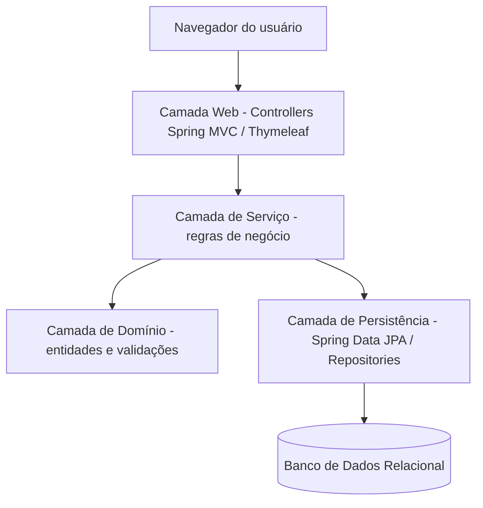
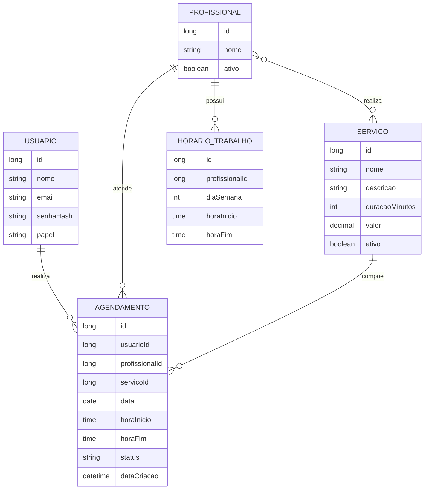

# Documentação do Software — Sistema de Agendamento para Salões de Beleza (MVP)

| Campo | Valor |
|---|---|
| **Versão do documento** | 1.0 |
| **Data** | 28/08/2026 |
| **Autor(es)** | Desenvolvedor único do projeto (Engenheiro de Software) |
| **Status** | Aprovado — escopo fechado |
| **Aprovado por** | Autor do projeto |

## Histórico de Revisões

| Versão | Data | Autor | Descrição da alteração |
|---|---|---|---|
| 1.0 | 28/08/2026 | Desenvolvedor único | Criação do documento com escopo fechado do MVP |

---

## Sumário

1. [Visão Geral](#1-visão-geral)
2. [Escopo do Projeto](#2-escopo-do-projeto)
3. [Requisitos Funcionais](#3-requisitos-funcionais)
4. [Requisitos Não Funcionais](#4-requisitos-não-funcionais)
5. [Regras de Negócio](#5-regras-de-negócio)
6. [Projeto e Arquitetura do Software](#6-projeto-e-arquitetura-do-software)
7. [Plano e Casos de Teste](#7-plano-e-casos-de-teste)
8. [Matriz de Rastreabilidade](#8-matriz-de-rastreabilidade-requisitos-x-testes-x-código-fonte)
9. [Glossário](#9-glossário)
10. [Anexos e Referências](#10-anexos-e-referências)

---

## 1. Visão Geral

### 1.1 Propósito do documento

Este documento define, de forma única, fechada e completa, o escopo da primeira versão (MVP) do **Sistema de Agendamento para Salões de Beleza**. Ele serve simultaneamente como especificação funcional, especificação técnica, plano de testes e matriz de rastreabilidade, sendo a única fonte de verdade do projeto. Destina-se ao próprio desenvolvedor (autor e único responsável pela implementação) e, secundariamente, a quem for avaliar o projeto (ex.: professora/banca).

O projeto é desenvolvido por **uma única pessoa**, portanto toda decisão de escopo, arquitetura e processo aqui definida já considera essa limitação: **tudo o que está listado neste documento é necessário e suficiente para considerar o projeto 100% concluído. Nada aqui pode ser adiado, e nada além disto deve ser implementado nesta versão.**

### 1.2 Descrição resumida do sistema

O sistema é uma plataforma web para agendamento de atendimentos em um **único estabelecimento** de beleza (salão, barbearia, estúdio de estética, etc.). Ele permite que um administrador cadastre os serviços oferecidos, os profissionais que os realizam e os horários de trabalho de cada profissional. A partir dessas informações, o sistema calcula automaticamente os horários disponíveis para agendamento e permite que clientes se cadastrem, escolham um serviço, um profissional e um horário livre, e confirmem o agendamento. O administrador acompanha todos os agendamentos e pode confirmar sua conclusão, cancelar ou registrar a ausência do cliente.

O problema resolvido é o controle centralizado da agenda de um estabelecimento de atendimento por horário marcado, evitando conflitos de horário e substituindo controles manuais (papel, planilhas, WhatsApp) por um fluxo automatizado e consistente.

### 1.3 Stakeholders

| Nome / Papel | Responsabilidade | Contato |
|---|---|---|
| Product Owner / Desenvolvedor | Definição de escopo, desenvolvimento, testes e entrega do projeto | Autor do projeto |
| Arquiteto de Software | Definição da arquitetura (mesma pessoa do desenvolvimento) | Autor do projeto |
| Time de Desenvolvimento | Implementação do sistema | Autor do projeto |
| Time de QA | Execução dos casos de teste definidos na Seção 7 | Autor do projeto |
| Cliente / Avaliador | Avaliação da entrega conforme critérios definidos | Professora / banca avaliadora |

---

## 2. Escopo do Projeto

### 2.1 Objetivos do projeto

- Disponibilizar um fluxo completo e funcional de agendamento de serviços para um único estabelecimento.
- Garantir que nenhum agendamento seja criado em conflito com outro (mesmo profissional, mesmo horário).
- Permitir que o administrador controle serviços, profissionais e agendamentos sem depender de nenhuma etapa manual fora do sistema.
- Entregar uma aplicação Java **100% funcional de ponta a ponta**, desenvolvível e concluível por um único desenvolvedor.

### 2.2 Dentro do escopo (In Scope)

- Cadastro e autenticação de usuários com dois papéis: **ADMIN** e **CLIENTE**.
- Cadastro de **serviços** (nome, descrição, duração em minutos, valor, status ativo/inativo) pelo ADMIN.
- Cadastro de **profissionais** (nome, status ativo/inativo) pelo ADMIN.
- Vínculo entre profissionais e serviços (quais serviços cada profissional realiza).
- Cadastro do **horário de trabalho semanal fixo** de cada profissional (dia da semana, hora de início, hora de término).
- Cálculo automático de horários disponíveis para agendamento, considerando: horário de trabalho do profissional no dia da semana, duração do serviço escolhido e agendamentos já existentes daquele profissional.
- Fluxo de agendamento pelo cliente: escolher serviço → escolher profissional habilitado → escolher data/horário disponível → confirmar.
- Confirmação automática do agendamento (sem etapa de aprovação manual pelo administrador).
- Listagem dos agendamentos do próprio cliente, com status.
- Cancelamento do próprio agendamento pelo cliente, enquanto o status for "Agendado".
- Painel do administrador para listar todos os agendamentos do sistema.
- Ações do administrador sobre um agendamento: **cancelar**, **marcar como concluído**, **marcar falta do cliente (no-show)**.
- Regra de não sobreposição de horários (nenhum profissional pode ter dois agendamentos que se sobreponham).
- Testes automatizados cobrindo o fluxo principal (cadastro, disponibilidade, criação e cancelamento de agendamento).

### 2.3 Fora do escopo (Out of Scope)

Os itens abaixo **não fazem parte desta versão** e não devem ser implementados agora, mesmo que pareçam simples de adicionar:

- Múltiplos estabelecimentos / múltiplas unidades (multi-tenant).
- Confirmação manual de agendamento pelo administrador (fila de "aguardando confirmação").
- Reagendamento de um atendimento existente (alterar data/hora/profissional de um agendamento já criado). Cancelar e criar um novo agendamento cobre essa necessidade nesta versão.
- Configuração de feriados, férias, folgas avulsas, bloqueios manuais de horário e intervalos configuráveis dentro do expediente.
- Upload/gestão de imagens de serviços ou de profissionais.
- Notificações por e-mail, SMS ou push.
- Pagamentos, cobrança ou integração financeira.
- Avaliações/comentários de clientes sobre serviços ou profissionais.
- Relatórios gerenciais, dashboards e exportações.
- Recuperação de senha por e-mail (fluxo de "esqueci minha senha").
- Aplicativo mobile nativo.
- Qualquer funcionalidade de expansão futura não listada na Seção 2.2.

### 2.4 Premissas

- O sistema atenderá a um único estabelecimento, funcionando todos os dias em que houver profissional com horário de trabalho cadastrado.
- O desenvolvedor tem conhecimento prévio em Java e no ecossistema Spring.
- O ambiente de desenvolvimento e testes será local, sem necessidade de infraestrutura em nuvem para a conclusão do MVP.
- Os dados de exemplo (serviços, profissionais, horários) serão inseridos manualmente pelo próprio desenvolvedor durante o desenvolvimento e a demonstração.

### 2.5 Restrições

- Linguagem obrigatória: **Java**.
- Desenvolvimento realizado por **uma única pessoa**, o que limita o tamanho do escopo (ver Seção 2.2/2.3).
- O projeto deve poder ser considerado **100% concluído** dentro do escopo fechado definido neste documento — sem etapas dependentes de decisões futuras.

### 2.6 Riscos identificados

| ID | Risco | Probabilidade | Impacto | Mitigação |
|---|---|---|---|---|
| R-01 | Escopo crescer durante o desenvolvimento ("scope creep") | Média | Alto | Este documento é tratado como fechado; qualquer nova ideia é anotada para uma versão futura e não implementada agora |
| R-02 | Cálculo de disponibilidade de horários conter falhas de lógica (conflitos não detectados) | Média | Alto | Casos de teste dedicados na Seção 7 cobrindo sobreposição de horários |
| R-03 | Tempo de desenvolvimento insuficiente por ser um único desenvolvedor | Média | Médio | Escopo reduzido ao fluxo essencial (Seção 2.2/2.3) |
| R-04 | Complexidade de fuso horário / datas mal tratada no Java | Baixa | Médio | Uso padronizado de `LocalDate`, `LocalTime` e `LocalDateTime` do `java.time` em todo o sistema |

### 2.7 Entregáveis

- Código-fonte completo da aplicação Java (backend + interface web), organizado conforme a Seção 6.
- Banco de dados com script de criação das tabelas (gerado automaticamente pelo JPA/Hibernate em ambiente de desenvolvimento).
- Suíte de testes automatizados cobrindo os casos de teste da Seção 7.
- Este documento (`documentacao-sistema-agendamento-salao.md`), como única fonte de especificação do projeto.

---

## 3. Requisitos Funcionais

> Requisitos funcionais descrevem **o que** o sistema deve fazer.

### Convenção de ID
`RF-XX` (Requisito Funcional número XX)

### 3.1 Lista de Requisitos Funcionais

| ID | Descrição | Prioridade | Origem / Solicitante | Status |
|---|---|---|---|---|
| RF-01 | O sistema deve permitir o cadastro de um novo usuário (cliente), informando nome, e-mail e senha. | Alta | Autor do projeto | A implementar |
| RF-02 | O sistema deve permitir que um usuário (cliente ou admin) se autentique com e-mail e senha. | Alta | Autor do projeto | A implementar |
| RF-03 | O sistema deve permitir que o ADMIN cadastre, edite e ative/inative um serviço (nome, descrição, duração em minutos, valor). | Alta | Autor do projeto | A implementar |
| RF-04 | O sistema deve permitir que o ADMIN cadastre, edite e ative/inative um profissional (nome). | Alta | Autor do projeto | A implementar |
| RF-05 | O sistema deve permitir que o ADMIN vincule e desvincule serviços a um profissional. | Alta | Autor do projeto | A implementar |
| RF-06 | O sistema deve permitir que o ADMIN cadastre o horário de trabalho semanal de um profissional (dia da semana, hora início, hora fim). | Alta | Autor do projeto | A implementar |
| RF-07 | O sistema deve listar, para o cliente, apenas os serviços com status ativo. | Alta | Autor do projeto | A implementar |
| RF-08 | O sistema deve listar, para um serviço escolhido, apenas os profissionais ativos vinculados a ele. | Alta | Autor do projeto | A implementar |
| RF-09 | O sistema deve calcular e exibir, para um profissional, serviço e data escolhidos, apenas os horários de início realmente disponíveis. | Alta | Autor do projeto | A implementar |
| RF-10 | O sistema deve permitir que o cliente crie um agendamento somente após confirmar um resumo com serviço, profissional, data, horário e valor. | Alta | Autor do projeto | A implementar |
| RF-11 | O sistema deve impedir a criação de um agendamento em um horário que já esteja ocupado, indisponível ou insuficiente para a duração do serviço. | Alta | Autor do projeto | A implementar |
| RF-12 | O sistema deve listar os agendamentos do cliente autenticado, com seus respectivos status. | Alta | Autor do projeto | A implementar |
| RF-13 | O sistema deve permitir que o cliente cancele um agendamento próprio enquanto o status for "Agendado". | Alta | Autor do projeto | A implementar |
| RF-14 | O sistema deve permitir que o ADMIN liste todos os agendamentos do sistema, com filtro por data. | Alta | Autor do projeto | A implementar |
| RF-15 | O sistema deve permitir que o ADMIN altere o status de um agendamento para "Concluído", "Cancelado" ou "Falta do cliente". | Alta | Autor do projeto | A implementar |

### 3.2 Detalhamento dos Requisitos Funcionais

#### RF-01 — Cadastro de cliente
- **Descrição:** O sistema deve permitir que um visitante crie uma conta informando nome, e-mail e senha.
- **Ator(es):** Visitante (futuro cliente)
- **Pré-condições:** E-mail ainda não cadastrado no sistema.
- **Fluxo principal:**
  1. Visitante acessa a tela de cadastro.
  2. Visitante informa nome, e-mail e senha.
  3. Sistema valida os dados (RN-01, RN-02) e cria o usuário com papel CLIENTE.
  4. Sistema confirma o cadastro e permite o login.
- **Fluxos alternativos / exceções:**
  - E-mail já cadastrado → sistema exibe mensagem de erro e não cria o usuário.
  - Senha fora do padrão mínimo → sistema exibe mensagem de erro.
- **Pós-condições:** Usuário criado com papel CLIENTE e senha armazenada com hash.
- **Critérios de aceite:**
  - [ ] Cadastro com dados válidos é concluído com sucesso.
  - [ ] Cadastro com e-mail duplicado é rejeitado.
  - [ ] Senha nunca é armazenada em texto puro.
- **Requisitos relacionados:** RNF-02, RN-01, RN-02

#### RF-02 — Autenticação
- **Descrição:** O sistema deve permitir login de CLIENTE e ADMIN com e-mail e senha, direcionando cada papel à sua respectiva área.
- **Ator(es):** Cliente, Admin
- **Pré-condições:** Usuário previamente cadastrado.
- **Fluxo principal:**
  1. Usuário acessa a tela de login.
  2. Usuário informa e-mail e senha.
  3. Sistema valida as credenciais e o papel do usuário.
  4. Sistema redireciona para a área do cliente ou do admin, conforme o papel.
- **Fluxos alternativos / exceções:**
  - Credenciais inválidas → sistema exibe mensagem de erro e não autentica.
- **Pós-condições:** Sessão autenticada criada.
- **Critérios de aceite:**
  - [ ] Login válido autentica e redireciona corretamente por papel.
  - [ ] Login inválido é rejeitado com mensagem clara.
- **Requisitos relacionados:** RNF-02, RN-03

#### RF-03 — Cadastro de serviço
- **Descrição:** ADMIN cadastra, edita e ativa/inativa serviços oferecidos pelo estabelecimento.
- **Ator(es):** Admin
- **Pré-condições:** Usuário autenticado com papel ADMIN.
- **Fluxo principal:**
  1. Admin acessa a área de serviços.
  2. Admin informa nome, descrição, duração (minutos) e valor.
  3. Sistema valida (RN-04) e salva o serviço como ativo por padrão.
- **Fluxos alternativos / exceções:**
  - Duração ou valor inválidos (≤ 0) → sistema rejeita o cadastro.
- **Pós-condições:** Serviço disponível para vínculo com profissionais.
- **Critérios de aceite:**
  - [ ] Serviço criado aparece na listagem administrativa.
  - [ ] Serviço inativo não aparece para o cliente (RF-07).
- **Requisitos relacionados:** RN-04, RF-07

#### RF-04 — Cadastro de profissional
- **Descrição:** ADMIN cadastra, edita e ativa/inativa profissionais do estabelecimento.
- **Ator(es):** Admin
- **Pré-condições:** Usuário autenticado com papel ADMIN.
- **Fluxo principal:**
  1. Admin acessa a área de profissionais.
  2. Admin informa o nome do profissional.
  3. Sistema salva o profissional como ativo por padrão.
- **Pós-condições:** Profissional disponível para vínculo com serviços e cadastro de horário de trabalho.
- **Critérios de aceite:**
  - [ ] Profissional criado aparece na listagem administrativa.
  - [ ] Profissional inativo não aparece como opção para o cliente (RF-08).
- **Requisitos relacionados:** RF-05, RF-06, RF-08

#### RF-05 — Vínculo profissional × serviço
- **Descrição:** ADMIN define quais serviços um profissional pode realizar.
- **Ator(es):** Admin
- **Pré-condições:** Serviço e profissional já cadastrados.
- **Fluxo principal:**
  1. Admin seleciona um profissional.
  2. Admin marca/desmarca os serviços que esse profissional realiza.
  3. Sistema salva o vínculo.
- **Pós-condições:** O profissional passa a ser (ou deixa de ser) uma opção válida para o serviço vinculado.
- **Critérios de aceite:**
  - [ ] Vincular um serviço faz o profissional aparecer na etapa de escolha de profissional (RF-08).
  - [ ] Desvincular remove o profissional dessa listagem para o serviço.
- **Requisitos relacionados:** RF-03, RF-04, RF-08

#### RF-06 — Horário de trabalho do profissional
- **Descrição:** ADMIN cadastra os dias da semana e o intervalo (hora início/fim) em que cada profissional trabalha.
- **Ator(es):** Admin
- **Pré-condições:** Profissional já cadastrado.
- **Fluxo principal:**
  1. Admin seleciona um profissional.
  2. Admin cadastra, para um dia da semana, a hora de início e a hora de término do expediente.
  3. Sistema salva o horário de trabalho (RN-05).
- **Fluxos alternativos / exceções:**
  - Hora de início maior ou igual à hora de término → sistema rejeita o cadastro.
- **Pós-condições:** O dia/horário passa a ser considerado no cálculo de disponibilidade (RF-09).
- **Critérios de aceite:**
  - [ ] Um profissional sem horário cadastrado para um dia não possui horários disponíveis nesse dia.
  - [ ] Horário sobreposto para o mesmo profissional/dia é rejeitado.
- **Requisitos relacionados:** RN-05, RF-09

#### RF-07 — Listagem de serviços ativos
- **Descrição:** Cliente visualiza somente os serviços com status ativo.
- **Ator(es):** Cliente
- **Fluxo principal:**
  1. Cliente acessa a tela inicial de agendamento.
  2. Sistema lista todos os serviços com status ativo.
- **Critérios de aceite:**
  - [ ] Serviços inativos nunca aparecem nesta lista.
- **Requisitos relacionados:** RF-03

#### RF-08 — Listagem de profissionais por serviço
- **Descrição:** Ao escolher um serviço, o cliente vê apenas os profissionais ativos vinculados a ele.
- **Ator(es):** Cliente
- **Fluxo principal:**
  1. Cliente escolhe um serviço.
  2. Sistema lista os profissionais ativos vinculados a esse serviço.
  3. Se houver apenas um profissional vinculado, o sistema o seleciona automaticamente e avança para a escolha de data/horário.
- **Critérios de aceite:**
  - [ ] Profissionais inativos ou não vinculados ao serviço nunca aparecem.
  - [ ] Com um único profissional vinculado, a seleção manual é dispensada.
- **Requisitos relacionados:** RF-05, RF-04

#### RF-09 — Cálculo de horários disponíveis
- **Descrição:** O sistema calcula os horários de início disponíveis para um profissional, serviço e data, considerando expediente e agendamentos existentes.
- **Ator(es):** Cliente (consumidor da informação); Sistema (processamento)
- **Pré-condições:** Serviço, profissional e data selecionados.
- **Fluxo principal:**
  1. Sistema obtém o horário de trabalho do profissional para o dia da semana da data escolhida.
  2. Sistema obtém a duração do serviço escolhido.
  3. Sistema obtém os agendamentos já existentes do profissional naquela data.
  4. Sistema gera os possíveis horários de início dentro do expediente, garantindo que o intervalo completo (início + duração) não se sobreponha a nenhum agendamento existente e não ultrapasse o fim do expediente (RN-06, RN-07).
  5. Sistema retorna a lista de horários disponíveis.
- **Fluxos alternativos / exceções:**
  - Profissional sem expediente cadastrado na data → lista de horários disponíveis vazia.
  - Nenhum horário livre suficiente para a duração do serviço → lista de horários disponíveis vazia.
- **Pós-condições:** Nenhuma (consulta, não altera dados).
- **Critérios de aceite:**
  - [ ] Horários que se sobrepõem a um agendamento existente nunca são retornados.
  - [ ] Horários sem tempo suficiente para a duração completa do serviço nunca são retornados.
- **Requisitos relacionados:** RF-06, RN-06, RN-07

#### RF-10 — Confirmação e criação do agendamento
- **Descrição:** O cliente revisa um resumo do agendamento antes de confirmá-lo; o agendamento só é criado após confirmação explícita.
- **Ator(es):** Cliente
- **Pré-condições:** Serviço, profissional, data e horário selecionados dentre os horários disponíveis (RF-09).
- **Fluxo principal:**
  1. Sistema exibe o resumo: serviço, profissional, data, horário de início, duração e valor.
  2. Cliente confirma o agendamento.
  3. Sistema revalida a disponibilidade do horário (RN-06) e cria o agendamento com status "Agendado".
- **Fluxos alternativos / exceções:**
  - Horário deixou de estar disponível entre a consulta e a confirmação (ex.: ocupado por outro agendamento) → sistema rejeita a criação e informa o cliente.
- **Pós-condições:** Agendamento criado; horário passa a ocupar a agenda do profissional para novos cálculos de disponibilidade (RF-09).
- **Critérios de aceite:**
  - [ ] Nenhum agendamento é criado sem confirmação explícita do resumo.
  - [ ] Um horário confirmado por dois clientes simultaneamente resulta em apenas um agendamento criado.
- **Requisitos relacionados:** RF-09, RF-11, RN-06, RN-07

#### RF-11 — Prevenção de conflito de horário
- **Descrição:** O sistema nunca permite dois agendamentos do mesmo profissional com sobreposição de horário.
- **Ator(es):** Sistema
- **Fluxo principal:** Validação executada dentro de RF-10, no momento da criação do agendamento.
- **Critérios de aceite:**
  - [ ] Tentativa de criar agendamento sobreposto a outro existente é sempre rejeitada.
- **Requisitos relacionados:** RF-09, RF-10, RN-06

#### RF-12 — Listagem de agendamentos do cliente
- **Descrição:** Cliente visualiza seus próprios agendamentos com status atual.
- **Ator(es):** Cliente
- **Fluxo principal:**
  1. Cliente acessa "Meus agendamentos".
  2. Sistema lista todos os agendamentos do cliente autenticado, ordenados por data, com status (Agendado, Concluído, Cancelado, Falta).
- **Critérios de aceite:**
  - [ ] Cliente nunca visualiza agendamentos de outro cliente.
- **Requisitos relacionados:** RN-03

#### RF-13 — Cancelamento pelo cliente
- **Descrição:** Cliente cancela um agendamento próprio, desde que ainda esteja com status "Agendado".
- **Ator(es):** Cliente
- **Pré-condições:** Agendamento pertence ao cliente autenticado e possui status "Agendado".
- **Fluxo principal:**
  1. Cliente seleciona um agendamento próprio com status "Agendado".
  2. Cliente confirma o cancelamento.
  3. Sistema altera o status do agendamento para "Cancelado" e libera o horário para novos agendamentos.
- **Fluxos alternativos / exceções:**
  - Agendamento já concluído, cancelado ou com falta registrada → ação de cancelar não é permitida.
- **Pós-condições:** Horário liberado no cálculo de disponibilidade (RF-09).
- **Critérios de aceite:**
  - [ ] Agendamento cancelado libera o horário para novos clientes.
  - [ ] Cliente não consegue cancelar agendamento de outro cliente.
- **Requisitos relacionados:** RF-09, RF-12, RN-08

#### RF-14 — Listagem administrativa de agendamentos
- **Descrição:** ADMIN visualiza todos os agendamentos do sistema, podendo filtrar por data.
- **Ator(es):** Admin
- **Fluxo principal:**
  1. Admin acessa o painel de agendamentos.
  2. Sistema lista todos os agendamentos, com filtro opcional por data.
- **Critérios de aceite:**
  - [ ] Todos os agendamentos do sistema aparecem para o admin, independentemente do cliente.
- **Requisitos relacionados:** RF-15

#### RF-15 — Alteração de status pelo admin
- **Descrição:** ADMIN altera o status de um agendamento para "Concluído", "Cancelado" ou "Falta do cliente".
- **Ator(es):** Admin
- **Pré-condições:** Agendamento com status "Agendado".
- **Fluxo principal:**
  1. Admin seleciona um agendamento.
  2. Admin escolhe a nova situação: concluído, cancelado ou falta do cliente.
  3. Sistema atualiza o status do agendamento.
- **Fluxos alternativos / exceções:**
  - Agendamento já finalizado (concluído/cancelado/falta) → não pode ser alterado novamente.
- **Pós-condições:** Status refletido para o cliente na sua listagem (RF-12); horário liberado na agenda quando cancelado.
- **Critérios de aceite:**
  - [ ] Alteração de status feita pelo admin aparece imediatamente para o cliente.
- **Requisitos relacionados:** RF-12, RF-14, RN-08

---

## 4. Requisitos Não Funcionais

> As categorias seguem o modelo de qualidade da **ISO/IEC 25010**, complementado por requisitos de conformidade legal (LGPD), ambos reduzidos ao mínimo necessário para um MVP de uso individual/acadêmico.

### Convenção de ID
`RNF-XX` (Requisito Não Funcional número XX)

### 4.1 Categorias segundo ISO/IEC 25010

| Característica ISO 25010 | Subcaracterísticas | Descrição |
|---|---|---|
| **Adequação Funcional** | Completude, Corretude | O sistema deve implementar exatamente os RFs da Seção 3, sem lacunas. |
| **Eficiência de Desempenho** | Comportamento temporal | Tempo de resposta adequado para uso individual/demonstração. |
| **Compatibilidade** | N/A nesta versão | Não há integração com sistemas externos no MVP (fora de escopo). |
| **Usabilidade** | Operabilidade, Proteção contra erros | Fluxo de agendamento deve ser simples e sem ambiguidade. |
| **Confiabilidade** | Maturidade | O sistema não deve permitir estados de dados inconsistentes (ex.: agendamentos conflitantes). |
| **Segurança** | Confidencialidade, Autenticidade | Senhas protegidas; acesso a áreas restritas por papel (ADMIN/CLIENTE). |
| **Manutenibilidade** | Modularidade, Testabilidade | Código organizado em camadas, com testes automatizados do fluxo principal. |
| **Portabilidade** | Instalabilidade | Aplicação executável localmente via Maven, sem dependências pagas. |

### 4.2 Lista de Requisitos Não Funcionais

| ID | Característica ISO 25010 | Subcaracterística | Descrição | Critério de aceite / Métrica | Prioridade |
|---|---|---|---|---|---|
| RNF-01 | Eficiência de Desempenho | Comportamento temporal | O cálculo de horários disponíveis deve responder em até 1 segundo para um dia com até 50 agendamentos existentes. | Tempo de resposta ≤ 1s em ambiente local | Média |
| RNF-02 | Segurança | Confidencialidade | Senhas devem ser armazenadas com hash (BCrypt). | Nenhuma senha em texto puro no banco de dados | Alta |
| RNF-03 | Confiabilidade | Maturidade | O sistema nunca deve persistir dois agendamentos sobrepostos para o mesmo profissional. | 0 conflitos em teste automatizado de concorrência simples (RF-11) | Alta |
| RNF-04 | Usabilidade | Operabilidade | O fluxo completo de agendamento (serviço → profissional → data/horário → confirmação) deve ser realizável em no máximo 5 telas/passos. | Validação manual do fluxo | Média |
| RNF-05 | Segurança | Autenticidade | Áreas administrativas só podem ser acessadas por usuários com papel ADMIN. | Tentativa de acesso por CLIENTE é bloqueada (HTTP 403) | Alta |
| RNF-06 | Manutenibilidade | Testabilidade | As regras de cálculo de disponibilidade e de conflito de horário devem possuir testes unitários dedicados. | Cobertura de testes nas classes de serviço de agendamento | Alta |
| RNF-07 | Manutenibilidade | Modularidade | O código deve ser organizado em camadas (apresentação, aplicação/serviço, domínio, persistência), conforme Seção 6. | Estrutura de pastas conforme Seção 6.7 | Alta |
| RNF-08 | Portabilidade | Instalabilidade | O projeto deve subir localmente com um único comando Maven, sem infraestrutura externa obrigatória. | `mvn spring-boot:run` inicia a aplicação com banco H2 embarcado | Média |

### 4.3 Conformidade com a LGPD (Lei nº 13.709/2018)

> Neste MVP, o sistema trata dados pessoais básicos de cadastro (nome, e-mail, senha). Os requisitos de LGPD abaixo foram reduzidos ao estritamente necessário para essa coleta mínima — os demais mecanismos previstos na lei (portabilidade, DPO, notificação formal de incidentes, etc.) ficam **fora do escopo** desta versão, por não serem essenciais ao ciclo funcional do MVP.

| ID | Princípio / Exigência LGPD | Descrição | Critério de aceite | Prioridade |
|---|---|---|---|---|
| RNF-L01 | Finalidade | O formulário de cadastro deve informar que os dados são usados apenas para autenticação e identificação nos agendamentos. | Texto de finalidade visível na tela de cadastro | Alta |
| RNF-L02 | Minimização de dados | O sistema deve coletar somente nome, e-mail e senha do cliente — nenhum outro dado pessoal. | Revisão do formulário de cadastro (RF-01) | Alta |
| RNF-L03 | Segurança e sigilo (Art. 46) | Senha armazenada com hash; acesso a dados de outro usuário é bloqueado. | Ver RNF-02 e RNF-05 | Alta |
| RNF-L04 | Direitos do titular (Art. 18) — exclusão | O cliente deve conseguir excluir a própria conta, o que remove seus dados de identificação. | Ação de exclusão de conta disponível na área do cliente | Média |

### 4.4 Mapeamento RNF × ISO 25010 × LGPD

| ID | Categoria | Referência normativa | Requisito(s) funcional(is) relacionado(s) |
|---|---|---|---|
| RNF-02 | Segurança (ISO 25010) | LGPD Art. 46 | RF-01, RF-02 |
| RNF-05 | Segurança (ISO 25010) | — | RF-03, RF-04, RF-05, RF-06, RF-14, RF-15 |
| RNF-L02 | Adequação Funcional | LGPD Art. 6º (minimização) | RF-01 |
| RNF-L04 | Adequação Funcional | LGPD Art. 18 | RF-01 |

---

## 5. Regras de Negócio

> Regras de negócio são políticas independentes de uma tela específica e valem em todo o sistema.

### Convenção de ID
`RN-XX` (Regra de Negócio número XX)

### 5.1 Lista de Regras de Negócio

| ID | Descrição | Origem | Requisitos relacionados |
|---|---|---|---|
| RN-01 | A senha do usuário deve ter no mínimo 8 caracteres, contendo letras e números. | Autor do projeto | RF-01 |
| RN-02 | Não pode existir mais de um usuário com o mesmo e-mail. | Autor do projeto | RF-01 |
| RN-03 | Um usuário só pode visualizar e alterar os próprios dados e os próprios agendamentos, salvo o ADMIN, que visualiza todos os agendamentos. | Autor do projeto | RF-02, RF-12, RF-14 |
| RN-04 | A duração de um serviço deve ser maior que 0 minutos e o valor deve ser maior ou igual a 0. | Autor do projeto | RF-03 |
| RN-05 | Para um mesmo profissional e dia da semana, os intervalos de horário de trabalho cadastrados não podem se sobrepor. | Autor do projeto | RF-06 |
| RN-06 | Um agendamento só pode ser criado se o intervalo completo (horário de início + duração do serviço) estiver contido no horário de trabalho do profissional e não se sobrepuser a nenhum outro agendamento ativo (status "Agendado" ou "Concluído") do mesmo profissional. | Autor do projeto | RF-09, RF-10, RF-11 |
| RN-07 | Agendamentos com status "Cancelado" não bloqueiam horários — o horário correspondente volta a ficar disponível. | Autor do projeto | RF-09, RF-13 |
| RN-08 | Um agendamento só pode ter seu status alterado (concluído, cancelado, falta) enquanto estiver no status "Agendado". Uma vez finalizado, o status não pode ser alterado novamente. | Autor do projeto | RF-13, RF-15 |
| RN-09 | Apenas usuários com papel ADMIN podem cadastrar/editar serviços, profissionais, vínculos e horários de trabalho, e podem alterar o status de qualquer agendamento. | Autor do projeto | RF-03, RF-04, RF-05, RF-06, RF-15 |
| RN-10 | Um serviço só pode ser selecionado pelo cliente para agendamento se estiver com status ativo. Um profissional só pode ser selecionado se estiver ativo e vinculado ao serviço escolhido. | Autor do projeto | RF-07, RF-08 |

---

## 6. Projeto e Arquitetura do Software

### 6.1 Visão arquitetural

Aplicação **monolítica**, em camadas (arquitetura em camadas simples: apresentação → aplicação/serviço → domínio → persistência), adequada para desenvolvimento e manutenção por um único desenvolvedor. Não há microsserviços, filas, mensageria ou múltiplos serviços implantáveis nesta versão — decisão deliberada para manter o projeto 100% concluível.

### 6.2 Diagrama de arquitetura (visão geral)



### 6.3 Componentes / Módulos

| Componente | Responsabilidade | Tecnologia |
|---|---|---|
| Web / Apresentação | Telas de cadastro, login, agendamento e painel do admin | Spring MVC + Thymeleaf |
| Serviço de Usuário | Cadastro, autenticação, papéis | Spring Security |
| Serviço de Catálogo | Serviços, profissionais e vínculos | Spring Boot / Java |
| Serviço de Agenda | Horário de trabalho e cálculo de disponibilidade | Spring Boot / Java (`java.time`) |
| Serviço de Agendamento | Criação, cancelamento e mudança de status de agendamentos | Spring Boot / Java |
| Persistência | Acesso e mapeamento dos dados | Spring Data JPA / Hibernate |
| Banco de Dados | Armazenamento dos dados da aplicação | H2 (desenvolvimento) / PostgreSQL (opcional) |

### 6.4 Stack tecnológica

| Camada | Tecnologia / Ferramenta | Versão |
|---|---|---|
| Linguagem | Java | 17 (LTS) |
| Framework principal | Spring Boot | 3.x |
| Camada web | Spring MVC + Thymeleaf | Compatível com Spring Boot 3.x |
| Persistência | Spring Data JPA + Hibernate | Compatível com Spring Boot 3.x |
| Banco de Dados | H2 (desenvolvimento/testes) | Embarcado |
| Segurança | Spring Security (autenticação por formulário, papéis) | Compatível com Spring Boot 3.x |
| Build | Maven | 3.9+ |
| Testes | JUnit 5 + Mockito | JUnit 5.x |

### 6.5 Modelo de dados



### 6.6 Decisões de arquitetura (ADR resumido)

| ID | Decisão | Contexto | Alternativas consideradas | Justificativa |
|---|---|---|---|---|
| ADR-01 | Monolito em camadas, sem microsserviços | Projeto desenvolvido por uma única pessoa, com escopo fechado | Microsserviços, arquitetura hexagonal completa | Reduz complexidade de infraestrutura e acelera a conclusão total do MVP |
| ADR-02 | Confirmação automática de agendamento (sem fila de aprovação manual) | Simplificar o ciclo de status do agendamento | Fluxo com status "Aguardando confirmação" | Remove uma tela e uma decisão administrativa extra sem comprometer o fluxo principal |
| ADR-03 | Horário de trabalho semanal fixo (sem exceções de feriado/férias) | Reduzir a superfície de regras de disponibilidade | Calendário completo de exceções | Mantém o cálculo de disponibilidade simples e testável dentro do prazo de um único desenvolvedor |
| ADR-04 | Interface web server-side com Thymeleaf, sem front-end separado (SPA) | Evitar duas bases de código (backend + frontend) | React/Angular consumindo API REST | Um único projeto Maven cobre 100% do ciclo, sem exigir build/deploy de um segundo projeto |

### 6.7 Estrutura de pastas do projeto

```
/src
  /main
    /java/com/salao/agendamento
      /web            -> Controllers (Spring MVC)
      /service        -> Regras de negócio (UsuarioService, ServicoService,
                          ProfissionalService, AgendaService, AgendamentoService)
      /domain          -> Entidades JPA (Usuario, Servico, Profissional,
                          HorarioTrabalho, Agendamento)
      /repository      -> Interfaces Spring Data JPA
      /security        -> Configuração do Spring Security
      /exception       -> Exceções de negócio (ex.: HorarioIndisponivelException)
    /resources
      /templates       -> Páginas Thymeleaf
      /static           -> CSS/JS mínimos
      application.properties
  /test
    /java/com/salao/agendamento
      /service          -> Testes unitários das regras de negócio (RN-05, RN-06, RN-07)
      /web               -> Testes de integração dos fluxos principais (RF-09, RF-10, RF-13)
/docs
  documentacao-sistema-agendamento-salao.md
```

### 6.8 Integrações externas

| Sistema externo | Finalidade | Protocolo | Observações |
|---|---|---|---|
| — | Nenhuma integração externa nesta versão | — | Fora de escopo (Seção 2.3) |

---

## 7. Plano e Casos de Teste

### 7.1 Estratégia de testes

- **Testes unitários** para as regras de negócio críticas: cálculo de disponibilidade (RN-06, RN-07) e validações de cadastro (RN-01, RN-02, RN-04, RN-05).
- **Testes de integração** para os fluxos completos via camada de serviço/controller: criação de agendamento, cancelamento e alteração de status pelo admin.
- Ferramentas: **JUnit 5** e **Mockito**, executados via Maven (`mvn test`).
- Não há testes de carga, segurança ofensiva ou testes end-to-end de interface nesta versão — fora de escopo.

### 7.2 Ambientes de teste

| Ambiente | Finalidade | URL / Acesso |
|---|---|---|
| Desenvolvimento/Testes | Execução local com banco H2 embarcado | `http://localhost:8080` |

### Convenção de ID
`CT-XX` (Caso de Teste número XX)

### 7.3 Casos de Teste

| ID | Requisito relacionado | Descrição / Cenário | Pré-condições | Passos | Resultado esperado | Status |
|---|---|---|---|---|---|---|
| CT-01 | RF-01 | Cadastro de cliente com dados válidos | Nenhuma | 1. Preencher nome, e-mail e senha válidos 2. Enviar formulário | Usuário criado com papel CLIENTE | A executar |
| CT-02 | RF-01, RN-02 | Cadastro com e-mail já existente | Usuário já cadastrado com o e-mail X | 1. Preencher cadastro com e-mail X 2. Enviar | Sistema rejeita com mensagem de e-mail duplicado | A executar |
| CT-03 | RF-02 | Login com credenciais válidas | Usuário cadastrado | 1. Informar e-mail/senha corretos 2. Enviar | Usuário autenticado e redirecionado por papel | A executar |
| CT-04 | RF-02 | Login com senha inválida | Usuário cadastrado | 1. Informar senha incorreta 2. Enviar | Mensagem de erro exibida, sem autenticação | A executar |
| CT-05 | RF-03, RN-04 | Cadastro de serviço com duração inválida (0 minutos) | Admin autenticado | 1. Preencher serviço com duração 0 2. Enviar | Sistema rejeita o cadastro | A executar |
| CT-06 | RF-06, RN-05 | Cadastro de horário de trabalho sobreposto para o mesmo profissional/dia | Profissional já possui horário 08:00–12:00 na segunda-feira | 1. Cadastrar novo horário 10:00–14:00 na segunda-feira para o mesmo profissional | Sistema rejeita por sobreposição | A executar |
| CT-07 | RF-09 | Consulta de horários disponíveis em dia sem expediente cadastrado | Profissional sem horário cadastrado na data escolhida | 1. Selecionar serviço, profissional e data | Lista de horários disponíveis vazia | A executar |
| CT-08 | RF-09, RN-06 | Consulta de horários disponíveis considerando agendamento existente | Profissional com expediente 08:00–12:00; agendamento das 09:00 às 10:00 (serviço de 60 min) já existente | 1. Selecionar mesmo profissional, serviço de 60 min e mesma data | Horário 09:00 não aparece na lista; 08:00 e 10:00 aparecem | A executar |
| CT-09 | RF-10, RF-11, RN-06 | Criação de agendamento em horário disponível | Horário disponível conforme CT-08 | 1. Selecionar horário 10:00 2. Confirmar resumo | Agendamento criado com status "Agendado" | A executar |
| CT-10 | RF-10, RF-11, RN-06 | Tentativa de criar agendamento em horário já ocupado | Agendamento já existente às 09:00 (CT-08) | 1. Tentar criar novo agendamento às 09:00 para o mesmo profissional | Sistema rejeita a criação por conflito de horário | A executar |
| CT-11 | RF-13, RN-07, RN-08 | Cancelamento de agendamento pelo cliente | Agendamento com status "Agendado", pertencente ao cliente autenticado | 1. Cliente seleciona o agendamento 2. Confirma o cancelamento | Status alterado para "Cancelado" e horário liberado (reaparece em CT-07/CT-08) | A executar |
| CT-12 | RF-13, RN-08 | Tentativa de cancelar agendamento já concluído | Agendamento com status "Concluído" | 1. Cliente tenta cancelar o agendamento | Ação não permitida | A executar |
| CT-13 | RF-15, RN-08 | Admin marca agendamento como concluído | Agendamento com status "Agendado" | 1. Admin seleciona o agendamento 2. Marca como "Concluído" | Status alterado para "Concluído" e refletido na área do cliente (RF-12) | A executar |
| CT-14 | RF-14 | Admin lista todos os agendamentos do sistema | Existem agendamentos de mais de um cliente | 1. Admin acessa o painel de agendamentos | Todos os agendamentos aparecem, independentemente do cliente | A executar |
| CT-15 | RNF-05, RN-09 | Cliente tenta acessar área administrativa | Usuário autenticado com papel CLIENTE | 1. Cliente tenta acessar rota/tela administrativa | Acesso negado (HTTP 403) | A executar |

---

## 8. Matriz de Rastreabilidade (Requisitos x Testes x Código-fonte)

| Requisito (RF/RNF/RN) | Descrição resumida | Caso(s) de Teste | Arquivo(s) / Módulo de código | Status de implementação | Status de teste |
|---|---|---|---|---|---|
| RF-01 | Cadastro de cliente | CT-01, CT-02 | `service/UsuarioService.java`, `web/CadastroController.java` | Não iniciado | Pendente |
| RF-02 | Autenticação | CT-03, CT-04 | `security/SecurityConfig.java`, `web/LoginController.java` | Não iniciado | Pendente |
| RF-03 | Cadastro de serviço | CT-05 | `service/ServicoService.java`, `web/admin/ServicoController.java` | Não iniciado | Pendente |
| RF-04 | Cadastro de profissional | — | `service/ProfissionalService.java`, `web/admin/ProfissionalController.java` | Não iniciado | Pendente |
| RF-05 | Vínculo profissional × serviço | — | `service/ProfissionalService.java` | Não iniciado | Pendente |
| RF-06 | Horário de trabalho do profissional | CT-06 | `service/AgendaService.java`, `web/admin/HorarioController.java` | Não iniciado | Pendente |
| RF-07 | Listagem de serviços ativos | — | `service/ServicoService.java`, `web/AgendamentoController.java` | Não iniciado | Pendente |
| RF-08 | Listagem de profissionais por serviço | — | `service/ProfissionalService.java`, `web/AgendamentoController.java` | Não iniciado | Pendente |
| RF-09 | Cálculo de horários disponíveis | CT-07, CT-08 | `service/AgendaService.java` | Não iniciado | Pendente |
| RF-10 | Confirmação e criação do agendamento | CT-09 | `service/AgendamentoService.java`, `web/AgendamentoController.java` | Não iniciado | Pendente |
| RF-11 | Prevenção de conflito de horário | CT-10 | `service/AgendamentoService.java` | Não iniciado | Pendente |
| RF-12 | Listagem de agendamentos do cliente | CT-13 (reflexo) | `web/MeusAgendamentosController.java` | Não iniciado | Pendente |
| RF-13 | Cancelamento pelo cliente | CT-11, CT-12 | `service/AgendamentoService.java` | Não iniciado | Pendente |
| RF-14 | Listagem administrativa de agendamentos | CT-14 | `web/admin/AgendamentoAdminController.java` | Não iniciado | Pendente |
| RF-15 | Alteração de status pelo admin | CT-13 | `service/AgendamentoService.java`, `web/admin/AgendamentoAdminController.java` | Não iniciado | Pendente |
| RNF-02 | Senha com hash (BCrypt) | CT-01 | `security/SecurityConfig.java` | Não iniciado | Pendente |
| RNF-05 | Acesso administrativo restrito | CT-15 | `security/SecurityConfig.java` | Não iniciado | Pendente |
| RNF-06 | Testes unitários das regras de agenda | CT-06, CT-07, CT-08, CT-10 | `test/service/AgendaServiceTest.java` | Não iniciado | Pendente |
| RN-05 | Sem sobreposição de horário de trabalho | CT-06 | `service/AgendaService.java` | Não iniciado | Pendente |
| RN-06/RN-07 | Sem conflito de agendamento / liberação ao cancelar | CT-08, CT-09, CT-10, CT-11 | `service/AgendamentoService.java` | Não iniciado | Pendente |

**Legenda — Status de implementação:** Não iniciado / Em desenvolvimento / Concluído / Bloqueado
**Legenda — Status de teste:** Pendente / Em execução / Aprovado / Reprovado

---

## 9. Glossário

| Termo | Definição |
|---|---|
| Admin | Usuário responsável por configurar serviços, profissionais, horários e gerenciar todos os agendamentos. |
| Cliente | Usuário que realiza agendamentos de serviços. |
| Serviço | Procedimento oferecido pelo estabelecimento, com duração e valor definidos. |
| Profissional | Pessoa que realiza os serviços vinculados a ela dentro do seu horário de trabalho. |
| Horário de trabalho | Intervalo de tempo, em um dia da semana, em que um profissional está disponível para atender. |
| Horário disponível | Horário de início dentro do expediente do profissional em que cabe integralmente a duração do serviço, sem conflitar com agendamentos existentes. |
| Agendamento | Registro que vincula cliente, profissional, serviço, data e horário, com um status associado. |
| Status "Agendado" | Situação inicial de um agendamento criado e ainda não finalizado. |
| Status "Concluído" | Agendamento em que o atendimento foi realizado, registrado pelo admin. |
| Status "Cancelado" | Agendamento cancelado pelo cliente ou pelo admin; libera o horário na agenda. |
| Status "Falta" | Agendamento em que o cliente não compareceu, registrado pelo admin. |
| MVP | Minimum Viable Product — menor versão funcional e completa do sistema, definida por este documento. |

---

## 10. Anexos e Referências

- **Repositório de código:** a ser definido pelo autor no início da implementação (ex.: repositório Git pessoal).
- **Documento de referência de escopo:** este próprio arquivo (`documentacao-sistema-agendamento-salao.md`), único documento oficial do projeto.
- **Critério de conclusão do MVP:** o projeto é considerado 100% concluído quando todos os Requisitos Funcionais da Seção 3 estiverem implementados, todas as Regras de Negócio da Seção 5 estiverem aplicadas, e todos os Casos de Teste da Seção 7.3 estiverem com status "Aprovado" na Matriz de Rastreabilidade (Seção 8).
- **Regra de governança do escopo:** nenhuma funcionalidade fora da Seção 2.2 deve ser adicionada antes da conclusão de 100% deste escopo. Qualquer nova ideia deve ser anotada separadamente para uma versão futura, fora deste documento.
