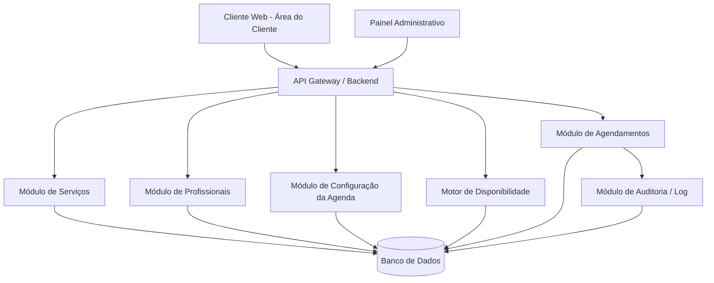
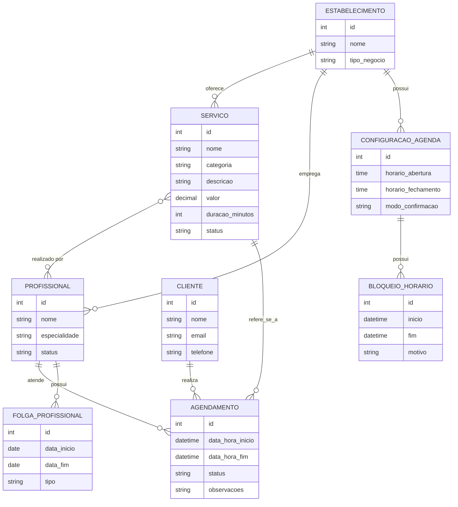

# Documentação do Software — Sistema de Agendamento e Gestão para Salões de Beleza

| Campo | Valor |
|---|---|
| **Versão do documento** | 1.0 |
| **Data** | 28/08/2026 |
| **Autor(es)** | Equipe de Produto / Desenvolvimento |
| **Status** | Rascunho |
| **Aprovado por** | — |

## Histórico de Revisões

| Versão | Data | Autor | Descrição da alteração |
|---|---|---|---|
| 1.0 | 28/08/2026 | Equipe de Produto | Criação do documento a partir da descrição funcional do MVP |

---

## Sumário

1. [Visão Geral](#1-visão-geral)
2. [Escopo do Projeto](#2-escopo-do-projeto)
3. [Requisitos Funcionais](#3-requisitos-funcionais)
4. [Requisitos Não Funcionais](#4-requisitos-não-funcionais)
5. [Regras de Negócio](#5-regras-de-negócio)
6. [Projeto e Arquitetura do Software](#6-projeto-e-arquitetura-do-software)
7. [Plano e Casos de Teste](#7-plano-e-casos-de-teste)
8. [Matriz de Rastreabilidade](#8-matriz-de-rastreabilidade-requisitos-x-testes-x-código-fonte)
9. [Glossário](#9-glossário)
10. [Anexos e Referências](#10-anexos-e-referências)

---

## 1. Visão Geral

### 1.1 Propósito do documento
Este documento descreve os requisitos funcionais, não funcionais, regras de negócio, arquitetura e plano de testes do Sistema de Agendamento e Gestão para Salões de Beleza. Destina-se à equipe de desenvolvimento, QA, product owners e demais stakeholders envolvidos na construção do MVP, servindo como referência única para especificação, implementação, testes e rastreabilidade do sistema.

### 1.2 Descrição resumida do sistema
O sistema é uma plataforma de agendamento voltada para salões de cabelo, barbearias, estúdios de unhas, extensão de cílios, clínicas de estética e demais negócios que operam por horário marcado. O núcleo do sistema é a agenda: serviços, profissionais e configurações de funcionamento alimentam um motor de cálculo de disponibilidade que apresenta ao cliente apenas horários realmente livres, evitando conflitos de agendamento e centralizando o controle dos atendimentos para o administrador do estabelecimento.

### 1.3 Stakeholders

| Nome / Papel | Responsabilidade | Contato |
|---|---|---|
| Product Owner | Define prioridades e valida requisitos do MVP | — |
| Arquiteto de Software | Define arquitetura técnica e stack | — |
| Time de Desenvolvimento | Implementação do sistema | — |
| Time de QA | Execução dos casos de teste e validação de qualidade | — |
| Administrador do Salão (usuário-chave) | Configura serviços, profissionais e agenda; gerencia atendimentos | — |
| Cliente Final (usuário-chave) | Realiza agendamentos e acompanha seus atendimentos | — |

---

## 2. Escopo do Projeto

### 2.1 Objetivos do projeto
- Permitir que salões de beleza e negócios similares organizem seus atendimentos por meio de uma agenda centralizada e automatizada.
- Eliminar conflitos de horário entre profissionais e clientes.
- Reduzir o trabalho manual de controle de agenda feito por telefone, WhatsApp ou caderno.
- Dar ao cliente autonomia para agendar, visualizar e acompanhar seus atendimentos.
- Dar ao administrador visão centralizada e controle total sobre serviços, profissionais e agendamentos.

### 2.2 Dentro do escopo (In Scope)
- Cadastro e gestão de serviços (nome, categoria, descrição, valor, duração, imagens, status).
- Cadastro e gestão de profissionais (horários de trabalho, folgas, especialidades, serviços realizados).
- Configuração da agenda do estabelecimento (dias/horários de funcionamento, intervalos, feriados, férias, bloqueios).
- Cálculo automático de disponibilidade de horários, considerando duração do serviço.
- Fluxo de agendamento do cliente: seleção de serviço, profissional, data/horário e confirmação.
- Confirmação de agendamento manual ou automática (conforme configuração do administrador).
- Área do cliente com histórico e status dos agendamentos.
- Painel administrativo com gestão de agendamentos (confirmar, cancelar, reagendar, alterar profissional/horário, finalizar, registrar ausência, observações).
- Atualização em tempo real da disponibilidade da agenda conforme mudanças de status dos agendamentos.

### 2.3 Fora do escopo (Out of Scope)
- Pagamentos online e split de pagamento entre estabelecimento e profissionais.
- Aplicativo mobile nativo (o MVP contempla apenas plataforma web/responsiva).
- Sistema de fidelidade, cupons e programas de indicação.
- Multiempresa/franquias com gestão centralizada entre unidades diferentes.
- Notificações via WhatsApp/SMS integradas a provedores externos (pode ser considerado em fase futura).
- Relatórios financeiros avançados e BI.

### 2.4 Premissas
- Cada estabelecimento (tenant) opera de forma isolada dentro do sistema.
- O administrador realiza a configuração inicial (serviços, profissionais, agenda) antes da abertura para agendamentos de clientes.
- Os clientes possuem acesso à internet e utilizam navegador ou aplicação web para agendar.
- Um profissional só pode estar vinculado a um atendimento por vez.

### 2.5 Restrições
- O sistema deve ser desenvolvido como MVP, priorizando o fluxo central de agendamento antes de funcionalidades acessórias.
- O cálculo de disponibilidade deve ser confiável mesmo sob acessos concorrentes (dois clientes tentando o mesmo horário simultaneamente).
- Conformidade com a LGPD é obrigatória, dado o tratamento de dados pessoais de clientes.

### 2.6 Riscos identificados

| ID | Risco | Probabilidade | Impacto | Mitigação |
|---|---|---|---|---|
| R-01 | Concorrência entre dois clientes agendando o mesmo horário simultaneamente | Média | Alto | Uso de transações atômicas e locks otimistas no momento da confirmação do agendamento |
| R-02 | Configuração incorreta da agenda pelo administrador (ex.: sem definir horário de funcionamento) gerar ausência de horários disponíveis | Média | Médio | Validações no cadastro e mensagens orientativas na configuração |
| R-03 | Cálculo incorreto de disponibilidade ao considerar duração do serviço, folgas e bloqueios simultaneamente | Média | Alto | Cobertura de testes automatizados extensiva no motor de disponibilidade |
| R-04 | Vazamento ou uso indevido de dados pessoais de clientes | Baixa | Alto | Aplicação dos requisitos de LGPD (criptografia, controle de acesso, minimização de dados) |
| R-05 | Baixa adoção pelo administrador por complexidade de configuração inicial | Média | Médio | Fluxo de onboarding guiado e valores padrão sensatos |

### 2.7 Entregáveis
- Sistema web funcional (MVP) com os fluxos de administrador e cliente.
- Documentação técnica e funcional (este documento).
- Casos de teste executados e matriz de rastreabilidade.
- Modelo de dados (diagrama ER) e diagrama de arquitetura.

---

## 3. Requisitos Funcionais

> Requisitos funcionais descrevem **o que** o sistema deve fazer.

### Convenção de ID
`RF-XX` (Requisito Funcional número XX)

### 3.1 Lista de Requisitos Funcionais

| ID | Descrição | Prioridade | Origem / Solicitante | Status |
|---|---|---|---|---|
| RF-01 | O sistema deve permitir que o administrador cadastre serviços, com nome, categoria, descrição, valor, duração, imagens e status. | Alta | Administrador | A implementar |
| RF-02 | O sistema deve permitir que o administrador vincule um ou mais profissionais habilitados a cada serviço. | Alta | Administrador | A implementar |
| RF-03 | O sistema deve permitir que o administrador ative ou desative um serviço. | Alta | Administrador | A implementar |
| RF-04 | O sistema deve permitir que o administrador cadastre profissionais, com horários de trabalho, dias de folga e especialidades. | Alta | Administrador | A implementar |
| RF-05 | O sistema deve permitir que o administrador configure o funcionamento geral da agenda (dias e horários de abertura/fechamento, intervalos, folgas, feriados, datas especiais, férias, fechamentos temporários e bloqueios de horário). | Alta | Administrador | A implementar |
| RF-06 | O sistema deve exibir ao cliente apenas os serviços com status ativo. | Alta | Cliente | A implementar |
| RF-07 | O sistema deve exibir ao cliente os profissionais habilitados para o serviço escolhido, selecionando automaticamente quando houver apenas um profissional vinculado. | Alta | Cliente | A implementar |
| RF-08 | O sistema deve calcular e exibir ao cliente apenas os horários efetivamente disponíveis para o serviço e profissional escolhidos, considerando a duração do serviço. | Alta | Cliente | A implementar |
| RF-09 | O sistema deve impedir a seleção de horários que estejam ocupados, bloqueados, dentro de intervalos, fora do funcionamento do estabelecimento, ou sem tempo suficiente para concluir o serviço. | Alta | Sistema | A implementar |
| RF-10 | O sistema deve apresentar ao cliente um resumo do agendamento (serviço, profissional, data, horário, duração e valor) antes da confirmação final. | Alta | Cliente | A implementar |
| RF-11 | O sistema deve criar o agendamento somente após a confirmação explícita do cliente. | Alta | Cliente | A implementar |
| RF-12 | O sistema deve suportar dois modos de confirmação de agendamento configuráveis pelo administrador: confirmação manual (aguardando aprovação) e confirmação automática. | Alta | Administrador | A implementar |
| RF-13 | O sistema deve permitir que o cliente visualize seus agendamentos futuros, concluídos, cancelados e pendentes de confirmação, com status atualizado. | Alta | Cliente | A implementar |
| RF-14 | O sistema deve permitir que o administrador visualize todos os agendamentos do estabelecimento em um painel administrativo. | Alta | Administrador | A implementar |
| RF-15 | O sistema deve permitir que o administrador confirme, cancele, reagende, altere horário, altere profissional, finalize, registre ausência do cliente e adicione observações a um agendamento. | Alta | Administrador | A implementar |
| RF-16 | O sistema deve atualizar automaticamente a disponibilidade da agenda sempre que um agendamento for criado, cancelado ou reagendado. | Alta | Sistema | A implementar |
| RF-17 | O sistema deve refletir para o cliente, em tempo hábil, qualquer alteração de status realizada pelo administrador em um agendamento. | Média | Sistema | A implementar |
| RF-18 | O sistema deve permitir o cadastro e autenticação de administradores e clientes. | Alta | Sistema | A implementar |

### 3.2 Detalhamento de Requisitos

#### RF-01 — Cadastro de serviços
- **Descrição:** O administrador deve poder cadastrar um serviço informando nome, categoria, descrição, valor, tempo médio de duração, imagens e status (ativo/inativo).
- **Ator(es):** Administrador
- **Pré-condições:** Administrador autenticado no painel administrativo.
- **Fluxo principal:**
  1. Administrador acessa o módulo de serviços.
  2. Administrador clica em "Novo serviço".
  3. Administrador preenche nome, categoria, descrição, valor, duração e imagens.
  4. Administrador define o status inicial (ativo/inativo).
  5. Sistema salva o serviço.
- **Fluxos alternativos / exceções:**
  - Campos obrigatórios não preenchidos → sistema exibe mensagem de validação e impede o salvamento.
- **Pós-condições:** Serviço disponível para vínculo com profissionais e, se ativo, disponível para agendamento por clientes.
- **Critérios de aceite:**
  - [ ] Serviço criado aparece na listagem administrativa.
  - [ ] Serviço com status "inativo" não aparece para o cliente.
  - [ ] Duração do serviço é utilizada corretamente no cálculo de disponibilidade (ver RF-08).
- **Requisitos relacionados:** RF-02, RF-03, RF-06, RF-08, RN-01

#### RF-05 — Configuração da agenda do estabelecimento
- **Descrição:** O administrador deve poder configurar dias e horários de funcionamento, intervalos, folgas, feriados, datas especiais, períodos de férias, fechamentos temporários e bloqueios específicos de horário.
- **Ator(es):** Administrador
- **Pré-condições:** Administrador autenticado.
- **Fluxo principal:**
  1. Administrador acessa o módulo de configuração da agenda.
  2. Administrador define dias/horários de funcionamento do estabelecimento.
  3. Administrador cadastra exceções (feriados, férias, bloqueios pontuais).
  4. Sistema salva as configurações e recalcula a disponibilidade futura.
- **Fluxos alternativos / exceções:**
  - Configuração conflitante (ex.: horário de fechamento anterior ao de abertura) → sistema rejeita e exibe mensagem de erro.
- **Pós-condições:** Períodos configurados como indisponíveis deixam de ser exibidos para novos agendamentos.
- **Critérios de aceite:**
  - [ ] Período bloqueado não é exibido como disponível para o cliente.
  - [ ] Alteração na configuração reflete automaticamente no cálculo de disponibilidade.
- **Requisitos relacionados:** RF-08, RF-09, RF-16, RN-04, RN-05

#### RF-08 — Cálculo de disponibilidade de horários
- **Descrição:** O sistema deve calcular os horários disponíveis para um serviço e profissional específicos, considerando simultaneamente o funcionamento do estabelecimento, folgas do profissional, feriados, férias, intervalos, bloqueios manuais, agendamentos já existentes e a duração do serviço escolhido.
- **Ator(es):** Sistema
- **Pré-condições:** Serviço e profissional selecionados pelo cliente; data escolhida.
- **Fluxo principal:**
  1. Cliente seleciona uma data.
  2. Sistema consulta as regras de funcionamento e exceções da agenda.
  3. Sistema consulta a agenda individual do profissional (folgas, agendamentos existentes).
  4. Sistema calcula os intervalos de tempo livres com duração igual ou superior à duração do serviço.
  5. Sistema exibe apenas os horários de início válidos.
- **Fluxos alternativos / exceções:**
  - Nenhum horário disponível na data selecionada → sistema informa que não há horários e sugere escolher outra data.
- **Pós-condições:** Lista de horários válidos exibida ao cliente.
- **Critérios de aceite:**
  - [ ] Um horário cujo intervalo seguinte não comporte a duração total do serviço não é exibido.
  - [ ] Um horário sobreposto a um agendamento existente não é exibido.
  - [ ] Um horário dentro de bloqueio, folga, feriado ou fora do funcionamento não é exibido.
- **Requisitos relacionados:** RF-05, RF-09, RN-02, RN-03, RN-04, RN-05, RN-06

#### RF-11 — Confirmação do agendamento pelo cliente
- **Descrição:** O agendamento só é efetivamente criado após a confirmação explícita do cliente sobre o resumo apresentado.
- **Ator(es):** Cliente
- **Pré-condições:** Cliente selecionou serviço, profissional, data e horário válidos.
- **Fluxo principal:**
  1. Sistema exibe o resumo do agendamento.
  2. Cliente confirma o agendamento.
  3. Sistema verifica novamente a disponibilidade do horário (para evitar condição de corrida).
  4. Sistema registra o agendamento e atualiza a disponibilidade da agenda.
- **Fluxos alternativos / exceções:**
  - Horário deixou de estar disponível entre a seleção e a confirmação (concorrência) → sistema informa o cliente e solicita nova seleção de horário.
- **Pós-condições:** Agendamento criado com status "pendente" ou "confirmado", conforme configuração do estabelecimento (RF-12).
- **Critérios de aceite:**
  - [ ] Nenhum horário é reservado antes da confirmação explícita.
  - [ ] Dois clientes não conseguem confirmar o mesmo horário simultaneamente.
- **Requisitos relacionados:** RF-08, RF-09, RF-10, RF-12, RF-16, RN-07, R-01

#### RF-15 — Gestão de agendamentos pelo administrador
- **Descrição:** O administrador deve poder confirmar, cancelar, reagendar, alterar horário, alterar profissional, finalizar, registrar ausência do cliente e adicionar observações a qualquer agendamento existente.
- **Ator(es):** Administrador
- **Pré-condições:** Agendamento existente; administrador autenticado.
- **Fluxo principal:**
  1. Administrador acessa o agendamento no painel.
  2. Administrador seleciona a ação desejada (confirmar, cancelar, reagendar, etc.).
  3. Sistema aplica a alteração e recalcula a disponibilidade, se aplicável.
  4. Sistema atualiza o status visível ao cliente.
- **Fluxos alternativos / exceções:**
  - Reagendamento para horário indisponível → sistema impede e solicita novo horário válido.
- **Pós-condições:** Status do agendamento atualizado; disponibilidade da agenda recalculada quando necessário.
- **Critérios de aceite:**
  - [ ] Cancelamento libera o horário para novos agendamentos.
  - [ ] Reagendamento respeita as mesmas regras de disponibilidade do agendamento original (RF-08, RF-09).
- **Requisitos relacionados:** RF-08, RF-09, RF-16, RF-17, RN-08

---

## 4. Requisitos Não Funcionais

> Requisitos não funcionais descrevem **como** o sistema deve se comportar (qualidade, desempenho, segurança etc.). As categorias abaixo seguem o modelo de qualidade da **ISO/IEC 25010**, complementado por requisitos de **conformidade legal (LGPD)**.

### Convenção de ID
`RNF-XX` (Requisito Não Funcional número XX)

### 4.1 Categorias segundo ISO/IEC 25010

| Característica ISO 25010 | Subcaracterísticas | Descrição |
|---|---|---|
| **Adequação Funcional** | Completude, Corretude, Pertinência funcional | O quanto o sistema atende às funções especificadas e às necessidades reais. |
| **Eficiência de Desempenho** | Comportamento temporal, Utilização de recursos, Capacidade | Desempenho relativo à quantidade de recursos usados (tempo de resposta, throughput, uso de CPU/memória). |
| **Compatibilidade** | Coexistência, Interoperabilidade | Capacidade de coexistir com outros sistemas e trocar informações com eles. |
| **Usabilidade** | Reconhecibilidade, Aprendizagem, Operabilidade, Proteção contra erros, Estética, Acessibilidade | Facilidade de uso e aprendizado pelo usuário. |
| **Confiabilidade** | Maturidade, Disponibilidade, Tolerância a falhas, Recuperabilidade | Capacidade de manter um nível de desempenho sob condições especificadas. |
| **Segurança** | Confidencialidade, Integridade, Não repúdio, Responsabilização (accountability), Autenticidade | Proteção de informações e dados contra acesso não autorizado. |
| **Manutenibilidade** | Modularidade, Reusabilidade, Analisabilidade, Modificabilidade, Testabilidade | Facilidade de modificar e evoluir o software. |
| **Portabilidade** | Adaptabilidade, Instalabilidade, Substituibilidade | Facilidade de transferir o software entre ambientes. |

### 4.2 Lista de Requisitos Não Funcionais

| ID | Característica ISO 25010 | Subcaracterística | Descrição | Critério de aceite / Métrica | Prioridade |
|---|---|---|---|---|---|
| RNF-01 | Eficiência de Desempenho | Comportamento temporal | O cálculo de disponibilidade de horários deve responder em até 2 segundos sob carga normal. | Tempo de resposta ≤ 2s (p95) | Alta |
| RNF-02 | Segurança | Confidencialidade | Senhas de administradores e clientes devem ser armazenadas com hash e salt. | Uso de bcrypt/argon2 | Alta |
| RNF-03 | Confiabilidade | Disponibilidade | O sistema deve ter disponibilidade mínima de 99,5% ao mês. | Uptime mensal | Média |
| RNF-04 | Usabilidade | Acessibilidade | O fluxo de agendamento do cliente deve ser operável via teclado e compatível com leitores de tela nos elementos essenciais. | Conformidade com WCAG 2.1 nível AA nas telas de agendamento | Média |
| RNF-05 | Eficiência de Desempenho | Capacidade | O sistema deve suportar múltiplos clientes tentando agendar simultaneamente no mesmo estabelecimento sem inconsistência de dados. | Teste de carga com concorrência simulada sem duplicidade de horários | Alta |
| RNF-06 | Manutenibilidade | Testabilidade | O motor de cálculo de disponibilidade deve ser isolado em módulo próprio, testável de forma unitária. | Cobertura de testes unitários ≥ 80% no módulo de disponibilidade | Alta |
| RNF-07 | Compatibilidade | Interoperabilidade | O sistema deve expor uma API para integração futura com canais externos de agendamento. | Documentação de API disponível (ex.: OpenAPI/Swagger) | Baixa |
| RNF-08 | Portabilidade | Adaptabilidade | O sistema deve suportar múltiplos tipos de estabelecimento (cabelo, unhas, estética etc.) sem alteração estrutural do modelo de dados. | Cadastro de novo tipo de serviço/categoria sem alteração de schema | Média |
| RNF-09 | Confiabilidade | Tolerância a falhas | Uma falha ao confirmar um agendamento não deve deixar o horário parcialmente reservado. | Uso de transações atômicas na criação do agendamento | Alta |
| RNF-10 | Usabilidade | Operabilidade | O fluxo completo de agendamento do cliente (serviço → profissional → horário → confirmação) deve ser concluído em no máximo 4 etapas. | Validação de UX/fluxo em testes de usabilidade | Média |

### 4.3 Conformidade com a LGPD (Lei nº 13.709/2018)

| ID | Princípio / Exigência LGPD | Descrição | Critério de aceite | Prioridade |
|---|---|---|---|---|
| RNF-L01 | Finalidade | Dados pessoais do cliente (nome, telefone, e-mail) só podem ser coletados para viabilizar o agendamento e contato sobre o atendimento. | Tela de cadastro exibe finalidade da coleta antes da submissão. | Alta |
| RNF-L02 | Consentimento | O sistema deve obter e registrar consentimento explícito do cliente no cadastro. | Log de consentimento com timestamp, versão do termo e IP. | Alta |
| RNF-L03 | Minimização de dados | O sistema deve coletar apenas dados estritamente necessários ao agendamento (nome, contato, e-mail). | Revisão dos campos do formulário de cadastro/agendamento. | Alta |
| RNF-L04 | Direitos do titular (Art. 18) | O cliente deve poder acessar, corrigir, exportar ou solicitar exclusão de seus dados pessoais e histórico de agendamentos. | Funcionalidade de autoatendimento na área do cliente ou processo com SLA definido (ex.: 15 dias). | Alta |
| RNF-L05 | Segurança e sigilo (Art. 46) | Dados pessoais de clientes devem ser protegidos com medidas técnicas contra acesso não autorizado. | Criptografia em trânsito (TLS) e em repouso; controle de acesso por perfil (RBAC administrador/cliente). | Alta |
| RNF-L06 | Retenção e eliminação | Dados de clientes inativos devem ser eliminados ou anonimizados após período definido de retenção. | Rotina automatizada de expurgo/anonimização com registro de execução. | Média |
| RNF-L07 | Registro de operações (Art. 37) | O sistema deve registrar as operações realizadas sobre agendamentos e dados de clientes (quem alterou, o quê e quando). | Log de auditoria com usuário, ação, dado afetado e data/hora. | Média |
| RNF-L08 | Notificação de incidentes (Art. 48) | O sistema deve possibilitar identificar e comunicar incidentes de segurança envolvendo dados de clientes. | Processo de resposta a incidentes documentado. | Alta |
| RNF-L09 | Privacy by Design / by Default | Configurações padrão devem minimizar a exposição de dados do cliente a terceiros. | Revisão de configurações padrão do sistema. | Média |
| RNF-L10 | Transferência internacional de dados | Caso o provedor de hospedagem/infraestrutura esteja fora do Brasil, deve haver base legal e garantias adequadas. | Mapeamento de fluxos de dados e cláusulas contratuais com fornecedores. | Baixa/Média |

### 4.4 Mapeamento RNF × ISO 25010 × LGPD

| ID | Categoria | Referência normativa | Requisito(s) funcional(is) relacionado(s) |
|---|---|---|---|
| RNF-02 | Segurança (ISO 25010) | LGPD Art. 46 | RF-18 |
| RNF-05 / RNF-09 | Eficiência de Desempenho / Confiabilidade | — | RF-08, RF-09, RF-11 |
| RNF-L02 | Adequação Funcional / Segurança | LGPD Art. 7º, 8º | RF-18 |
| RNF-L04 | Adequação Funcional | LGPD Art. 18 | RF-13 (área do cliente) |
| RNF-L07 | Manutenibilidade / Segurança | LGPD Art. 37 | RF-15, RF-17 |

---

## 5. Regras de Negócio

> Regras de negócio são políticas, restrições ou lógicas que independem de uma funcionalidade específica e devem ser respeitadas em todo o sistema.

### Convenção de ID
`RN-XX` (Regra de Negócio número XX)

### 5.1 Lista de Regras de Negócio

| ID | Descrição | Origem | Requisitos relacionados |
|---|---|---|---|
| RN-01 | Somente serviços com status "ativo" podem ser selecionados para novos agendamentos. | Definição do MVP | RF-01, RF-03, RF-06 |
| RN-02 | Um profissional não pode ter dois atendimentos sobrepostos no mesmo intervalo de tempo. | Definição do MVP | RF-08, RF-09 |
| RN-03 | Um horário só é considerado disponível se comportar a duração completa do serviço escolhido, e não apenas o horário de início. | Definição do MVP | RF-08, RF-09 |
| RN-04 | Períodos definidos como fechamento do estabelecimento, folga do profissional, férias, feriados ou bloqueio manual não podem ser utilizados para agendamento. | Definição do MVP | RF-05, RF-08, RF-09 |
| RN-05 | Alterações nas configurações da agenda (funcionamento, folgas, bloqueios) devem recalcular a disponibilidade de horários futuros imediatamente. | Definição do MVP | RF-05, RF-16 |
| RN-06 | Quando existir apenas um profissional vinculado a um serviço, o sistema deve selecioná-lo automaticamente, sem exigir escolha do cliente. | Definição do MVP | RF-07 |
| RN-07 | Nenhum horário é reservado até a confirmação explícita do cliente sobre o resumo do agendamento. | Definição do MVP | RF-10, RF-11 |
| RN-08 | O status de um agendamento (pendente, confirmado, cancelado, concluído, ausência) deve ser sempre visível e atualizado tanto para o cliente quanto para o administrador. | Definição do MVP | RF-13, RF-15, RF-17 |
| RN-09 | Quando a confirmação manual estiver configurada, um agendamento criado pelo cliente inicia com status "pendente" até ação do administrador. | Definição do MVP | RF-12 |
| RN-10 | Quando a confirmação automática estiver configurada, o agendamento criado pelo cliente inicia diretamente com status "confirmado". | Definição do MVP | RF-12 |
| RN-11 | O cancelamento ou reagendamento de um atendimento libera o horário correspondente para novos agendamentos. | Definição do MVP | RF-15, RF-16 |

---

## 6. Projeto e Arquitetura do Software

### 6.1 Visão arquitetural
Recomenda-se, para o MVP, uma arquitetura em camadas dentro de um monolito modular (facilitando evolução futura para microsserviços, caso necessário), com separação clara entre: camada de apresentação (web), camada de API/regras de negócio, e camada de persistência. O motor de cálculo de disponibilidade deve ser isolado como módulo de domínio independente, dado seu papel central e a necessidade de alta cobertura de testes (RNF-06).

### 6.2 Diagrama de arquitetura (visão geral)



### 6.3 Componentes / Módulos

| Componente | Responsabilidade | Tecnologia |
|---|---|---|
| Front-end (Área do Cliente) | Fluxo de agendamento, histórico de atendimentos | A definir (ex.: React/Next.js) |
| Front-end (Painel Administrativo) | Gestão de serviços, profissionais, agenda e agendamentos | A definir (ex.: React/Next.js) |
| API / Backend | Regras de negócio, orquestração dos módulos | A definir (ex.: Node.js/NestJS) |
| Motor de Disponibilidade | Cálculo de horários livres considerando todas as restrições | Módulo de domínio isolado |
| Banco de Dados | Persistência de dados de serviços, profissionais, agenda e agendamentos | A definir (ex.: PostgreSQL) |
| Módulo de Auditoria | Registro de operações para conformidade LGPD (RNF-L07) | — |
| Serviço de Autenticação | Login e controle de acesso de administradores e clientes | — |

### 6.4 Stack tecnológica

| Camada | Tecnologia / Ferramenta | Versão |
|---|---|---|
| Front-end | A definir | — |
| Back-end | A definir | — |
| Banco de Dados | A definir (relacional recomendado, dado o modelo de agenda) | — |
| Infraestrutura / Cloud | A definir | — |
| CI/CD | A definir | — |

### 6.5 Modelo de dados



### 6.6 Decisões de arquitetura (ADR resumido)

| ID | Decisão | Contexto | Alternativas consideradas | Justificativa |
|---|---|---|---|---|
| ADR-01 | Isolar o cálculo de disponibilidade em módulo de domínio próprio | O cálculo envolve múltiplas fontes de restrição (funcionamento, folgas, bloqueios, agendamentos existentes) | Cálculo distribuído em diferentes controllers | Facilita testes unitários (RNF-06) e reduz risco de inconsistência (R-03) |
| ADR-02 | Uso de transações atômicas na confirmação do agendamento | Risco de concorrência entre dois clientes no mesmo horário (R-01) | Verificação otimista sem lock | Garante integridade de dados sob concorrência (RNF-09) |
| ADR-03 | Banco de dados relacional | Modelo de agenda com forte necessidade de integridade referencial e consultas por intervalo de tempo | Banco NoSQL | Relacionamentos entre serviço, profissional, agendamento e configuração de agenda favorecem modelo relacional |

### 6.7 Estrutura de pastas do projeto

```
/src
  /api
    /servicos
    /profissionais
    /agenda
    /agendamentos
    /auth
  /domain
    /disponibilidade   # motor de cálculo de horários
    /agendamento
  /infra
    /database
    /auditoria
  /tests
/docs
```

### 6.8 Integrações externas

| Sistema externo | Finalidade | Protocolo | Observações |
|---|---|---|---|
| Provedor de e-mail | Notificação de confirmação/cancelamento de agendamento | SMTP/API REST | Fase futura |
| Provedor de SMS/WhatsApp | Lembrete de agendamento | API REST | Fora do escopo do MVP (seção 2.3) |

---

## 7. Plano e Casos de Teste

### 7.1 Estratégia de testes
O MVP deve priorizar testes unitários no motor de disponibilidade (dado seu papel central e complexidade combinatória), testes de integração nos fluxos de agendamento (cliente e administrador) e testes de carga/concorrência para validar a integridade da agenda sob acesso simultâneo (RNF-05, RNF-09). Recomenda-se também testes de aceitação end-to-end cobrindo o fluxo completo do cliente, do início da seleção de serviço até a confirmação do agendamento.

### 7.2 Ambientes de teste

| Ambiente | Finalidade | URL / Acesso |
|---|---|---|
| Desenvolvimento | Testes locais e integração contínua | — |
| Homologação (QA) | Validação funcional antes do deploy | — |
| Produção | Ambiente final do estabelecimento | — |

### Convenção de ID
`CT-XX` (Caso de Teste número XX)

### 7.3 Casos de Teste

| ID | Requisito relacionado | Descrição / Cenário | Pré-condições | Passos | Resultado esperado | Status |
|---|---|---|---|---|---|---|
| CT-01 | RF-01 | Cadastro de serviço com todos os campos obrigatórios | Administrador autenticado | 1. Acessar módulo de serviços 2. Preencher todos os campos 3. Salvar | Serviço criado e listado | A executar |
| CT-02 | RF-01 | Tentativa de cadastro de serviço sem campo obrigatório | Administrador autenticado | 1. Acessar módulo de serviços 2. Deixar campo "duração" em branco 3. Tentar salvar | Sistema exibe erro de validação e não salva | A executar |
| CT-03 | RF-03, RF-06 | Serviço inativo não aparece para o cliente | Serviço cadastrado como inativo | 1. Cliente acessa lista de serviços | Serviço inativo não é exibido | A executar |
| CT-04 | RF-07, RN-06 | Seleção automática de profissional único | Serviço vinculado a apenas um profissional | 1. Cliente seleciona o serviço | Profissional é selecionado automaticamente, sem exigir escolha | A executar |
| CT-05 | RF-08, RN-02, RN-03 | Horário indisponível por sobreposição de duração | Profissional com agendamento das 10h às 11h; serviço com duração de 1h | 1. Cliente tenta agendar às 10h30 | Horário 10h30 não é exibido como disponível | A executar |
| CT-06 | RF-08, RN-04 | Horário dentro de feriado configurado não é exibido | Data configurada como feriado do estabelecimento | 1. Cliente seleciona a data do feriado | Nenhum horário é exibido para essa data | A executar |
| CT-07 | RF-11, RN-07 | Agendamento não é criado antes da confirmação | Cliente selecionou serviço, profissional e horário | 1. Cliente visualiza o resumo 2. Cliente fecha a tela sem confirmar | Nenhum agendamento é registrado | A executar |
| CT-08 | RF-11, RNF-09, R-01 | Concorrência entre dois clientes no mesmo horário | Dois clientes com o mesmo horário selecionado simultaneamente | 1. Cliente A confirma 2. Cliente B confirma o mesmo horário logo em seguida | Apenas um agendamento é criado; o segundo cliente recebe mensagem de indisponibilidade | A executar |
| CT-09 | RF-12, RN-09 | Agendamento criado como "pendente" com confirmação manual | Estabelecimento configurado com confirmação manual | 1. Cliente confirma o agendamento | Agendamento criado com status "pendente" | A executar |
| CT-10 | RF-12, RN-10 | Agendamento criado como "confirmado" com confirmação automática | Estabelecimento configurado com confirmação automática | 1. Cliente confirma o agendamento | Agendamento criado com status "confirmado" | A executar |
| CT-11 | RF-15, RN-11 | Cancelamento de agendamento libera horário | Agendamento confirmado existente | 1. Administrador cancela o agendamento 2. Outro cliente tenta agendar o mesmo horário | Horário volta a ficar disponível | A executar |
| CT-12 | RF-13, RF-17, RN-08 | Cliente visualiza status atualizado após ação do administrador | Agendamento pendente | 1. Administrador confirma o agendamento 2. Cliente acessa sua área de agendamentos | Status exibido ao cliente é "confirmado" | A executar |

---

## 8. Matriz de Rastreabilidade (Requisitos x Testes x Código-fonte)

> Objetivo: garantir que todo requisito tenha teste(s) associado(s) e implementação identificável no código-fonte, permitindo análise de cobertura e impacto de mudanças.

| Requisito (RF/RNF/RN) | Descrição resumida | Caso(s) de Teste | Arquivo(s) / Módulo de código | Status de implementação | Status de teste |
|---|---|---|---|---|---|
| RF-01 | Cadastro de serviços | CT-01, CT-02 | `src/api/servicos/servico.controller.ts` | Não iniciado | Pendente |
| RF-03 | Ativação/desativação de serviço | CT-03 | `src/api/servicos/servico.service.ts` | Não iniciado | Pendente |
| RF-07 | Seleção automática de profissional único | CT-04 | `src/domain/agendamento/selecao-profissional.ts` | Não iniciado | Pendente |
| RF-08 | Cálculo de disponibilidade | CT-05, CT-06 | `src/domain/disponibilidade/*` | Não iniciado | Pendente |
| RF-11 | Confirmação do agendamento | CT-07, CT-08 | `src/domain/agendamento/confirmar-agendamento.ts` | Não iniciado | Pendente |
| RF-12 | Modo de confirmação (manual/automática) | CT-09, CT-10 | `src/api/agenda/configuracao.service.ts` | Não iniciado | Pendente |
| RF-15 | Ações administrativas sobre agendamento | CT-11 | `src/api/agendamentos/agendamento-admin.controller.ts` | Não iniciado | Pendente |
| RF-17 | Reflexo de status para o cliente | CT-12 | `src/api/agendamentos/agendamento.service.ts` | Não iniciado | Pendente |
| RNF-05 / RNF-09 | Integridade sob concorrência | CT-08 | `src/domain/agendamento/confirmar-agendamento.ts` | Não iniciado | Pendente |
| RNF-L02 | Registro de consentimento (LGPD) | CT-XX | `src/domain/consent/*` | Não iniciado | Pendente |
| RNF-L05 | Criptografia em trânsito/repouso (LGPD) | CT-XX | `src/infra/security/*` | Não iniciado | Pendente |
| RN-02, RN-03 | Regras de sobreposição e duração | CT-05 | `src/domain/disponibilidade/regras.ts` | Não iniciado | Pendente |
| RN-07 | Reserva apenas após confirmação | CT-07 | `src/domain/agendamento/confirmar-agendamento.ts` | Não iniciado | Pendente |

**Legenda — Status de implementação:** Não iniciado / Em desenvolvimento / Concluído / Bloqueado
**Legenda — Status de teste:** Pendente / Em execução / Aprovado / Reprovado

> Dica: esta matriz pode ser mantida em planilha ou ferramenta de gestão de testes (ex.: Xray, TestRail, Zephyr) e sincronizada com este documento, ou gerada automaticamente a partir de tags nos testes automatizados (ex.: `@RF-08`) e commits/PRs vinculados aos IDs dos requisitos.

---

## 9. Glossário

| Termo | Definição |
|---|---|
| Agenda | Estrutura central do sistema que organiza os horários disponíveis para atendimento, com base em serviços, profissionais e configurações do estabelecimento. |
| Agendamento | Registro de um atendimento marcado por um cliente, vinculado a um serviço, profissional, data e horário. |
| Bloqueio de horário | Período específico marcado manualmente pelo administrador como indisponível para agendamento. |
| Confirmação automática | Modo de operação em que o agendamento criado pelo cliente já nasce com status "confirmado", sem necessidade de aprovação do administrador. |
| Confirmação manual | Modo de operação em que o agendamento criado pelo cliente aguarda aprovação do administrador antes de ser confirmado. |
| Disponibilidade | Conjunto de horários que podem ser oferecidos ao cliente para agendamento, calculado a partir de todas as restrições da agenda. |
| Folga | Período em que um profissional específico não está disponível para atendimento. |
| Intervalo | Período de pausa dentro do horário de funcionamento (ex.: almoço) em que não há atendimentos. |
| Profissional | Pessoa vinculada ao estabelecimento, habilitada a realizar um ou mais serviços em horários específicos. |
| Serviço | Atendimento oferecido pelo estabelecimento, com nome, categoria, valor e duração definidos. |
| Status do agendamento | Situação atual de um agendamento: pendente, confirmado, cancelado, concluído ou ausência registrada. |

---

## 10. Anexos e Referências

- Link para protótipos / wireframes: —
- Link para repositório de código: —
- Link para backlog / board (Jira, Trello, Azure DevOps): —
- Documentos de referência:
  - Descrição funcional original do MVP (documento base desta especificação)
  - Lei nº 13.709/2018 — Lei Geral de Proteção de Dados (LGPD)
  - ISO/IEC 25010 — Modelo de Qualidade de Produto de Software
