<p align="center">
  
</p>

<p align="center">
  <b>Sistema de agendamento para salões, barbearias e estúdios de estética</b><br>
  Projeto da disciplina <b>Engenharia de Software III</b> — Fatec
</p>

<p align="center">
  
  
  
  
</p>

---

> ### 📄 Documentação completa → [`DOCUMENTACAO.md`](DOCUMENTACAO.md)
> Requisitos (RF/RNF/RN), casos de uso, diagramas UML, **padrões GoF**, plano de testes com **JUnit** e matriz de rastreabilidade, no modelo da disciplina.

---

## ⬇️ Como abrir (sem instalar nada)

1. Baixe **`AgendaFlow-windows.zip`** em [**Releases**](../../releases/latest).
2. Extraia o zip e abra **`AgendaFlow\AgendaFlow.exe`**.

O Java e o banco de dados já vão **dentro** do executável. O banco (SQLite) nasce sozinho no primeiro uso, já com dados de demonstração, em `%APPDATA%\AgendaFlow\`.

| Perfil | E-mail | Senha |
|---|---|---|
| 👤 Cliente | `cliente@agendaflow.com` | `cliente123` |
| 🛠️ Administrador | `admin@agendaflow.com` | `admin123` |

> Na tela de login, é só clicar na conta de demonstração para preencher.
> Dica: o botão <kbd>⧉</kbd> na barra de título abre **outra janela**. Entre como admin numa e como cliente na outra: quando o admin conclui um atendimento, a tela do cliente atualiza na hora (padrão **Observer**).

---

## ✨ O que o sistema faz

| Cliente | Administrador |
|---|---|
| Cria conta (com aviso de finalidade da LGPD) e entra | Cadastra, edita e ativa/inativa **serviços** |
| Agenda em **4 passos**: serviço → profissional → dia/horário → confirmar | Cadastra **profissionais** e marca os serviços que cada um faz |
| Só vê **horários realmente livres** (expediente, duração e agenda já ocupada) | Define o **horário de trabalho semanal** (vários intervalos por dia, sem sobreposição) |
| Vê **resumo com valor** antes de confirmar e ganha **10% de desconto** a partir do 3º atendimento concluído | Vê **todos os agendamentos** em lista (com filtro por data) ou em **calendário do mês** |
| Acompanha e **cancela** os próprios agendamentos, em **lista ou calendário** | Marca **concluído**, **falta do cliente** ou **cancela** |
| **Exclui a própria conta** (LGPD) | — |

Regras garantidas no código **e no banco**: nenhum profissional fica com dois atendimentos sobrepostos (há até um *trigger* no SQLite como última barreira), cancelado libera o horário, status finalizado não muda mais e o cliente não acessa a área do admin.

---

## 🖼️ Telas

<table>
  <tr>
    <td width="50%">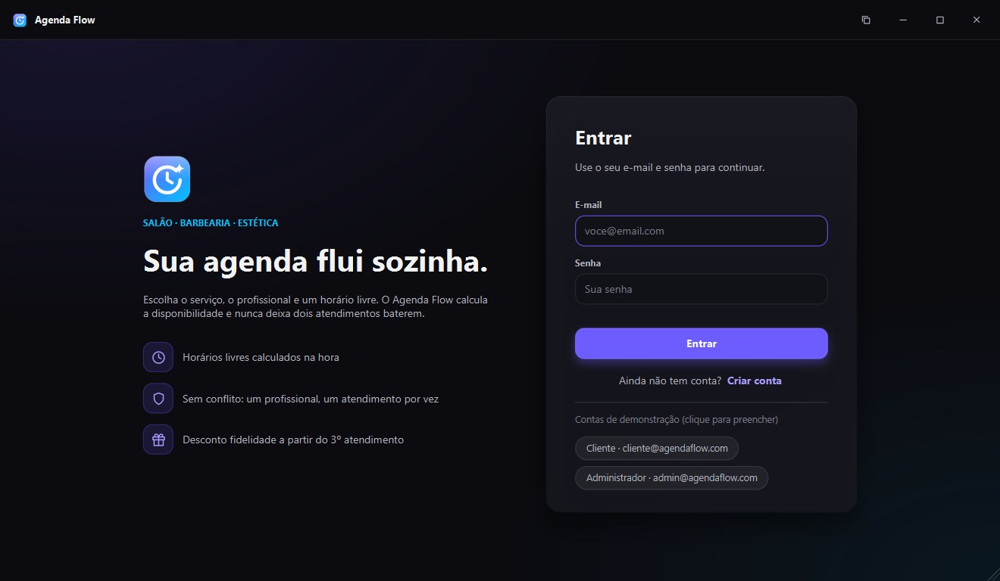<br><sub><b>Login</b> — tema dark (grafite + azul)</sub></td>
    <td width="50%">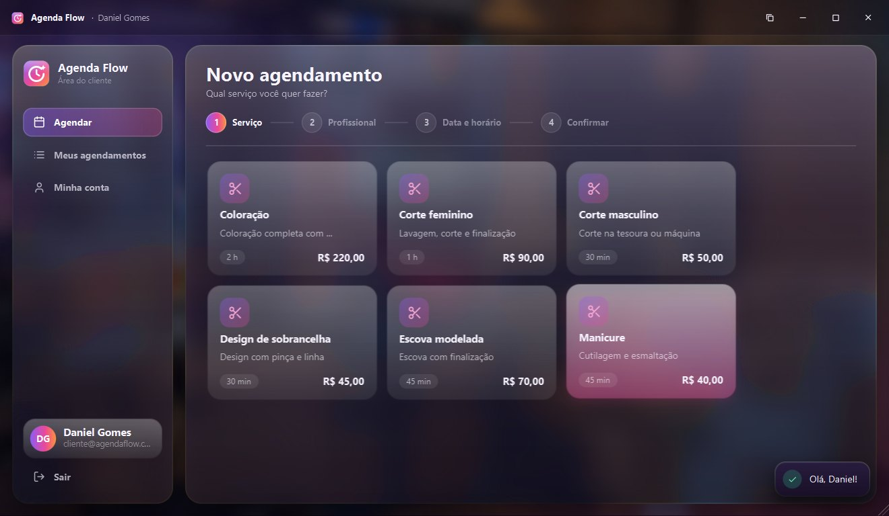<br><sub><b>Passo 1</b> — serviços ativos</sub></td>
  </tr>
  <tr>
    <td>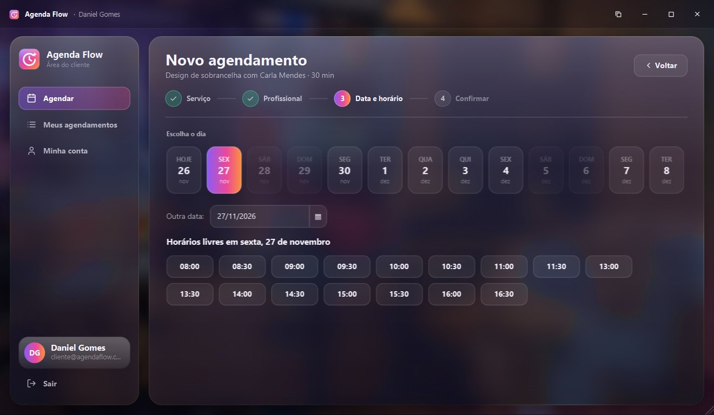<br><sub><b>Passo 3</b> — só os horários livres</sub></td>
    <td>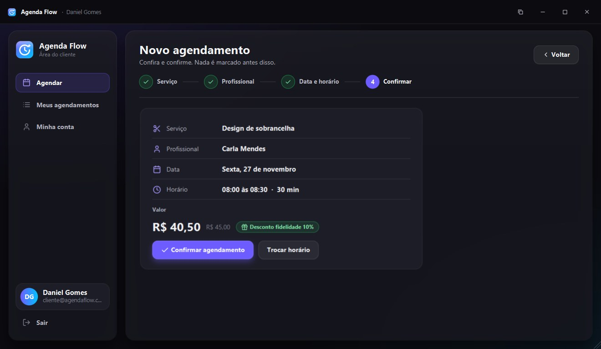<br><sub><b>Passo 4</b> — resumo com desconto fidelidade (Strategy)</sub></td>
  </tr>
  <tr>
    <td>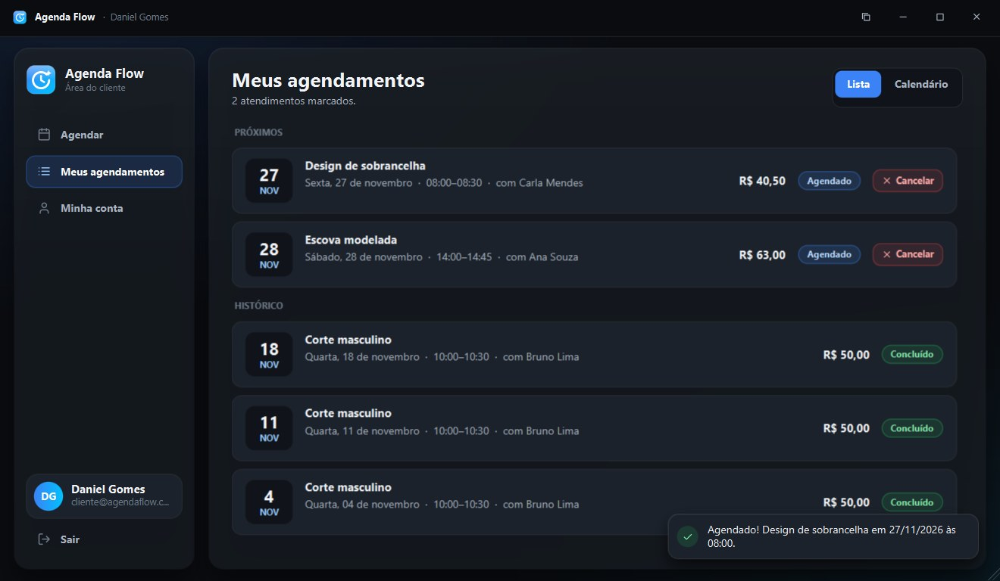<br><sub><b>Meus agendamentos</b> — próximos e histórico</sub></td>
    <td>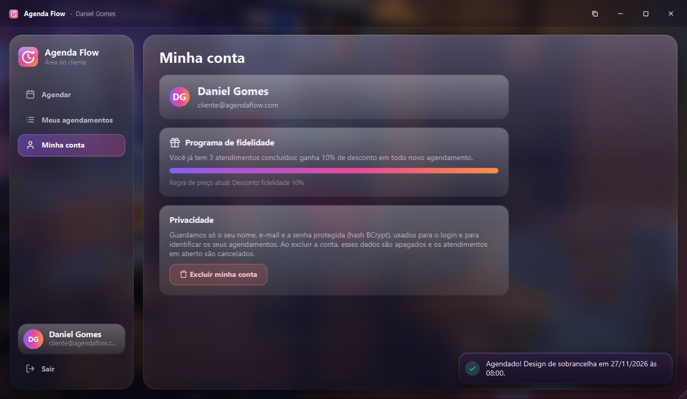<br><sub><b>Minha conta</b> — fidelidade e privacidade</sub></td>
  </tr>
  <tr>
    <td>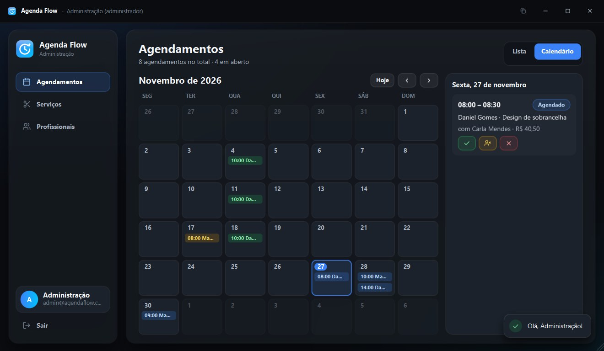<br><sub><b>Admin</b> — calendário do mês com o painel do dia</sub></td>
    <td>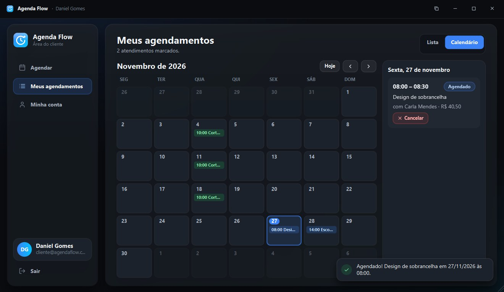<br><sub><b>Cliente</b> — meus agendamentos no calendário</sub></td>
  </tr>
  <tr>
    <td>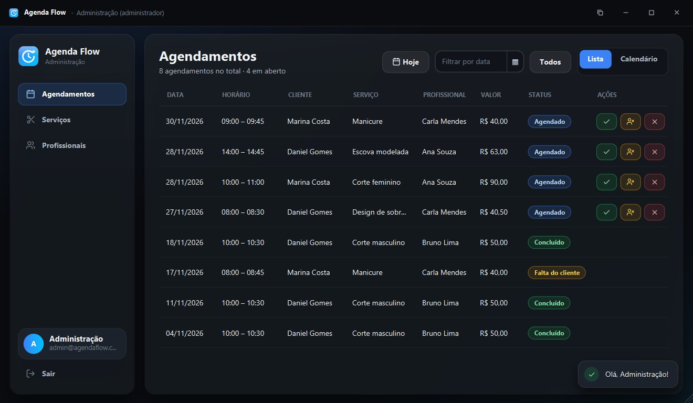<br><sub><b>Admin</b> — todos os agendamentos e ações</sub></td>
    <td>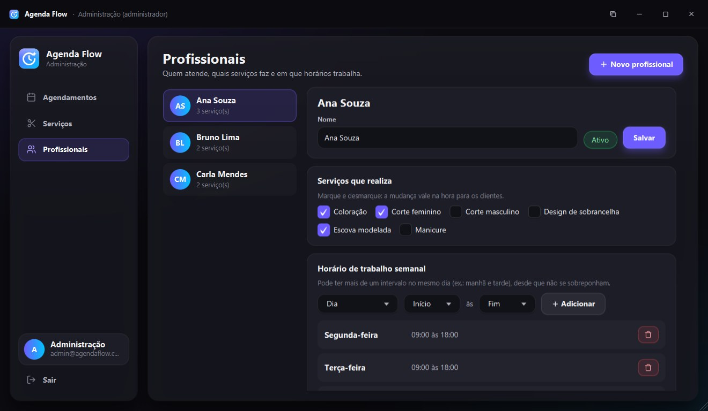<br><sub><b>Admin</b> — serviços e expediente de cada profissional</sub></td>
  </tr>
</table>

<details>
<summary>Mais telas</summary>

| | |
|---|---|
| 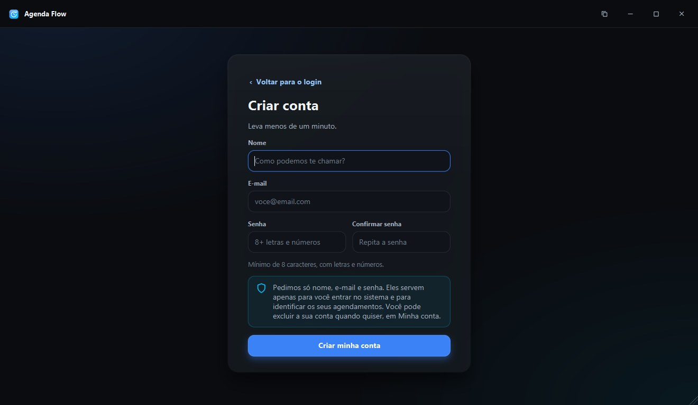 | 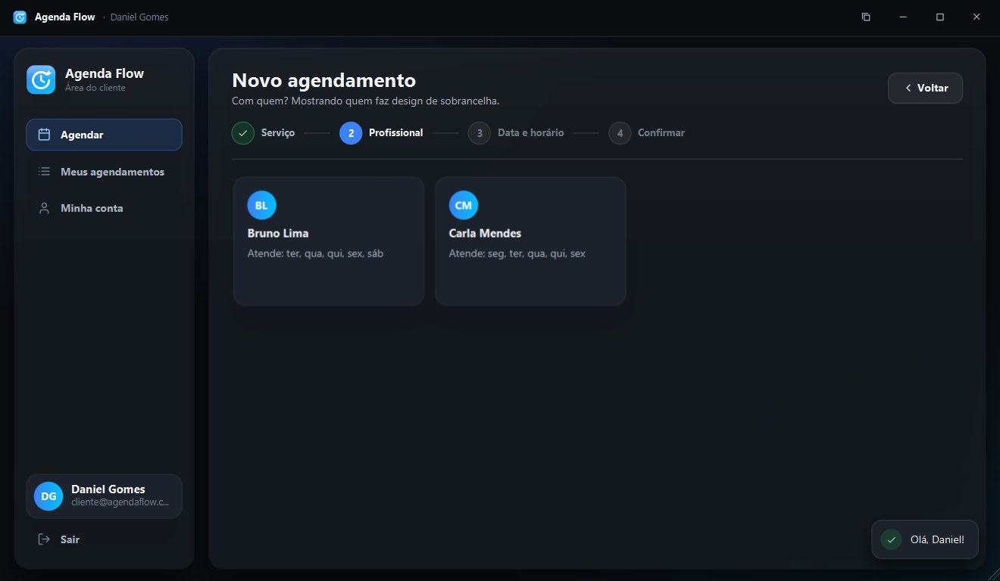 |
| 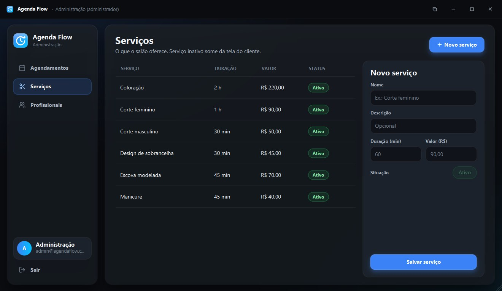 | |

</details>

---

## 🧩 Padrões de projeto (GoF)

| Padrão | Tipo | Onde | Para quê |
|---|---|---|---|
| **Factory** | Criacional | [`factory/UsuarioFactory`](src/main/java/br/com/fatec/agendaflow/factory/UsuarioFactory.java) | Decide se cria `Cliente` ou `Administrador` (no cadastro e ao ler o banco) |
| **Observer** | Comportamental | [`observer/`](src/main/java/br/com/fatec/agendaflow/observer) | Toda criação/mudança de agendamento avisa o histórico em arquivo e as telas abertas |
| **Strategy** | Comportamental | [`strategy/`](src/main/java/br/com/fatec/agendaflow/strategy) | Troca a regra de preço: integral ou desconto fidelidade (RN-11) |

Detalhes, diagramas e trechos de código na seção **6.9** da [documentação](DOCUMENTACAO.md#69-padrões-de-projeto-gof-utilizados).

---

## 🏗️ Arquitetura

Monolito desktop em camadas, no padrão MVC + DAO visto nas aulas:

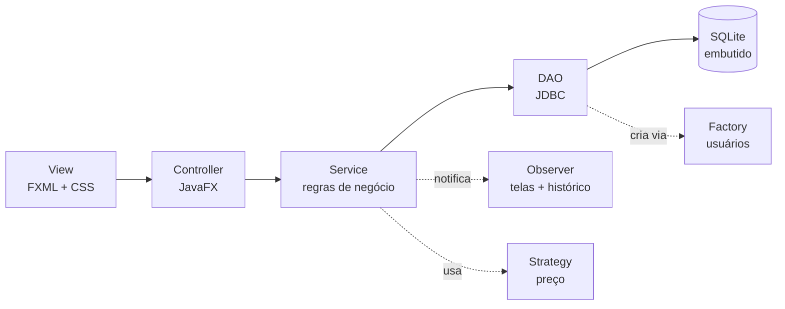

```
src/main/java/br/com/fatec/agendaflow
├── model/          entidades (Usuario, Cliente, Administrador, Servico, Profissional, HorarioTrabalho, Agendamento)
├── dao/            DAO<MODEL> + um DAO por tabela (JDBC)
├── persistencia/   Banco (conexão SQLite), Esquema (tabelas) e dados de demonstração
├── service/        regras de negócio (agenda, agendamento, usuários, catálogo, permissões)
├── factory/        padrão Factory
├── observer/       padrão Observer
├── strategy/       padrão Strategy
├── controller/     controllers das telas FXML
└── util/           janela (barra de título, avisos, diálogos), calendário do mês, ícones, logo, formatação
src/main/resources/br/com/fatec/agendaflow
├── view/           telas .fxml
├── styles/app.css  tema dark (grafite + azul)
└── img/            ícone
src/test/java       66 testes JUnit 5
db/agendaflow.sql   script do banco (o app cria sozinho)
```

---

## 🛠️ Rodar pelo código-fonte

Precisa de **JDK 21** e **Maven** (o NetBeans já traz o Maven).

```bash
mvn javafx:run          # abre o app
mvn test                # roda os 66 testes
mvn package             # gera target/agenda-flow.jar (tudo em um)
```

Gerar o executável do Windows (com o Java embutido):

```bash
jpackage --type app-image --name AgendaFlow --input target --main-jar agenda-flow.jar ^
  --main-class br.com.fatec.agendaflow.Launcher --icon packaging/icone.ico --dest dist ^
  --add-modules java.base,java.desktop,java.logging,java.naming,java.sql,java.xml,java.scripting,java.management,jdk.unsupported,jdk.charsets,jdk.localedata,jdk.crypto.ec
```

---

## 🧪 Testes

8 classes de teste e **66 testes**, todos passando (`mvn test`). Cobrem o cálculo de horários livres, o conflito de horários (inclusive o gatilho do banco), cancelamento, status, permissões, cadastro e login, além dos três padrões GoF. Os testes de integração usam um banco SQLite temporário (`@TempDir`), sem tocar no banco real.

---

<p align="center">
  <br>
  <sub>Logo e ícones desenhados para o projeto (ícones no estilo Lucide).</sub>
</p>
